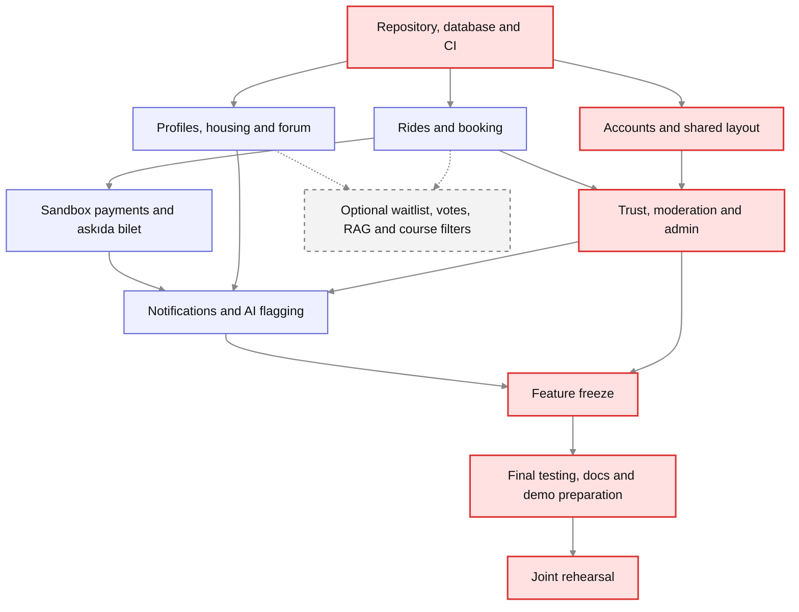

# Software Engineering — Project Plan

## Cover Page

| Field | Details |
|---|---|
| **Course** | BLG411E Software Engineering |
| **Report name** | Project Plan |
| **Project title** | İTÜ ShareMaxxing |
| **Group name / number** | The Goys|
| **Group members** | Mehmet Fuat Karakaya — 150230084 , Ege Demir — 150220007, Alperen Akbaş — 150220078, Bünyamin İbrahim Kalaycı — 150230030, Egemen Çevik — 150220012 |
| **Instructors** | Tolga Ovatman, Ayşe Tosun Kühn |
| **Submission date** | 2026-10-25 |

---

## 1. Introduction

### 1.1 Scope

**Project overview:**  
İTÜ ShareMaxxing is a web platform where İTÜ students help each other, open only to verified @itu.edu.tr accounts. Its core is intercity ride sharing to and from İstanbul: drivers post a trip with a start city and an end city and their free seats, passengers search by start and end city, and drivers share their travel costs with passengers through in-app payment. An anonymous "askıda bilet" request pool lets donors pay for seats requested by students in financial need. The same accounts and reputation also serve a roommate-housing finder and a student forum.

The hypothetical customer is a university student affairs office or student union that wants a trusted alternative to unmoderated WhatsApp groups. Key users are İTÜ students acting as drivers, passengers, donors, funded-seat recipients, room seekers, room owners and forum members, together with moderators and administrators.

**Objectives:**

- Provide a trusted ride-sharing platform limited to email verified İTÜ students
- Help students share travel costs, keeping rides as cost sharing rather than a commercial service
- Let the community anonymously fund seats for students in financial need
- Bring housing search and student questions into the same trusted platform
- Deliver a working, cloud-hosted web application

**In scope:**

- **Accounts and access:** sign-up restricted to @itu.edu.tr addresses with email code verification, user profiles, and student, moderator and admin roles
- **Ride posting:** a driver publishes a trip with exactly two cities, a start city and an end city, one of which is always İstanbul, with date, time, number of free seats and price per seat, plus optional contact details shown to verified students so that questions can be asked before booking
- **Ride search and booking:** a passenger enters a start and an end city; the engine returns trips with that start and end city, listing trips with free seats first and full trips after them; each trip has one seat count, with booking and cancellation; a waitlist is optional
- **Cost sharing:** drivers set a price per seat to share their travel costs
- **Ride completion:** after the trip, the driver and the passengers each mark the ride as ended; this releases the held payment, adds the ride to ride history and opens ratings
- **In-app payment:** passengers pay in the app; the amount is held until the ride is marked as ended and then released to the driver, with refunds on cancellation (payment provider in test mode)
- **Askıda bilet:** a student in financial need creates an askıda bilet request for a seat; all open requests are listed on an askıda bilet request pool page; a donor picks a request and pays for it anonymously; donors only make the payment and do not see ride details or the recipient, and recipients and drivers do not see the donor; every payment is recorded in a ledger
- **Trust and safety:** ride history, two-way ratings revealed only after both sides submit, no-show records, user reports and a moderation queue
- **Housing and roommates:** "I have a room" and "I need a room" listings with optional contact details provided by the poster, listings tagged with an İstanbul district
- **Forum:** questions and answers with category filters (course-related, general, yemekhane, housing, transport, campus life) and keyword search; votes are optional
- **Notifications:** in-app notifications for bookings, payments, and replies
- **AI assistance:** AI-supported flagging of unsuitable content for moderator review
- **Admin panel:** moderation queue and report handling (moderators and admins), plus user management, askıda bilet overview and usage statistics (admins only)
- **Platform:** a responsive web application with a backend API, deployed to the cloud with an automated build and test pipeline

**Optional scope:**

- AI-supported forum search: all forum posts are indexed in a vector database; a retrieval-augmented generation (RAG) system retrieves related posts for a natural-language query (D-13; T-23; WBS-23.2–23.3).
- Course-code tagging and filtering of course-related forum posts (D-14; T-34; WBS-19.3).
- Waitlist for full trips (T-08; WBS-8.1–8.2) and forum votes (T-20; WBS-20.1).
- English language support.

**Out of scope:**

- Live transactions with real money (the payment provider is used in test mode only)
- Automatic route planning, map navigation and live GPS tracking of rides
- Trips that neither start nor end in İstanbul
- Stops between the start and end city of a trip
- Pricing guidelines or limits for the price per seat
- Rides within a city and daily campus commuting
- Verification of driving licences, vehicle documents or insurance
- Real-time chat between users
- Integration with İTÜ's own login and student information systems
- Rent payments, deposits and rental contracts
- Verification of financial need through official documents
- Support for other universities
- A native mobile app (students use the responsive web app in their phone's browser)

**Assumptions and constraints:**

- **Team:** five members, all working as full-stack developers alongside their project roles.
- **Availability:** normally 6 hours per member per week (0.15 FTE), with no project work on the exam dates in Section 4.3.
- **AI coding tools:** the team uses AI coding agents, which on average make development about 4 times faster; estimates in Section 3 account for this.
- **Time:** development starts on 26.10.2026 and must fit the course calendar; the codebase is due 25.12.2026, the demo 26.12.2026 and the presentation 28.12.2026. Course reports are written in parallel with development.
- **Language:** the user interface is in Turkish.
- **Technology:** Node.js/Express (TypeScript), PostgreSQL with Prisma, React (TypeScript) with Vite and Tailwind CSS, JWT authentication, Nodemailer (sign-up verification codes), Jest/Supertest with GitHub Actions, and a free or very low-cost cloud provider chosen during cloud setup (WBS-29.1).
- **AI provider:** the AI model provider is chosen in the design phase; its cost must stay within free or student tiers.
- **Payments:** iyzico is used in sandbox (test) mode only. The full payment flow would require legal and regulatory review before real use.
- **Budget:** no dedicated budget; only free or very low-cost cloud resources are used.
- **Users:** all users are İTÜ students with a working @itu.edu.tr email address.

### 1.2 Deliverables

Every implemented deliverable must also meet a common baseline (optional items are accepted only if selected): its automated tests pass in the CI pipeline, it works on the deployed cloud site in both a phone and a desktop browser, and it is shown in the demo scenario.

| Deliverable ID | Deliverable name | Description / contents | Acceptance criterion |
|---|---|---|---|
| D-01 | Accounts & Access | Sign-up restricted to @itu.edu.tr, email code verification, login, user profiles, student/moderator/admin roles, and the shared web layout (navigation, page shell, common components) | A non-İTÜ email is rejected; an unverified user cannot log in; a student cannot reach admin pages; all pages use the shared layout |
| D-02 | Ride Sharing | Trip posting (a start city and an end city, one of which is İstanbul; date, time, seats, price per seat, optional contact details), search by start and end city, booking, cancellation, optional waitlist, marking the ride as ended | A trip where neither city is İstanbul, or where both cities are the same, is rejected; search returns only trips with the searched start and end city, with free-seat trips listed first and full trips after them; full trips cannot be booked; if the optional waitlist is implemented, users can join it and receive a freed seat in queue order; driver and passengers can mark the ride as ended |
| D-03 | Payments & Askıda Bilet | In-app payment via iyzico sandbox, money held until the ride is marked as ended, release to driver, refunds, askıda bilet requests and request pool page, anonymous donor payment, ledger of all payments | A full pay → hold → release (after the ride is marked as ended) flow succeeds; cancellation triggers a refund; a donor can pay a request without seeing the ride details or the recipient, and the recipient and driver never see the donor; every askıda bilet payment matches a ledger entry |
| D-04 | Trust & Safety | Ride history, two-way ratings revealed after both sides submit, no-show records, user reports | A rating stays hidden until both sides submit; a submitted report appears in the moderation queue |
| D-05 | Housing & Roommates | "I have a room" / "I need a room" listings, İstanbul district tags, optional contact details provided by the poster | Listings can be posted, edited and deleted by their owner; listings can be filtered by district and type; contact details appear only when the poster has provided them |
| D-06 | Forum | Questions and answers, category filters and keyword search; votes are optional | Posts can be filtered by category and searched by keyword; if implemented, votes change ranking |
| D-07 | Notifications | In-app notifications for bookings, payments and replies | Each listed event produces an in-app notification |
| D-08 | AI Content Flagging | AI-supported flagging of unsuitable content for moderator review | A test post with unsuitable content is flagged into the moderation queue |
| D-09 | Admin Panel | Moderation queue and report handling (moderators and admins); user management, askıda bilet overview, usage statistics (admins only) | A moderator can handle reports but cannot manage users; an admin can do both; the askıda bilet overview matches the ledger |
| D-10 | Deployment & CI Pipeline | Cloud-hosted backend, database and frontend; automated build and test on every push to GitHub | The live site is reachable at a public URL; a push with a failing test is blocked from merging |
| D-11 | Documentation | Course reports (requirements, analysis, design, test), user guide, API documentation, setup instructions | All reports are submitted on time; a new person can run the project locally using only the setup instructions |
| D-12 | Demo & Presentation | Demo scenario script, prepared test data on the live site, demo run, presentation slides | The demo follows the script on the live site without errors and covers all main user flows within the time limit; slides are submitted by 28.12.2026 |
| D-13 | AI-supported Forum Search *(optional)* | Vector database indexing of all forum posts and RAG retrieval of related posts | New and edited posts are indexed; sample questions retrieve related posts with links to the originals |
| D-14 | Course-code Forum Filters *(optional)* | Course-code tags and filters for course-related posts | Users can tag a course-related post with a course code and filter posts by that code |

### 1.3 Functional Requirements / Tasks

| Task ID | Functional requirement / task | Description | Related deliverable ID(s) |
|---|---|---|---|
| T-01 | Sign-up and email verification | A user signs up with an @itu.edu.tr address only and activates the account by entering a code sent by email | D-01 |
| T-02 | Login and role-based access | Verified users log in; the system gives each user a student, moderator or admin role and blocks pages and actions the role is not allowed to use | D-01 |
| T-03 | User profiles | Users view and edit their profile; other students see a public profile with ride history and ratings | D-01, D-04 |
| T-04 | Shared web layout | Common navigation, page frame, reusable components and phone-friendly layout used by every feature | D-01 |
| T-05 | Trip posting and cost sharing | A driver posts a trip with exactly two cities, a start city and an end city, one of which is İstanbul, with date, time, free seats, a price per seat to share travel costs, and optional contact details; the driver can edit or cancel the trip | D-02, D-03 |
| T-06 | Trip search | A passenger enters a start and an end city; the system returns trips with that start and end city, listing trips with free seats first and full trips after them, marked as full | D-02 |
| T-07 | Booking and cancellation | A passenger books a free seat (which starts the payment) or cancels a booking (which starts the refund); the seat count updates | D-02, D-03 |
| T-08 | Waitlist *(optional)* | A passenger joins the waitlist of a full trip; when a seat frees up, the first person on the list is offered the seat | D-02, D-07 |
| T-09 | Ride completion | After the trip, the driver and each passenger mark the ride as ended; this releases the held payment to the driver, adds the ride to ride history and opens ratings | D-02, D-03, D-04 |
| T-10 | In-app payment | The passenger pays through iyzico sandbox; the money is held until the ride is marked as ended and then released to the driver | D-03 |
| T-11 | Refunds | The held payment is returned when a passenger cancels or the driver cancels the trip | D-03 |
| T-12 | Askıda bilet requests and request pool page | A student in financial need creates an askıda bilet request for a seat on a trip; all open requests are listed on the request pool page without ride details or the requester's identity | D-03, D-02 |
| T-13 | Anonymous askıda bilet payment | A donor picks a request from the pool page and pays for it; the donor only makes the payment and sees no ride details or recipient; the recipient and driver do not see the donor; the seat is booked for the recipient | D-03, D-02 |
| T-14 | Ledger | Every payment, hold, release, refund and askıda bilet payment is recorded so that balances can be checked | D-03, D-09 |
| T-15 | Ride history and no-show records | Ended rides are stored for each user; a driver or passenger can mark the other side as a no-show | D-04 |
| T-16 | Two-way ratings | After a ride is marked as ended, driver and passenger rate each other; ratings are shown only after both sides submit | D-04 |
| T-17 | User reports | A user reports another user or content; the report goes to the moderation queue | D-04, D-09 |
| T-18 | Room listings | Users post "I have a room" or "I need a room" listings tagged with an İstanbul district, with optional contact details provided by the poster; others browse and filter them | D-05 |
| T-19 | Forum questions and answers | Users post questions and answers with a category and filter by them | D-06 |
| T-20 | Forum votes *(optional)* | Users vote on questions and answers; votes affect ranking | D-06 |
| T-21 | Forum search | Users search forum posts by keyword | D-06 |
| T-22 | Notifications | In-app notifications for bookings, cancellations, ride-end reminders, payments, funded askıda bilet requests and forum replies; waitlist-seat alerts are included only if the optional waitlist is implemented | D-07 |
| T-23 | AI-supported forum search *(optional)* | Index all forum posts in a vector database; use RAG to retrieve related posts for a natural-language question | D-13, D-06 |
| T-24 | AI content flagging | New posts and listings are checked by AI; unsuitable content is sent to the moderation queue for a human decision | D-08, D-09 |
| T-25 | Moderation queue and report handling | Moderators and admins review reports and flagged content and take action (hide content, warn or suspend users) | D-09, D-04 |
| T-26 | Admin tools | Admins manage users and roles, see the askıda bilet overview (open and paid requests) and view usage statistics | D-09 |
| T-27 | Database design and setup | Design the shared database structure used by all features and set it up with Prisma | D-10 |
| T-28 | CI pipeline | Every push to GitHub automatically builds the project and runs all tests; failing changes cannot be merged | D-10 |
| T-29 | Cloud deployment | Backend, database and frontend run on the cloud provider and are reachable at a public URL | D-10 |
| T-30 | Course reports | Requirement specification, requirement analysis, software design and software test reports | D-11 |
| T-31 | User guide, API docs and setup instructions | A short guide for users, a list of backend endpoints, and steps to run the project locally | D-11 |
| T-32 | Demo script and test data | A step-by-step demo scenario covering the main user flows and the sample data loaded on the live site for it | D-12 |
| T-33 | Presentation slides | Slides for the final presentation | D-12 |
| T-34 | Course-code forum filtering *(optional)* | Users tag course-related posts with course codes and filter the forum by those codes | D-14, D-06 |

### 1.4 Non-functional Issues

| Quality attribute | Requirement / concern | How it will be assessed |
|---|---|---|
| Security | Only verified @itu.edu.tr users can use the platform; every page and API action checks the user's role (student, moderator, admin); passwords are stored hashed, never as plain text; users can see only their own bookings and payments; secret keys are kept out of the code repository | Automated tests that try forbidden actions with the wrong role or another user's account and expect them to fail; code review of every merge request |
| Performance | Pages load and search results appear within 5 seconds on a phone over a mobile connection; the system serves about 100 students using it at the same time | Lighthouse mobile test on the deployed site; a simple load test simulating 100 simultaneous users |
| Usability | The interface is in Turkish; every page works on phone screens (from 360 px wide) as well as desktop; searching and booking a ride takes only a few clear steps | Manual testing on real phones|
| Reliability | No payment is lost: every ride payment, refund and askıda bilet payment is recorded and balances always match the ledger; payment provider errors are handled and shown to the user clearly | Automated tests that compare balances with the ledger; tests that simulate failed sandbox payments |
| Privacy | Askıda bilet donors and recipients stay anonymous to each other and to drivers, and donors never see ride details; contact details appear only when the poster chooses to add them and only to verified students; only the personal data the features need is collected | Automated tests checking that hidden fields never appear in API responses for unauthorized users |
| Maintainability | All code is in TypeScript, reviewed before merging, and covered by automated tests that run on every push | CI pipeline results on GitHub; review records on merge requests |

---

## 2. Project Plan — Work Breakdown Structure (WBS)

Decompose the tasks in Section 1.3 into smaller subtasks. Sizes: **T = Tiny · S = Small · M = Medium · L = Large · XL = Extra-large**. Activities marked *(optional)* belong to the optional scope; they are done only if time allows and are dropped first.

| WBS activity ID | Parent task ID | Activity / subtask | Description / completion condition | Size (T/S/M/L/XL) |
|---|---|---|---|---|
| WBS-1.1 | T-01 | Sign-up backend | Sign-up accepts only @itu.edu.tr addresses and stores passwords hashed | S |
| WBS-1.2 | T-01 | Email code verification | A code is emailed with Nodemailer; the account is activated only with the right code | S |
| WBS-1.3 | T-01 | Sign-up and verification pages | A user can sign up and enter the code from a phone or laptop | T |
| WBS-2.1 | T-02 | Login backend | Verified users (first the sample users) log in and receive a JWT; unverified users are refused | S |
| WBS-2.2 | T-02 | Role checks | Every page and API action checks the student / moderator / admin role; forbidden actions return an error | S |
| WBS-2.3 | T-02 | Login page | Login and logout work in the browser; logged-in state is kept between pages | T |
| WBS-3.1 | T-03 | Profile backend | Users edit their own profile; a public profile returns ride history and ratings | S |
| WBS-3.2 | T-03 | Profile pages | Own profile and public profile pages are shown | S |
| WBS-4.1 | T-04 | Frontend setup | Vite, Tailwind and page routing are set up; an empty home page opens | T |
| WBS-4.2 | T-04 | Shared layout and components | Menu, page frame, buttons, forms, cards and error/success messages exist and are used by every page | M |
| WBS-4.3 | T-04 | Phone-friendly check | Every page checked and fixed on screens from 360 px wide | T |
| WBS-5.1 | T-05 | Trip backend | Create, edit and cancel a trip; exactly two different cities and one of them is İstanbul; price per seat and optional contact details are stored | S |
| WBS-5.2 | T-05 | Trip posting pages | A driver can post, edit and cancel a trip from the browser | S |
| WBS-6.1 | T-06 | Search backend | Returns trips with the searched start and end city; trips with free seats first, full trips after them | S |
| WBS-6.2 | T-06 | Search and trip detail pages | Search form, results list (full trips marked as full) and trip detail page work | M |
| WBS-7.1 | T-07 | Booking backend | Book and cancel a seat; seat count always stays correct, even when two people book at the same moment | M |
| WBS-7.2 | T-07 | Booking screens | Book button on the trip page, 'my bookings' page, cancel button | S |
| WBS-8.1 | T-08 | Waitlist backend *(optional)* | Join and leave the waitlist of a full trip; a freed seat is offered to the first person in line, who is notified | S |
| WBS-8.2 | T-08 | Waitlist screens *(optional)* | Join-waitlist button and place-in-line shown on full trips | T |
| WBS-9.1 | T-09 | Ride-ended backend | Driver and each passenger mark the ride as ended; this releases payment, saves history and opens ratings; if someone does not mark it, the ride ends automatically 48 hours after the trip date | S |
| WBS-9.2 | T-09 | Ride-ended screens | 'Ride ended' button and ride status shown to driver and passengers | T |
| WBS-10.1 | T-10 | Pay and hold (iyzico sandbox) | Booking a seat takes payment in iyzico test mode, the money is held and the ledger records it | M |
| WBS-10.2 | T-10 | Release to driver | Held money is released to the driver when the ride is marked as ended | T |
| WBS-10.3 | T-10 | Payment screens | Payment page, success and failure screens, payment status in 'my bookings' | S |
| WBS-11.1 | T-11 | Refunds | Held money is returned when a passenger cancels or the driver cancels the trip | S |
| WBS-12.1 | T-12 | Askıda bilet request backend | A student creates a request for a seat on a trip; open requests are listed without ride details or identity; unpaid requests expire on the trip date | S |
| WBS-12.2 | T-12 | Request form and pool page | Request form for students and the pool page listing open requests (amount and request date only) | S |
| WBS-13.1 | T-13 | Anonymous donor payment | A donor pays a request; the seat is booked for the recipient; donor, recipient and driver never see each other | S |
| WBS-13.2 | T-13 | Donor payment screen | Donor pays a request from the pool page and sees a thank-you screen | T |
| WBS-14.1 | T-14 | Ledger | Every payment, hold, release, refund and askıda bilet payment is written to the ledger; a check confirms balances match | S |
| WBS-15.1 | T-15 | Ride history and no-shows | Ended rides appear in each user's history; driver or passenger can mark the other as a no-show | S |
| WBS-16.1 | T-16 | Ratings backend | Driver and passenger rate each other; a rating stays hidden until both sides submit | S |
| WBS-16.2 | T-16 | Rating screens | Rating form after a ride; ratings shown on profiles | T |
| WBS-17.1 | T-17 | User reports | Report button and form on users and content; report saved for the moderation queue | T |
| WBS-18.1 | T-18 | Room listing backend | Create, edit and delete listings; filter by district and type; optional contact details | S |
| WBS-18.2 | T-18 | Room listing pages | Browse with filters, listing detail, create and edit pages | M |
| WBS-19.1 | T-19 | Forum backend | Questions and answers with category tags and category filters | S |
| WBS-19.2 | T-19 | Forum pages | Question list with filters, question page with answers, new question form | M |
| WBS-19.3 | T-34 | Course-code tags and filtering *(optional)* | Add course-code tags, backend filtering and a course-code selector to the forum pages | S |
| WBS-20.1 | T-20 | Forum votes *(optional)* | Vote buttons on questions and answers; higher-voted posts rank higher | S |
| WBS-21.1 | T-21 | Forum keyword search | Search box returns posts that contain the keyword | S |
| WBS-22.1 | T-22 | Notification service | One service creates and stores in-app notifications | S |
| WBS-22.2 | T-22 | Connect events to notifications | Bookings, cancellations, ride-end reminders, payments, funded requests and forum replies each send a notification | S |
| WBS-22.3 | T-22 | Notification bell | Bell with unread count and notification list in the menu | T |
| WBS-23.1 | T-24 | Shared AI provider setup | Configure the provider, API key and usage limit for core content flagging; reused by optional RAG search | T |
| WBS-23.2 | T-23 | Vector database and RAG search backend *(optional)* | Index all posts, update the index on edits/deletions, and retrieve related posts with RAG for a natural-language query | M |
| WBS-23.3 | T-23 | AI search box *(optional)* | Show retrieved related posts and links to their originals in the forum | T |
| WBS-24.1 | T-24 | AI content flagging | New forum posts and room listings are checked by AI; unsuitable ones go to the moderation queue | S |
| WBS-25.1 | T-25 | Moderation backend | Lists reports and AI-flagged content; moderators can hide content, warn or suspend users | M |
| WBS-25.2 | T-25 | Moderation pages | Moderation queue and action screens for moderators and admins | S |
| WBS-26.1 | T-26 | User and role management | Admins search users and change roles; moderators cannot open this page | T |
| WBS-26.2 | T-26 | Askıda bilet overview and statistics | Admin page showing open and paid requests (matching the ledger) and usage numbers | T |
| WBS-27.1 | T-27 | Database design | All tables and links for every feature are drawn by Alperen and checked by each feature owner | S |
| WBS-27.2 | T-27 | Prisma setup and sample data | The design is created in PostgreSQL through Prisma; a script fills the database with sample users and data | S |
| WBS-28.1 | T-28 | Repository setup | Backend and frontend projects created in the GitHub repo with TypeScript, code style checks and branch rules; everyone can run both locally | S |
| WBS-28.2 | T-28 | Automatic build and test (CI) | Every push builds the project and runs all tests in GitHub Actions; a pull request with a failing test cannot be merged | S |
| WBS-28.3 | T-28 | Speed and load checks | On the live site, a Lighthouse mobile test shows the main pages within 5 seconds and a load test with 100 users on search, booking and forum passes | S |
| WBS-28.4 | T-28 | Testing on real phones | Each member tests their own features on a real phone and fixes the problems found | S |
| WBS-29.1 | T-29 | Cloud setup | Server, database and frontend hosting are created on the cloud provider; secret keys are stored outside the code | M |
| WBS-29.2 | T-29 | Automatic deployment | Every merge to the main branch is put on the live site automatically | S |
| WBS-30.1 | T-30 | Requirement Specification Report | User stories and requirements for every feature; submitted by 02.11.2026 | L |
| WBS-30.2 | T-30 | Requirement Analysis Report | Analysis models for every feature; submitted by 23.11.2026 | L |
| WBS-30.3 | T-30 | Software Design Report | Reuses the database design and API list; submitted by 07.12.2026 | S |
| WBS-30.4 | T-30 | Software Test Report | Reuses CI results and the phone and load tests; submitted by 21.12.2026 | S |
| WBS-31.1 | T-31 | User guide | Short Turkish guide covering every main flow | T |
| WBS-31.2 | T-31 | API documentation | Each member lists the endpoints of their own features | S |
| WBS-31.3 | T-31 | Setup instructions | README with the steps to run the project locally | T |
| WBS-32.1 | T-32 | Demo script | Step-by-step demo covering all main user flows within the time limit | T |
| WBS-32.2 | T-32 | Demo test data | Sample users, trips, requests, listings and posts loaded on the live site | T |
| WBS-32.3 | T-32 | Demo rehearsal | The whole team runs the demo together on the live site at least once without errors | S |
| WBS-33.1 | T-33 | Presentation slides | Slides for the final presentation, prepared early; screenshots are refreshed at the demo rehearsal; submitted by 28.12.2026 | S |

**WBS decomposition notes:**

- Each coding activity includes its automated tests.
- Sample users and a temporary test login let feature development proceed before authentication is complete.
- Optional work is excluded from the schedule; English language support is not estimated.

---

## 3. Estimates

| WBS activity ID | Size | Estimated effort (man-weeks) | Basis / assumptions |
|---|---|---|---|
| WBS-1.1 | S | 0.0625 | Small = 0.25 man-weeks ÷ 4 (AI) = 2.5 h |
| WBS-1.2 | S | 0.0625 | Small = 0.25 man-weeks ÷ 4 (AI) = 2.5 h |
| WBS-1.3 | T | 0.025 | Tiny = 0.1 man-weeks ÷ 4 (AI) = 1 h |
| WBS-2.1 | S | 0.0625 | Small = 0.25 man-weeks ÷ 4 (AI) = 2.5 h |
| WBS-2.2 | S | 0.0625 | Small = 0.25 man-weeks ÷ 4 (AI) = 2.5 h |
| WBS-2.3 | T | 0.025 | Tiny = 0.1 man-weeks ÷ 4 (AI) = 1 h |
| WBS-3.1 | S | 0.0625 | Small = 0.25 man-weeks ÷ 4 (AI) = 2.5 h |
| WBS-3.2 | S | 0.0625 | Small = 0.25 man-weeks ÷ 4 (AI) = 2.5 h |
| WBS-4.1 | T | 0.025 | Tiny = 0.1 man-weeks ÷ 4 (AI) = 1 h |
| WBS-4.2 | M | 0.125 | Medium = 0.5 man-weeks ÷ 4 (AI) = 5 h |
| WBS-4.3 | T | 0.025 | Tiny = 0.1 man-weeks ÷ 4 (AI) = 1 h |
| WBS-5.1 | S | 0.0625 | Small = 0.25 man-weeks ÷ 4 (AI) = 2.5 h |
| WBS-5.2 | S | 0.0625 | Small = 0.25 man-weeks ÷ 4 (AI) = 2.5 h |
| WBS-6.1 | S | 0.0625 | Small = 0.25 man-weeks ÷ 4 (AI) = 2.5 h |
| WBS-6.2 | M | 0.125 | Medium = 0.5 man-weeks ÷ 4 (AI) = 5 h |
| WBS-7.1 | M | 0.125 | Medium = 0.5 man-weeks ÷ 4 (AI) = 5 h |
| WBS-7.2 | S | 0.0625 | Small = 0.25 man-weeks ÷ 4 (AI) = 2.5 h |
| WBS-8.1 | S | 0.0625 | Small = 0.25 man-weeks ÷ 4 (AI) = 2.5 h; optional |
| WBS-8.2 | T | 0.025 | Tiny = 0.1 man-weeks ÷ 4 (AI) = 1 h; optional |
| WBS-9.1 | S | 0.0625 | Small = 0.25 man-weeks ÷ 4 (AI) = 2.5 h |
| WBS-9.2 | T | 0.025 | Tiny = 0.1 man-weeks ÷ 4 (AI) = 1 h |
| WBS-10.1 | M | 0.125 | Medium = 0.5 man-weeks ÷ 4 (AI) = 5 h |
| WBS-10.2 | T | 0.025 | Tiny = 0.1 man-weeks ÷ 4 (AI) = 1 h |
| WBS-10.3 | S | 0.0625 | Small = 0.25 man-weeks ÷ 4 (AI) = 2.5 h |
| WBS-11.1 | S | 0.0625 | Small = 0.25 man-weeks ÷ 4 (AI) = 2.5 h |
| WBS-12.1 | S | 0.0625 | Small = 0.25 man-weeks ÷ 4 (AI) = 2.5 h |
| WBS-12.2 | S | 0.0625 | Small = 0.25 man-weeks ÷ 4 (AI) = 2.5 h |
| WBS-13.1 | S | 0.0625 | Small = 0.25 man-weeks ÷ 4 (AI) = 2.5 h |
| WBS-13.2 | T | 0.025 | Tiny = 0.1 man-weeks ÷ 4 (AI) = 1 h |
| WBS-14.1 | S | 0.0625 | Small = 0.25 man-weeks ÷ 4 (AI) = 2.5 h |
| WBS-15.1 | S | 0.0625 | Small = 0.25 man-weeks ÷ 4 (AI) = 2.5 h |
| WBS-16.1 | S | 0.0625 | Small = 0.25 man-weeks ÷ 4 (AI) = 2.5 h |
| WBS-16.2 | T | 0.025 | Tiny = 0.1 man-weeks ÷ 4 (AI) = 1 h |
| WBS-17.1 | T | 0.025 | Tiny = 0.1 man-weeks ÷ 4 (AI) = 1 h |
| WBS-18.1 | S | 0.0625 | Small = 0.25 man-weeks ÷ 4 (AI) = 2.5 h |
| WBS-18.2 | M | 0.125 | Medium = 0.5 man-weeks ÷ 4 (AI) = 5 h |
| WBS-19.1 | S | 0.0625 | Small = 0.25 man-weeks ÷ 4 (AI) = 2.5 h; course-code filtering is separate optional work |
| WBS-19.2 | M | 0.125 | Medium = 0.5 man-weeks ÷ 4 (AI) = 5 h |
| WBS-19.3 | S | 0.0625 | Small = 0.25 man-weeks ÷ 4 (AI) = 2.5 h; optional |
| WBS-20.1 | S | 0.0625 | Small = 0.25 man-weeks ÷ 4 (AI) = 2.5 h; optional |
| WBS-21.1 | S | 0.0625 | Small = 0.25 man-weeks ÷ 4 (AI) = 2.5 h |
| WBS-22.1 | S | 0.0625 | Small = 0.25 man-weeks ÷ 4 (AI) = 2.5 h |
| WBS-22.2 | S | 0.0625 | Small = 0.25 man-weeks ÷ 4 (AI) = 2.5 h |
| WBS-22.3 | T | 0.025 | Tiny = 0.1 man-weeks ÷ 4 (AI) = 1 h |
| WBS-23.1 | T | 0.025 | Tiny = 0.1 man-weeks ÷ 4 (AI) = 1 h |
| WBS-23.2 | M | 0.125 | Medium = 0.5 man-weeks ÷ 4 (AI) = 5 h; optional |
| WBS-23.3 | T | 0.025 | Tiny = 0.1 man-weeks ÷ 4 (AI) = 1 h; optional |
| WBS-24.1 | S | 0.0625 | Small = 0.25 man-weeks ÷ 4 (AI) = 2.5 h |
| WBS-25.1 | M | 0.125 | Medium = 0.5 man-weeks ÷ 4 (AI) = 5 h |
| WBS-25.2 | S | 0.0625 | Small = 0.25 man-weeks ÷ 4 (AI) = 2.5 h |
| WBS-26.1 | T | 0.025 | Tiny = 0.1 man-weeks ÷ 4 (AI) = 1 h |
| WBS-26.2 | T | 0.025 | Tiny = 0.1 man-weeks ÷ 4 (AI) = 1 h |
| WBS-27.1 | S | 0.0625 | Small = 0.25 man-weeks ÷ 4 (AI) = 2.5 h |
| WBS-27.2 | S | 0.0625 | Small = 0.25 man-weeks ÷ 4 (AI) = 2.5 h |
| WBS-28.1 | S | 0.0625 | Small = 0.25 man-weeks ÷ 4 (AI) = 2.5 h |
| WBS-28.2 | S | 0.0625 | Small = 0.25 man-weeks ÷ 4 (AI) = 2.5 h |
| WBS-28.3 | S | 0.0625 | Small = 0.25 man-weeks ÷ 4 (AI) = 2.5 h |
| WBS-28.4 | S | 0.1875 | Direct estimate: 1.5 h per member, 7.5 h in total (AI does not speed up testing on real phones); split between members (Section 4.2) |
| WBS-29.1 | M | 0.125 | Medium = 0.5 man-weeks ÷ 4 (AI) = 5 h |
| WBS-29.2 | S | 0.0625 | Small = 0.25 man-weeks ÷ 4 (AI) = 2.5 h |
| WBS-30.1 | L | 0.25 | Large = 1 man-week ÷ 4 (AI) = 10 h in total, split between members (Section 4.2) |
| WBS-30.2 | L | 0.25 | Large = 1 man-week ÷ 4 (AI) = 10 h in total, split between members (Section 4.2) |
| WBS-30.3 | S | 0.0625 | Small = 0.25 man-weeks ÷ 4 (AI) = 2.5 h in total, split between members (Section 4.2) |
| WBS-30.4 | S | 0.0625 | Small = 0.25 man-weeks ÷ 4 (AI) = 2.5 h in total, split between members (Section 4.2) |
| WBS-31.1 | T | 0.025 | Tiny = 0.1 man-weeks ÷ 4 (AI) = 1 h |
| WBS-31.2 | S | 0.0625 | Small = 0.25 man-weeks ÷ 4 (AI) = 2.5 h in total, split between members (Section 4.2) |
| WBS-31.3 | T | 0.025 | Tiny = 0.1 man-weeks ÷ 4 (AI) = 1 h |
| WBS-32.1 | T | 0.025 | Tiny = 0.1 man-weeks ÷ 4 (AI) = 1 h |
| WBS-32.2 | T | 0.025 | Tiny = 0.1 man-weeks ÷ 4 (AI) = 1 h |
| WBS-32.3 | S | 0.125 | Direct estimate: 1 h per member, 5 h in total (AI does not speed up a rehearsal); all members take part (Section 4.2) |
| WBS-33.1 | S | 0.0625 | Small = 0.25 man-weeks ÷ 4 (AI) = 2.5 h |
| **Total (core)** | — | **4.4875** | 179.5 h |
| **Total (optional)** | — | **0.3625** | 14.5 h |
| **Total (all)** | — | **4.85** | 194 h |

**Estimation method:** Tiny/Small/Medium/Large/Extra-large equal 0.1/0.25/0.5/1/2 man-weeks before AI assistance (40 hours per man-week). Coding and writing effort is divided by 4 for AI assistance; phone testing (WBS-28.4) and the rehearsal (WBS-32.3) are estimated directly because AI does not speed them up. Calculations use unrounded values.

**Team capacity:** 26.10–25.12.2026 is 8.7 weeks, which gives 52.3 hours per member and 261.4 hours for the team at 6 hours per week. The listed exam dates reduce the team total to **247.7 hours**. Core work is **179.5 hours (72%)**, which leaves about 68 hours for meetings, rework and delays; optional work adds **14.5 hours** and is excluded. The forecast in Section 5.2 shows how this fits the deadlines.

**Effort versus duration:** one member normally contributes 0.15 FTE (6 of 40 hours per week). Duration is effort ÷ 0.15 FTE, extended by unavailable dates; a Small activity (2.5 h) takes about 0.4 weeks and a Medium activity (5 h) about 0.8 weeks. Shared activities use each member's allocated share.

---

## 4. Resources

### 4.1 Team Structure and Member Roles

| Member | Student ID | Role(s) | Main responsibilities |
|---|---|---|---|
| Mehmet Fuat Karakaya | 150230084 | Product Owner, Full-Stack Developer | Forum, Housing, Shared Web UI |
| Ege Demir | 150220007 | Configuration Manager, Full-Stack Developer | Ride Posting & Search, Cost Sharing, Notifications |
| Alperen Akbaş | 150220078 | QA Manager, Full-Stack Developer | Payments, Askıda Bilet, CI Pipeline |
| Bünyamin İbrahim Kalaycı | 150230030 | Project Manager (GitHub Projects), Full-Stack Developer | Booking & Waitlist, AI Features, Cloud Deployment |
| Egemen Çevik | 150220012 | UI/UX Coordinator, Full-Stack Developer | Trust & Safety, Admin Panel, Authentication |

### 4.2 Member-to-Activity Assignment

Each member builds both the backend and the frontend of their own features, including the tests; the feature areas follow Section 4.1. Shared work (profiles, ride completion, documentation, demo, testing) and the course reports are split between members to balance workload and calendar. Alperen writes no part of the first report because the database design and Prisma setup fill his first week; the other members write the requirements of his features with his input.

| WBS activity ID | Assigned member | Responsibility | Allocation to activity (FTE) |
|---|---|---|---|
| WBS-1.1 | Egemen | Builds it, with its automated tests | 0.15 |
| WBS-1.2 | Egemen | Builds it, with its automated tests | 0.15 |
| WBS-1.3 | Egemen | Builds it, with its automated tests | 0.15 |
| WBS-2.1 | Egemen | Builds it, with its automated tests | 0.15 |
| WBS-2.2 | Egemen | Builds it, with its automated tests | 0.15 |
| WBS-2.3 | Egemen | Builds it, with its automated tests | 0.15 |
| WBS-3.1 | Fuat | Builds it, with its automated tests | 0.15 |
| WBS-3.2 | Fuat | Builds it, with its automated tests | 0.15 |
| WBS-4.1 | Fuat | Builds it, with its automated tests | 0.15 |
| WBS-4.2 | Fuat | Builds it, with its automated tests | 0.15 |
| WBS-4.3 | Fuat | Builds it, with its automated tests | 0.15 |
| WBS-5.1 | Ege | Builds it, with its automated tests | 0.15 |
| WBS-5.2 | Ege | Builds it, with its automated tests | 0.15 |
| WBS-6.1 | Ege | Builds it, with its automated tests | 0.15 |
| WBS-6.2 | Ege | Builds it, with its automated tests | 0.15 |
| WBS-7.1 | Bünyamin | Builds it, with its automated tests | 0.15 |
| WBS-7.2 | Bünyamin | Builds it, with its automated tests | 0.15 |
| WBS-8.1 | Bünyamin | Builds it, with its automated tests *(optional — only if time allows)* | 0.15 |
| WBS-8.2 | Bünyamin | Builds it, with its automated tests *(optional — only if time allows)* | 0.15 |
| WBS-9.1 | Ege | Builds it, with its automated tests | 0.15 |
| WBS-9.2 | Ege | Builds it, with its automated tests | 0.15 |
| WBS-10.1 | Alperen | Builds it, with its automated tests | 0.15 |
| WBS-10.2 | Alperen | Builds it, with its automated tests | 0.15 |
| WBS-10.3 | Alperen | Builds it, with its automated tests | 0.15 |
| WBS-11.1 | Alperen | Builds it, with its automated tests | 0.15 |
| WBS-12.1 | Alperen | Builds it, with its automated tests | 0.15 |
| WBS-12.2 | Alperen | Builds it, with its automated tests | 0.15 |
| WBS-13.1 | Alperen | Builds it, with its automated tests | 0.15 |
| WBS-13.2 | Alperen | Builds it, with its automated tests | 0.15 |
| WBS-14.1 | Alperen | Builds it, with its automated tests | 0.15 |
| WBS-15.1 | Egemen | Builds it, with its automated tests | 0.15 |
| WBS-16.1 | Egemen | Builds it, with its automated tests | 0.15 |
| WBS-16.2 | Egemen | Builds it, with its automated tests | 0.15 |
| WBS-17.1 | Egemen | Builds it, with its automated tests | 0.15 |
| WBS-18.1 | Fuat | Builds it, with its automated tests | 0.15 |
| WBS-18.2 | Fuat | Builds it, with its automated tests | 0.15 |
| WBS-19.1 | Fuat | Builds it, with its automated tests | 0.15 |
| WBS-19.2 | Fuat | Builds it, with its automated tests | 0.15 |
| WBS-19.3 | Fuat | Builds course-code tagging and filtering, with tests *(optional — only if time allows)* | 0.15 |
| WBS-20.1 | Fuat | Builds it, with its automated tests *(optional — only if time allows)* | 0.15 |
| WBS-21.1 | Fuat | Builds it, with its automated tests | 0.15 |
| WBS-22.1 | Ege | Builds it, with its automated tests | 0.15 |
| WBS-22.2 | Ege | Builds it, with its automated tests | 0.15 |
| WBS-22.3 | Ege | Builds it, with its automated tests | 0.15 |
| WBS-23.1 | Bünyamin | Builds it, with its automated tests | 0.15 |
| WBS-23.2 | Bünyamin | Builds it, with its automated tests *(optional — only if time allows)* | 0.15 |
| WBS-23.3 | Bünyamin | Builds it, with its automated tests *(optional — only if time allows)* | 0.15 |
| WBS-24.1 | Bünyamin | Builds it, with its automated tests | 0.15 |
| WBS-25.1 | Egemen | Builds it, with its automated tests | 0.15 |
| WBS-25.2 | Egemen | Builds it, with its automated tests | 0.15 |
| WBS-26.1 | Egemen | Builds it, with its automated tests | 0.15 |
| WBS-26.2 | Egemen | Builds it, with its automated tests | 0.15 |
| WBS-27.1 | Alperen | Sets it up and tests it | 0.15 |
| WBS-27.2 | Alperen | Sets it up and tests it | 0.15 |
| WBS-28.1 | Ege | Sets it up and tests it | 0.15 |
| WBS-28.2 | Alperen | Sets it up and tests it | 0.15 |
| WBS-28.3 | Bünyamin | Sets it up and tests it | 0.15 |
| WBS-28.4 | Fuat | Tests own features on a real phone and fixes what is found | 0.15 |
| WBS-28.4 | Ege | Tests own features on a real phone and fixes what is found | 0.15 |
| WBS-28.4 | Alperen | Tests own features on a real phone and fixes what is found; organises the session with 3–5 students | 0.15 |
| WBS-28.4 | Bünyamin | Tests own features on a real phone and fixes what is found | 0.15 |
| WBS-28.4 | Egemen | Tests own features on a real phone and fixes what is found | 0.15 |
| WBS-29.1 | Bünyamin | Sets it up and tests it | 0.15 |
| WBS-29.2 | Bünyamin | Sets it up and tests it | 0.15 |
| WBS-30.1 | Fuat | Writes 15% of the report: the parts for own features | 0.15 |
| WBS-30.1 | Ege | Writes 25% of the report: the parts for own features | 0.15 |
| WBS-30.1 | Bünyamin | Writes 35% of the report: the parts for own features, plus general sections | 0.15 |
| WBS-30.1 | Egemen | Writes 25% of the report: the parts for own features | 0.15 |
| WBS-30.2 | Fuat | Writes 10% of the report: the parts for own features | 0.15 |
| WBS-30.2 | Ege | Writes 30% of the report: the parts for own features, plus general sections | 0.15 |
| WBS-30.2 | Alperen | Writes 25% of the report: the parts for own features | 0.15 |
| WBS-30.2 | Bünyamin | Writes 35% of the report: the parts for own features, plus general sections | 0.15 |
| WBS-30.3 | Fuat | Writes 20% of the report: the parts for own features | 0.15 |
| WBS-30.3 | Ege | Writes 20% of the report: the parts for own features | 0.15 |
| WBS-30.3 | Alperen | Writes 20% of the report: the parts for own features, plus the database section | 0.15 |
| WBS-30.3 | Bünyamin | Writes 20% of the report: the parts for own features | 0.15 |
| WBS-30.3 | Egemen | Writes 20% of the report: the parts for own features | 0.15 |
| WBS-30.4 | Fuat | Writes 20% of the report: the parts for own features, plus the phone test results | 0.15 |
| WBS-30.4 | Ege | Writes 20% of the report: the parts for own features | 0.15 |
| WBS-30.4 | Alperen | Writes 20% of the report: the parts for own features, plus the CI results | 0.15 |
| WBS-30.4 | Bünyamin | Writes 20% of the report: the parts for own features, plus the load test results | 0.15 |
| WBS-30.4 | Egemen | Writes 20% of the report: the parts for own features | 0.15 |
| WBS-31.1 | Egemen | Prepares it | 0.15 |
| WBS-31.2 | Fuat | Documents the endpoints of own features | 0.15 |
| WBS-31.2 | Ege | Documents the endpoints of own features | 0.15 |
| WBS-31.2 | Alperen | Documents the endpoints of own features | 0.15 |
| WBS-31.2 | Bünyamin | Documents the endpoints of own features | 0.15 |
| WBS-31.2 | Egemen | Documents the endpoints of own features | 0.15 |
| WBS-31.3 | Ege | Writes it; another member checks it by following it | 0.15 |
| WBS-32.1 | Bünyamin | Prepares it | 0.15 |
| WBS-32.2 | Ege | Prepares it | 0.15 |
| WBS-32.3 | Fuat | Runs own part of the demo | 0.15 |
| WBS-32.3 | Ege | Runs own part of the demo | 0.15 |
| WBS-32.3 | Alperen | Runs own part of the demo | 0.15 |
| WBS-32.3 | Bünyamin | Runs own part of the demo; leads the session | 0.15 |
| WBS-32.3 | Egemen | Runs own part of the demo | 0.15 |
| WBS-33.1 | Bünyamin | Prepares it | 0.15 |

**Workload per member** (hours after AI assistance; availability is through 25.12.2026):

| Member | Features and platform work (h) | Reports, documentation and demo (h) | Core work (h) | Available hours | Share of available time | Optional work (h) |
|---|---|---|---|---|---|---|
| Fuat | 31.0 | 5.0 | 36.0 | 48.9 | 74% | 5.0 |
| Ege | 26.0 | 10.0 | 36.0 | 50.6 | 71% | 0.0 |
| Alperen | 31.0 | 5.0 | 36.0 | 50.6 | 71% | 0.0 |
| Bünyamin | 22.5 | 13.0 | 35.5 | 48.0 | 74% | 9.5 |
| Egemen | 30.0 | 6.0 | 36.0 | 49.7 | 72% | 0.0 |
| **Team** | **140.5** | **39.0** | **179.5** | **247.7** | **72%** | **14.5** |

Features and platform work covers WBS-1.x–29.x, including each member's share of the real-phone testing, and ranges from 22.5 to 31.0 hours per member. Report writing is shared so that core work totals stay close to equal (35.5 to 36.0 hours). Optional work starts only after the core schedule is secured.

### 4.3 Availability and Allocation Constraints

Members work on one activity at a time. Each member has 6 hours per week for the project and spreads them over the week as they like; the schedule fixes the weekly total, not particular days. Listed exam dates carry no project work, so a week with an exam date has correspondingly fewer hours (each exam date removes about 0.9 hours). Normal hours resume afterward. No additional full exam-week blackout is assumed.

| Member | Exam dates in 2026 | Available hours by 25.12 |
|---|---|---|
| Mehmet Fuat Karakaya | 10, 23, 24 November; 3 December | 48.9 |
| Ege Demir | 11, 23 November | 50.6 |
| Alperen Akbaş | 12, 23 November | 50.6 |
| Bünyamin İbrahim Kalaycı | 11, 12, 13, 23 November; 13 December | 48.0 |
| Egemen Çevik | 12, 23, 24 November | 49.7 |

---

## 5. Schedule

### 5.1 PERT Chart — Activity Sequence

The table lists technical dependencies and nominal durations at 6 hours per week. Actual calendar dates also include the availability in Section 4.3 and each member's activity order. **Feature freeze** requires every core feature (WBS-1.x–26.x, excluding optional work and the final phone-friendly check WBS-4.3). The chart highlights the resource-constrained critical chain; optional activities are dashed.

| WBS activity ID | Activity | Must wait for | Duration (weeks) |
|---|---|---|---|
| WBS-1.1 | Sign-up backend | WBS-27.2 | 0.42 |
| WBS-1.2 | Email code verification | WBS-1.1 | 0.42 |
| WBS-1.3 | Sign-up and verification pages | WBS-1.2, WBS-4.2 | 0.17 |
| WBS-2.1 | Login backend | WBS-27.2 | 0.42 |
| WBS-2.2 | Role checks | WBS-2.1 | 0.42 |
| WBS-2.3 | Login page | WBS-2.1, WBS-4.2 | 0.17 |
| WBS-3.1 | Profile backend | WBS-27.2 | 0.42 |
| WBS-3.2 | Profile pages | WBS-3.1, WBS-4.2 | 0.42 |
| WBS-4.1 | Frontend setup | WBS-28.1 | 0.17 |
| WBS-4.2 | Shared layout and components | WBS-4.1 | 0.83 |
| WBS-4.3 | Phone-friendly check | Feature freeze | 0.17 |
| WBS-5.1 | Trip backend | WBS-27.2 | 0.42 |
| WBS-5.2 | Trip posting pages | WBS-5.1, WBS-4.2 | 0.42 |
| WBS-6.1 | Search backend | WBS-5.1 | 0.42 |
| WBS-6.2 | Search and trip detail pages | WBS-6.1, WBS-4.2 | 0.83 |
| WBS-7.1 | Booking backend | WBS-5.1 | 0.83 |
| WBS-7.2 | Booking screens | WBS-7.1, WBS-6.2 | 0.42 |
| WBS-8.1 | Waitlist backend *(optional)* | WBS-7.1, WBS-22.1 | 0.42 |
| WBS-8.2 | Waitlist screens *(optional)* | WBS-8.1, WBS-7.2 | 0.17 |
| WBS-9.1 | Ride-ended backend | WBS-7.1 | 0.42 |
| WBS-9.2 | Ride-ended screens | WBS-9.1, WBS-7.2 | 0.17 |
| WBS-10.1 | Pay and hold (iyzico sandbox) | WBS-7.1, WBS-14.1 | 0.83 |
| WBS-10.2 | Release to driver | WBS-10.1, WBS-9.1 | 0.17 |
| WBS-10.3 | Payment screens | WBS-10.1, WBS-4.2 | 0.42 |
| WBS-11.1 | Refunds | WBS-10.1 | 0.42 |
| WBS-12.1 | Askıda bilet request backend | WBS-5.1 | 0.42 |
| WBS-12.2 | Request form and pool page | WBS-12.1, WBS-4.2 | 0.42 |
| WBS-13.1 | Anonymous donor payment | WBS-12.1, WBS-10.1 | 0.42 |
| WBS-13.2 | Donor payment screen | WBS-13.1, WBS-12.2 | 0.17 |
| WBS-14.1 | Ledger | WBS-27.2 | 0.42 |
| WBS-15.1 | Ride history and no-shows | WBS-9.1 | 0.42 |
| WBS-16.1 | Ratings backend | WBS-9.1 | 0.42 |
| WBS-16.2 | Rating screens | WBS-16.1, WBS-4.2 | 0.17 |
| WBS-17.1 | User reports | WBS-27.2, WBS-4.2 | 0.17 |
| WBS-18.1 | Room listing backend | WBS-27.2 | 0.42 |
| WBS-18.2 | Room listing pages | WBS-18.1, WBS-4.2 | 0.83 |
| WBS-19.1 | Forum backend | WBS-27.2 | 0.42 |
| WBS-19.2 | Forum pages | WBS-19.1, WBS-4.2 | 0.83 |
| WBS-19.3 | Course-code tags and filtering *(optional)* | WBS-19.1, WBS-19.2 | 0.42 |
| WBS-20.1 | Forum votes *(optional)* | WBS-19.2 | 0.42 |
| WBS-21.1 | Forum keyword search | WBS-19.2 | 0.42 |
| WBS-22.1 | Notification service | WBS-27.2 | 0.42 |
| WBS-22.2 | Connect events to notifications | WBS-22.1, WBS-7.1, WBS-9.1, WBS-10.1, WBS-13.1, WBS-19.1 | 0.42 |
| WBS-22.3 | Notification bell | WBS-22.1, WBS-4.2 | 0.17 |
| WBS-23.1 | AI provider setup | — (can start on day one) | 0.17 |
| WBS-23.2 | AI search backend *(optional)* | WBS-23.1, WBS-19.1 | 0.83 |
| WBS-23.3 | AI search box *(optional)* | WBS-23.2, WBS-19.2 | 0.17 |
| WBS-24.1 | AI content flagging | WBS-23.1, WBS-19.1, WBS-18.1, WBS-25.1 | 0.42 |
| WBS-25.1 | Moderation backend | WBS-17.1 | 0.83 |
| WBS-25.2 | Moderation pages | WBS-25.1 | 0.42 |
| WBS-26.1 | User and role management | WBS-2.2, WBS-4.2 | 0.17 |
| WBS-26.2 | Askıda bilet overview and statistics | WBS-14.1, WBS-12.1 | 0.17 |
| WBS-27.1 | Database design | — (can start on day one) | 0.42 |
| WBS-27.2 | Prisma setup and sample data | WBS-27.1, WBS-28.1 | 0.42 |
| WBS-28.1 | Repository setup | — (can start on day one) | 0.42 |
| WBS-28.2 | Automatic build and test (CI) | WBS-28.1 | 0.42 |
| WBS-28.3 | Speed and load checks | WBS-29.2, WBS-6.2, WBS-7.2, WBS-19.2 | 0.42 |
| WBS-28.4 | Testing on real phones | Feature freeze | 0.25 (longest member part) |
| WBS-29.1 | Cloud setup | WBS-28.1 | 0.83 |
| WBS-29.2 | Automatic deployment | WBS-29.1, WBS-28.2 | 0.42 |
| WBS-30.1 | Requirement Specification Report | — (can start on day one) | 0.58 (longest member part) |
| WBS-30.2 | Requirement Analysis Report | WBS-30.1 | 0.58 (longest member part) |
| WBS-30.3 | Software Design Report | WBS-30.2, WBS-27.1 | 0.08 (longest member part) |
| WBS-30.4 | Software Test Report | WBS-28.3, WBS-28.4 | 0.08 (longest member part) |
| WBS-31.1 | User guide | Feature freeze | 0.17 |
| WBS-31.2 | API documentation | Feature freeze | 0.08 (longest member part) |
| WBS-31.3 | Setup instructions | WBS-27.2, WBS-29.2 | 0.17 |
| WBS-32.1 | Demo script | WBS-30.2 | 0.17 |
| WBS-32.2 | Demo test data | WBS-32.1, WBS-29.2, Feature freeze | 0.17 |
| WBS-32.3 | Demo rehearsal | WBS-32.2, WBS-28.4 | 0.17 (longest member part) |
| WBS-33.1 | Presentation slides | WBS-32.1 | 0.42 |
| — | **Feature freeze (milestone)** | all core feature activities WBS-1.x–26.x, except optional work and WBS-4.3 | 0 |

### 5.2 Critical Path and Total Project Duration

**Resource-constrained critical chain:**
`WBS-27.1 → WBS-27.2 → WBS-1.1 → WBS-2.1 → WBS-17.1 → WBS-1.2 → WBS-1.3 → WBS-2.3 → WBS-25.1 → WBS-2.2 → WBS-26.2 → WBS-30.3 → WBS-26.1 → WBS-25.2 → WBS-16.1 → WBS-15.1 → WBS-16.2 → Feature freeze → WBS-31.2 → WBS-28.4 → WBS-4.3 → WBS-30.4 → WBS-32.3`

Shared activities on this chain refer to Egemen's portion of WBS-30.3, Fuat's portions of WBS-31.2, WBS-28.4 and WBS-30.4, and the whole team's rehearsal.

| Critical-chain segment | Forecast interval | Scheduling constraint |
|---|---|---|
| Database design and Prisma setup, Alperen (27.1, 27.2) | 26.10–31.10 | Enables every feature backend |
| Egemen's feature sequence (1.1, 2.1, 17.1, 1.2, 1.3, 2.3, 25.1, 2.2, 26.2, 30.3, 26.1, 25.2, 16.1, 15.1, 16.2) | 31.10–07.12 | One activity at a time, with the listed availability; the last activity sets the feature freeze |
| Fuat's final checks (31.2, 28.4, 4.3, 30.4) | 07.12–11.12 | Start at the feature freeze; WBS-28.4 needs every feature |
| Joint rehearsal (32.3) | 11.12–12.12 | Requires demo data and all five members to be ready |

**Forecast:** feature freeze is **07.12.2026**; the final rehearsal finishes on **12.12.2026**, approximately **6.8 weeks** after the start. That is 13.1 days before the codebase deadline (25.12), 13.6 days before the demo (26.12) and 15.6 days before the presentation (28.12). The Requirement Specification, Requirement Analysis, Software Design and Software Test reports all finish before their deadlines.

**Critical-path explanation:** an activity starts only when its dependencies are complete and its owner is free. The longest chain under those constraints sets the finish date. Egemen's authentication, trust and admin features form the longest sequence for a single member, so they set the feature freeze; Fuat's final checks follow it. A delay in any member's feature sequence moves the freeze and everything after it (R-05 and R-06).

### 5.3 Gantt Chart — Project Timeline

The chart shows the forecast schedule, including exam-date reductions. Red bars identify the critical chain. Bars show elapsed calendar time at each member's weekly hours; a time of day on a bar only marks how far into that day the work reaches and is not a meeting time. Bars cross weekends because the weekly hours are not tied to particular days. Deadlines are fixed.

```mermaid
gantt
    title İTÜ ShareMaxxing — schedule forecast
    dateFormat YYYY-MM-DD HH:mm
    axisFormat %d %b
    tickInterval 1week
    weekday monday
    todayMarker off
    section Deadlines and milestones
    Requirement Specification due :milestone, due_req, 2026-11-02 23:59, 0d
    Requirement Analysis due :milestone, due_analysis, 2026-11-23 23:59, 0d
    Software Design due :milestone, due_design, 2026-12-07 23:59, 0d
    Feature freeze forecast :milestone, forecast_freeze, 2026-12-07 16:00, 0d
    Software Test due :milestone, due_test, 2026-12-21 23:59, 0d
    Codebase due :milestone, due_code, 2026-12-25 23:59, 0d
    Demo :milestone, due_demo, 2026-12-26 12:00, 0d
    Presentation :milestone, due_slides, 2026-12-28 12:00, 0d
    section Fuat
    Exam - unavailable :fua_exam_0, 2026-11-10 00:00, 2026-11-11 00:00
    Exam - unavailable :fua_exam_1, 2026-11-23 00:00, 2026-11-24 00:00
    Exam - unavailable :fua_exam_2, 2026-11-24 00:00, 2026-11-25 00:00
    Exam - unavailable :fua_exam_3, 2026-12-03 00:00, 2026-12-04 00:00
    WBS-30.1 Requirement Specification Report (own part) :fua_30_1, 2026-10-26 00:00, 2026-10-27 18:00
    WBS-4.1 Frontend setup :fua_4_1, 2026-10-28 22:00, 2026-10-30 02:00
    WBS-4.2 Shared layout and components :fua_4_2, 2026-10-30 02:00, 2026-11-04 22:00
    WBS-30.2 Requirement Analysis Report (own part) :fua_30_2, 2026-11-04 22:00, 2026-11-06 02:00
    WBS-18.1 Room listing backend :fua_18_1, 2026-11-06 02:00, 2026-11-09 00:00
    WBS-19.1 Forum backend :fua_19_1, 2026-11-09 00:00, 2026-11-12 22:00
    WBS-19.2 Forum pages :fua_19_2, 2026-11-12 22:00, 2026-11-18 18:00
    WBS-18.2 Room listing pages :fua_18_2, 2026-11-18 18:00, 2026-11-26 14:00
    WBS-30.3 Software Design Report (own part) :fua_30_3, 2026-11-26 14:00, 2026-11-27 04:00
    WBS-21.1 Forum keyword search :fua_21_1, 2026-11-27 04:00, 2026-11-30 02:00
    WBS-3.1 Profile backend :fua_3_1, 2026-11-30 02:00, 2026-12-03 00:00
    WBS-3.2 Profile pages :fua_3_2, 2026-12-04 00:00, 2026-12-06 22:00
    WBS-31.2 API documentation (own part) :crit, fua_31_2, 2026-12-07 16:00, 2026-12-08 06:00
    WBS-28.4 Testing on real phones (own part) :crit, fua_28_4, 2026-12-08 06:00, 2026-12-10 00:00
    WBS-4.3 Phone-friendly check :crit, fua_4_3, 2026-12-10 00:00, 2026-12-11 04:00
    WBS-30.4 Software Test Report (own part) :crit, fua_30_4, 2026-12-11 04:00, 2026-12-11 18:00
    WBS-32.3 Demo rehearsal (all) :crit, fua_32_3, 2026-12-11 18:00, 2026-12-12 22:00
    section Ege
    Exam - unavailable :ege_exam_0, 2026-11-11 00:00, 2026-11-12 00:00
    Exam - unavailable :ege_exam_1, 2026-11-23 00:00, 2026-11-24 00:00
    WBS-28.1 Repository setup :ege_28_1, 2026-10-26 00:00, 2026-10-28 22:00
    WBS-30.1 Requirement Specification Report (own part) :ege_30_1, 2026-10-28 22:00, 2026-10-31 20:00
    WBS-5.1 Trip backend :ege_5_1, 2026-10-31 20:00, 2026-11-03 18:00
    WBS-30.2 Requirement Analysis Report (own part) :ege_30_2, 2026-11-03 18:00, 2026-11-07 06:00
    WBS-6.1 Search backend :ege_6_1, 2026-11-07 06:00, 2026-11-10 04:00
    WBS-5.2 Trip posting pages :ege_5_2, 2026-11-10 04:00, 2026-11-14 02:00
    WBS-31.3 Setup instructions :ege_31_3, 2026-11-14 02:00, 2026-11-15 06:00
    WBS-6.2 Search and trip detail pages :ege_6_2, 2026-11-15 06:00, 2026-11-21 02:00
    WBS-22.1 Notification service :ege_22_1, 2026-11-21 02:00, 2026-11-25 00:00
    WBS-9.1 Ride-ended backend :ege_9_1, 2026-11-25 00:00, 2026-11-27 22:00
    WBS-22.2 Connect events to notifications :ege_22_2, 2026-11-27 22:00, 2026-11-30 20:00
    WBS-9.2 Ride-ended screens :ege_9_2, 2026-11-30 20:00, 2026-12-02 00:00
    WBS-30.3 Software Design Report (own part) :ege_30_3, 2026-12-02 00:00, 2026-12-02 14:00
    WBS-22.3 Notification bell :ege_22_3, 2026-12-02 14:00, 2026-12-03 18:00
    WBS-28.4 Testing on real phones (own part) :ege_28_4, 2026-12-07 16:00, 2026-12-09 10:00
    WBS-31.2 API documentation (own part) :ege_31_2, 2026-12-09 10:00, 2026-12-10 00:00
    WBS-32.2 Demo test data :ege_32_2, 2026-12-10 00:00, 2026-12-11 04:00
    WBS-30.4 Software Test Report (own part) :ege_30_4, 2026-12-11 04:00, 2026-12-11 18:00
    WBS-32.3 Demo rehearsal (all) :crit, ege_32_3, 2026-12-11 18:00, 2026-12-12 22:00
    section Alperen
    Exam - unavailable :alp_exam_0, 2026-11-12 00:00, 2026-11-13 00:00
    Exam - unavailable :alp_exam_1, 2026-11-23 00:00, 2026-11-24 00:00
    WBS-27.1 Database design :crit, alp_27_1, 2026-10-26 00:00, 2026-10-28 22:00
    WBS-27.2 Prisma setup and sample data :crit, alp_27_2, 2026-10-28 22:00, 2026-10-31 20:00
    WBS-28.2 Automatic build and test (CI) :alp_28_2, 2026-10-31 20:00, 2026-11-03 18:00
    WBS-12.1 Askıda bilet request backend :alp_12_1, 2026-11-03 18:00, 2026-11-06 16:00
    WBS-30.2 Requirement Analysis Report (own part) :alp_30_2, 2026-11-06 16:00, 2026-11-09 14:00
    WBS-14.1 Ledger :alp_14_1, 2026-11-09 14:00, 2026-11-13 12:00
    WBS-12.2 Request form and pool page :alp_12_2, 2026-11-13 12:00, 2026-11-16 10:00
    WBS-10.1 Pay and hold (iyzico sandbox) :alp_10_1, 2026-11-16 16:00, 2026-11-22 12:00
    WBS-13.1 Anonymous donor payment :alp_13_1, 2026-11-22 12:00, 2026-11-26 10:00
    WBS-11.1 Refunds :alp_11_1, 2026-11-26 10:00, 2026-11-29 08:00
    WBS-10.2 Release to driver :alp_10_2, 2026-11-29 08:00, 2026-11-30 12:00
    WBS-10.3 Payment screens :alp_10_3, 2026-11-30 12:00, 2026-12-03 10:00
    WBS-30.3 Software Design Report (own part) :alp_30_3, 2026-12-03 10:00, 2026-12-04 00:00
    WBS-13.2 Donor payment screen :alp_13_2, 2026-12-04 00:00, 2026-12-05 04:00
    WBS-31.2 API documentation (own part) :alp_31_2, 2026-12-07 16:00, 2026-12-08 06:00
    WBS-28.4 Testing on real phones (own part) :alp_28_4, 2026-12-08 06:00, 2026-12-10 00:00
    WBS-30.4 Software Test Report (own part) :alp_30_4, 2026-12-10 14:00, 2026-12-11 04:00
    WBS-32.3 Demo rehearsal (all) :crit, alp_32_3, 2026-12-11 18:00, 2026-12-12 22:00
    section Bünyamin
    Exam - unavailable :bun_exam_0, 2026-11-11 00:00, 2026-11-12 00:00
    Exam - unavailable :bun_exam_1, 2026-11-12 00:00, 2026-11-13 00:00
    Exam - unavailable :bun_exam_2, 2026-11-13 00:00, 2026-11-14 00:00
    Exam - unavailable :bun_exam_3, 2026-11-23 00:00, 2026-11-24 00:00
    Exam - unavailable :bun_exam_4, 2026-12-13 00:00, 2026-12-14 00:00
    WBS-30.1 Requirement Specification Report (own part) :bun_30_1, 2026-10-26 00:00, 2026-10-30 02:00
    WBS-29.1 Cloud setup :bun_29_1, 2026-10-30 02:00, 2026-11-04 22:00
    WBS-29.2 Automatic deployment :bun_29_2, 2026-11-04 22:00, 2026-11-07 20:00
    WBS-7.1 Booking backend :bun_7_1, 2026-11-07 20:00, 2026-11-16 16:00
    WBS-30.2 Requirement Analysis Report (own part) :bun_30_2, 2026-11-16 16:00, 2026-11-20 18:00
    WBS-7.2 Booking screens :bun_7_2, 2026-11-21 02:00, 2026-11-25 00:00
    WBS-23.1 Shared AI provider setup :bun_23_1, 2026-11-25 00:00, 2026-11-26 04:00
    WBS-32.1 Demo script :bun_32_1, 2026-11-26 04:00, 2026-11-27 08:00
    WBS-24.1 AI content flagging :bun_24_1, 2026-11-27 08:00, 2026-11-30 06:00
    WBS-28.3 Speed and load checks :bun_28_3, 2026-11-30 06:00, 2026-12-03 04:00
    WBS-30.3 Software Design Report (own part) :bun_30_3, 2026-12-03 04:00, 2026-12-03 18:00
    WBS-33.1 Presentation slides :bun_33_1, 2026-12-03 18:00, 2026-12-06 16:00
    WBS-31.2 API documentation (own part) :bun_31_2, 2026-12-07 16:00, 2026-12-08 06:00
    WBS-28.4 Testing on real phones (own part) :bun_28_4, 2026-12-08 06:00, 2026-12-10 00:00
    WBS-30.4 Software Test Report (own part) :bun_30_4, 2026-12-10 14:00, 2026-12-11 04:00
    WBS-32.3 Demo rehearsal (all) :crit, bun_32_3, 2026-12-11 18:00, 2026-12-12 22:00
    section Egemen
    Exam - unavailable :egm_exam_0, 2026-11-12 00:00, 2026-11-13 00:00
    Exam - unavailable :egm_exam_1, 2026-11-23 00:00, 2026-11-24 00:00
    Exam - unavailable :egm_exam_2, 2026-11-24 00:00, 2026-11-25 00:00
    WBS-30.1 Requirement Specification Report (own part) :egm_30_1, 2026-10-26 00:00, 2026-10-28 22:00
    WBS-1.1 Sign-up backend :crit, egm_1_1, 2026-10-31 20:00, 2026-11-03 18:00
    WBS-2.1 Login backend :crit, egm_2_1, 2026-11-03 18:00, 2026-11-06 16:00
    WBS-17.1 User reports :crit, egm_17_1, 2026-11-06 16:00, 2026-11-07 20:00
    WBS-1.2 Email code verification :crit, egm_1_2, 2026-11-07 20:00, 2026-11-10 18:00
    WBS-1.3 Sign-up and verification pages :crit, egm_1_3, 2026-11-10 18:00, 2026-11-11 22:00
    WBS-2.3 Login page :crit, egm_2_3, 2026-11-11 22:00, 2026-11-14 02:00
    WBS-25.1 Moderation backend :crit, egm_25_1, 2026-11-14 02:00, 2026-11-19 22:00
    WBS-2.2 Role checks :crit, egm_2_2, 2026-11-19 22:00, 2026-11-22 20:00
    WBS-26.2 Askıda bilet overview and statistics :crit, egm_26_2, 2026-11-22 20:00, 2026-11-26 00:00
    WBS-30.3 Software Design Report (own part) :crit, egm_30_3, 2026-11-26 00:00, 2026-11-26 14:00
    WBS-26.1 User and role management :crit, egm_26_1, 2026-11-26 14:00, 2026-11-27 18:00
    WBS-25.2 Moderation pages :crit, egm_25_2, 2026-11-27 18:00, 2026-11-30 16:00
    WBS-16.1 Ratings backend :crit, egm_16_1, 2026-11-30 16:00, 2026-12-03 14:00
    WBS-15.1 Ride history and no-shows :crit, egm_15_1, 2026-12-03 14:00, 2026-12-06 12:00
    WBS-16.2 Rating screens :crit, egm_16_2, 2026-12-06 12:00, 2026-12-07 16:00
    WBS-31.1 User guide :egm_31_1, 2026-12-07 16:00, 2026-12-08 20:00
    WBS-28.4 Testing on real phones (own part) :egm_28_4, 2026-12-08 20:00, 2026-12-10 14:00
    WBS-31.2 API documentation (own part) :egm_31_2, 2026-12-10 14:00, 2026-12-11 04:00
    WBS-30.4 Software Test Report (own part) :egm_30_4, 2026-12-11 04:00, 2026-12-11 18:00
    WBS-32.3 Demo rehearsal (all) :crit, egm_32_3, 2026-12-11 18:00, 2026-12-12 22:00
```

**Week-by-week view** (WBS IDs; available weekly hours are listed in parentheses; reserve hours are free for rework and optional work):

| Week | Dates | Fuat | Ege | Alperen | Bünyamin | Egemen | Deadlines and milestones |
|---|---|---|---|---|---|---|---|
| 1 | 26.10–01.11 | 30.1, 4.1, 4.2 (6 h) | 28.1, 30.1, 5.1 (6 h) | 27.1, 27.2, 28.2 (6 h) | 30.1, 29.1 (6 h) | 30.1, 1.1 (6 h) | — |
| 2 | 02.11–08.11 | 4.2, 30.2, 18.1 (6 h) | 5.1, 30.2, 6.1 (6 h) | 28.2, 12.1, 30.2 (6 h) | 29.1, 29.2, 7.1 (6 h) | 1.1, 2.1, 17.1, 1.2 (6 h) | 02.11 Requirement Specification due |
| 3 | 09.11–15.11 | 19.1, 19.2 (5.1 h) | 6.1, 5.2, 31.3, 6.2 (5.1 h) | 30.2, 14.1, 12.2 (5.1 h) | 7.1 (3.4 h) | 1.2, 1.3, 2.3, 25.1 (5.1 h) | — |
| 4 | 16.11–22.11 | 19.2, 18.2 (6 h) | 6.2, 22.1 (6 h) | 12.2, 10.1, 13.1 (6 h) | 7.1, 30.2, 7.2 (6 h) | 25.1, 2.2, 26.2 (6 h) | — |
| 5 | 23.11–29.11 | 18.2, 30.3, 21.1 (4.3 h) | 22.1, 9.1, 22.2 (5.1 h) | 13.1, 11.1, 10.2 (5.1 h) | 7.2, 23.1, 32.1, 24.1 (5.1 h) | 26.2, 30.3, 26.1, 25.2 (4.3 h) | 23.11 Requirement Analysis due |
| 6 | 30.11–06.12 | 21.1, 3.1, 3.2 (5.1 h) | 22.2, 9.2, 30.3, 22.3 (6 h) | 10.2, 10.3, 30.3, 13.2 (6 h) | 24.1, 28.3, 30.3, 33.1 (6 h) | 25.2, 16.1, 15.1, 16.2 (6 h) | — |
| 7 | 07.12–13.12 | 31.2, 28.4, 4.3, 30.4, 32.3 (6 h) | 28.4, 31.2, 32.2, 30.4, 32.3 (6 h) | 31.2, 28.4, 30.4, 32.3 (6 h) | 31.2, 28.4, 30.4, 32.3 (5.1 h) | 16.2, 31.1, 28.4, 31.2, 30.4, 32.3 (6 h) | 07.12 Software Design due; 07.12 forecast feature freeze; 12.12 forecast rehearsal finish |
| 8 | 14.12–20.12 | reserve (6 h) | reserve (6 h) | reserve (6 h) | reserve (6 h) | reserve (6 h) | — |
| 9 | 21.12–27.12 | reserve (6 h) | reserve (6 h) | reserve (6 h) | reserve (6 h) | reserve (6 h) | 21.12 Software Test due; 25.12 Codebase due; 26.12 Demo; 28.12 Presentation |

**Schedule checks:**

- All technical dependencies, member activity orders and exam-date reductions are included. Each member works on one activity at a time at 6 hours per week; the rehearsal has one common interval for all five members.
- Core effort totals 179.5 hours (72% of the 247.7 available hours); optional effort totals 14.5 hours and is excluded from the calendar. Shared parts sum to their activity estimates.
- Requirement Specification finishes 31.10, Requirement Analysis 20.11, Software Design 03.12 and Software Test 11.12, each before its deadline. CI is ready 03.11, automatic deployment 07.11 and the slides 06.12.
- Feature freeze is 07.12; real-phone testing finishes 10.12, documentation, demo data and the phone-friendly check by 11.12, and the rehearsal 12.12, leaving 13.1 days before the codebase deadline.

---

## 6. Risks

### 6.1 Risk Impact / Probability Chart

Probability and impact range from **1 (lowest)** to **5 (highest)**. Score = Probability × Impact.

| Risk ID | Risk description | Probability (1–5) | Impact (1–5) | Risk score (P × I) | Affected WBS activity ID(s) |
|---|---|---|---|---|---|
| R-01 | Cloud setup or deployment configuration problems | 2 | 4 | 8 | WBS-29.1, WBS-29.2, WBS-28.3, WBS-32.2 |
| R-02 | Askıda bilet anonymity fails: donor or recipient identities or ride details are exposed to unauthorized users | 2 | 4 | 8 | WBS-12.1, WBS-12.2, WBS-13.1, WBS-13.2, WBS-26.2 |
| R-03 | Missing database tables or fields require changes across several features | 3 | 3 | 9 | WBS-27.1, WBS-27.2 and backend activities |
| R-04 | Verification emails do not reach @itu.edu.tr addresses | 3 | 3 | 9 | WBS-1.2 |
| R-05 | Delays in the database setup and Egemen's dependent sequence (authentication, trust and admin work) postpone final testing and demo preparation | 3 | 5 | 15 | Critical chain in Section 5.2 |
| R-06 | Deadline misses due to underestimated effort and limited capacity | 4 | 5 | 20 | All core activities, especially WBS-4.2, WBS-7.1, WBS-10.1, WBS-19.2, WBS-25.1 and finishing work |

| Impact ↓ / Probability → | 1 (Very low) | 2 (Low) | 3 (Medium) | 4 (High) | 5 (Very high) |
|---|---|---|---|---|---|
| **1 — Very low** | — | — | — | — | — |
| **2 — Low** | — | — | — | — | — |
| **3 — Medium** | — | — | R-03, R-04 | — | — |
| **4 — High** | — | R-01, R-02 | — | — | — |
| **5 — Very high** | — | — | R-05 | R-06 | — |

### 6.2 Risk Mitigation / Aversion Plan

| Risk ID | Related WBS activity ID(s) | Mitigation / avoidance strategy | Responsible member | Contingency if risk occurs |
|---|---|---|---|---|
| R-01 | WBS-29.1, WBS-29.2, WBS-28.3, WBS-32.2 | Set up the cloud early and verify automated deployment after each merge | Bünyamin | Correct configuration or redeploy on another compatible host; update setup instructions |
| R-02 | WBS-12.1, WBS-12.2, WBS-13.1, WBS-13.2, WBS-26.2 | Test API responses for identity and ride-detail leaks; QA reviews access controls | Alperen | Restrict the affected page until the fix passes privacy tests |
| R-03 | WBS-27.1, WBS-27.2 and backend activities | Feature owners review the schema before Prisma setup; later changes use migrations | Alperen | Apply one coordinated migration and update affected endpoints and tests |
| R-04 | WBS-1.2 | Test delivery to real @itu.edu.tr addresses during email verification development | Egemen | Correct sender settings or change email service; resend affected verification codes and verify account activation |
| R-05 | Critical chain in Section 5.2 | Review database work promptly; track Egemen's dependent sequence and redistribute work before final testing is delayed | Bünyamin, Alperen | Move independent tasks to members with capacity and resequence final work; recalculate the critical chain |
| R-06 | All core work and report deadlines | Compare actual hours with estimates weekly; keep optional work outside the baseline; bring independent documentation forward | Bünyamin | Move independent work to members with spare hours; agree any core scope reduction explicitly and verify all fixed deadlines again |
