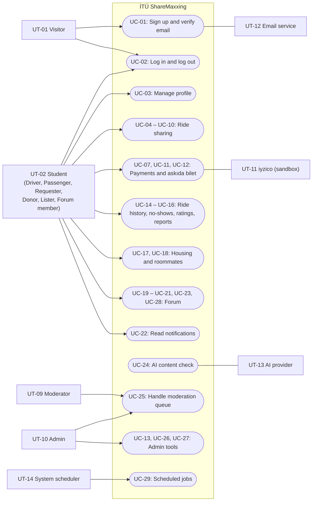
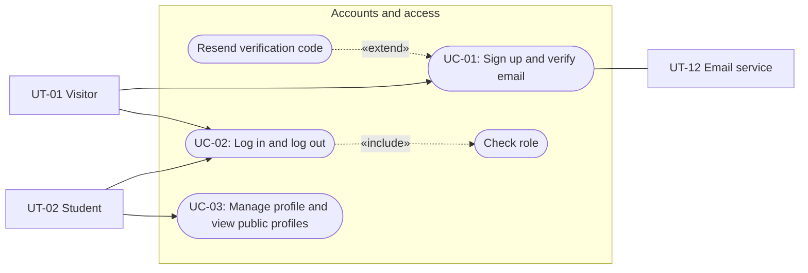
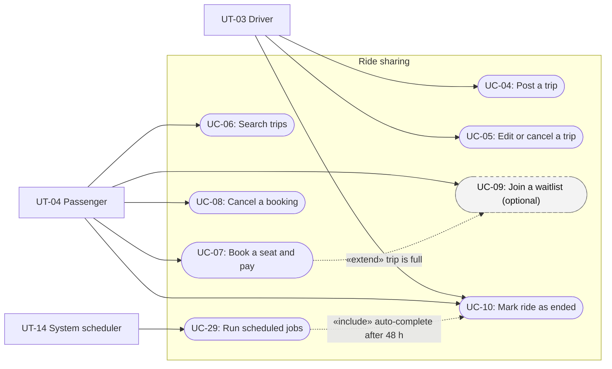
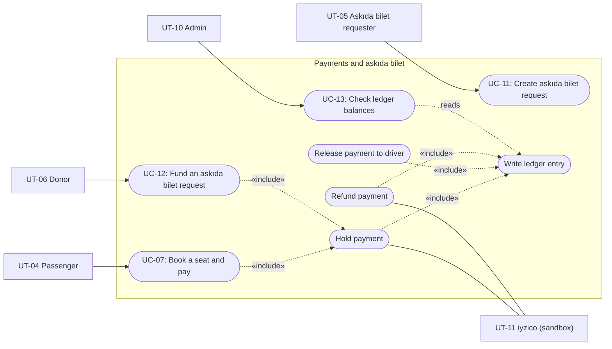
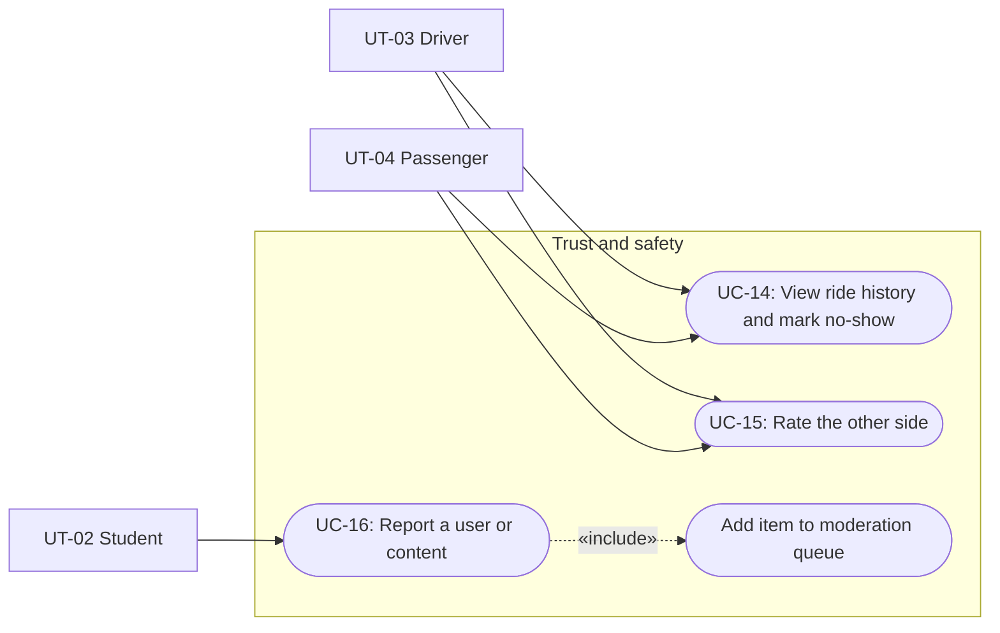
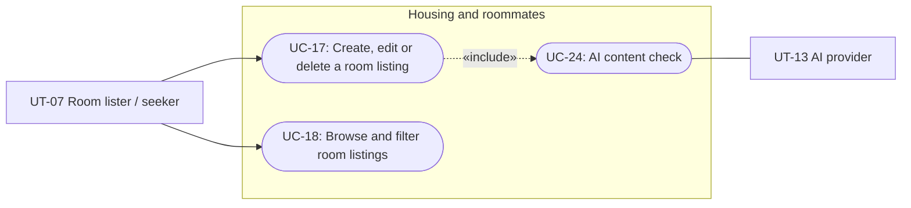
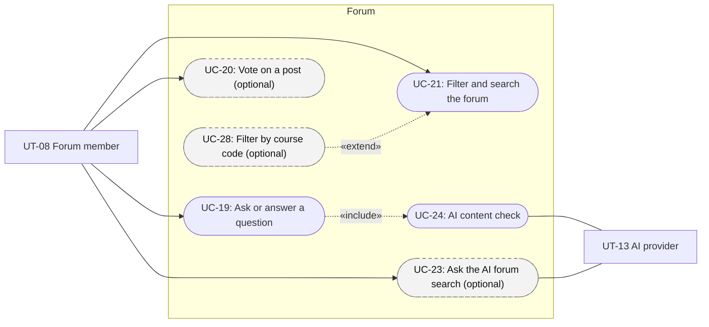
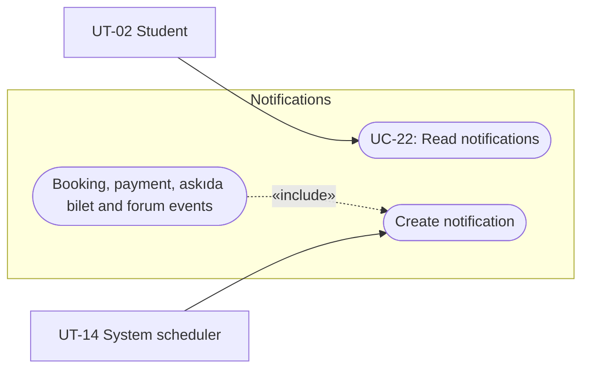
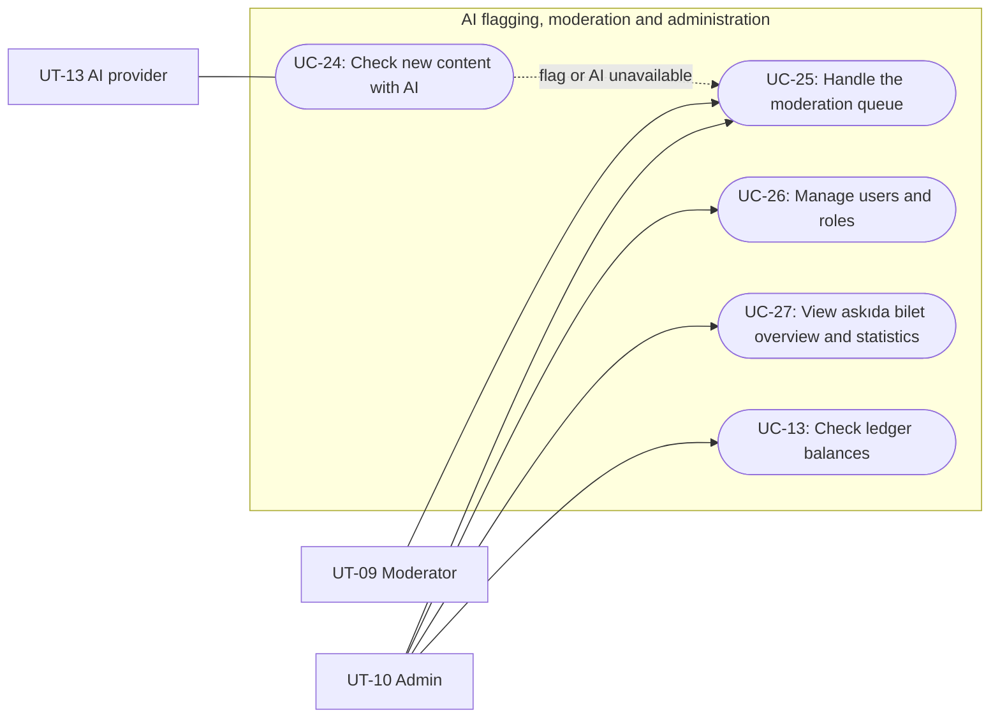

# Software Engineering: Requirements Specification

## Cover Page

| Field | Details |
|---|---|
| **Course** | BLG 411E Software Engineering |
| **Report name** | Requirements Specification |
| **Project title** | İTÜ ShareMaxxing |
| **Group name / number** | The Goys |
| **Group members** | Mehmet Fuat Karakaya — 150230084, Ege Demir — 150220007, Alperen Akbaş — 150220078, Bünyamin İbrahim Kalaycı — 150230030, Egemen Çevik — 150220012 |
| **Instructors** | Tolga Ovatman, Ayşe Tosun Kühn |
| **Submission date** | 2026-11-08 |
| **Document version** | 1.0 |

---

## Changelog

This section lists the changes to the Project Plan (v1.1, 2026-11-02) that came up while we wrote this document. The Project Plan file is not edited. The scope, task IDs, deliverable IDs and WBS IDs stay the same.

| Change ID | Date | Plan section | Change | Reason / source |
|---|---|---|---|---|
| CL-01 | 2026-11-03 | 1.1, 5.2, 5.3 | The Requirements Specification deadline is 08.11.2026 23:59, not 02.11.2026. The other report deadlines in the Plan are kept until the exact dates are announced on Ninova. | The deadline on Ninova (Deliverable 3) is one week later than the date in the Charter and the Plan. |
| CL-02 | 2026-11-03 | 1.1 (Askıda bilet), WBS-12.1 | An askıda bilet request does **not** reserve a seat. Other students can still book the seat. An open request closes when the trip becomes full, when the trip is cancelled or when the departure time passes. | Team decision on 2026-10-27: nobody may fund a request, so holding the seat would keep it empty for no reason. |
| CL-03 | 2026-11-03 | T-09, WBS-9.1 | Ride completion is tracked per booking. A booking is completed when both the driver and that passenger mark the ride as ended, or automatically 48 hours after departure. The held payment of that booking is released at that moment. | The Plan says that the driver and each passenger mark the ride as ended. It does not say what happens when only some of them mark it. This rule removes the ambiguity. |
| CL-04 | 2026-11-03 | 1.4 (AI reliability) | The AI flagging check runs after a post or listing is published. The content stays visible until a moderator acts. | The Plan says the system must keep the content and must not let the AI hide content. Publishing first is the simplest way to meet both rules. |

---

## 1. Introduction

### 1.1 Project overview

İTÜ ShareMaxxing is a web platform for İTÜ students with verified @itu.edu.tr accounts. Its main service is intercity ride sharing to and from İstanbul. A driver posts a trip with a start city, an end city, a date, a time, free seats and a price per seat. A passenger searches by start and end city, books a seat and pays a share of the travel costs in the app. The money is held until the ride ends and is then released to the driver.

Students in financial need can create an "askıda bilet" request for a seat. Donors see the open requests in a pool and pay for one anonymously. The same accounts are also used for housing and roommate listings and for a student forum. Moderators and administrators keep the platform safe with a moderation queue that receives user reports and AI flags.

The hypothetical customer is a university student affairs office or student union that wants a trusted alternative to unmoderated WhatsApp groups.

### 1.2 Purpose of this document

This document turns the scope of the Project Plan (v1.1) into testable requirements. It is written for the customer (our TA), for the team members who build each feature, and for whoever writes the tests.

- Every functional requirement is linked to a task (`T-##`) and a deliverable (`D-##`) of the Project Plan.
- Every task in Section 1.3 of the Project Plan is covered by at least one requirement and, if it is user-facing, by at least one use case.
- Every user-facing WBS activity has a user story.

### 1.3 Writing rules used in this document

We follow the requirement-writing guidelines from the lecture notes (Week 4):

- Each requirement has a unique ID (`FR-##`, `NFR-##`) and one standard format.
- **"shall"** is used for mandatory requirements (priority *Must*). **"should"** is used for desirable or optional requirements (priority *Should* or *Could*).
- The source and the rationale of each group of requirements are given below its table.
- Optional features from the Project Plan (waitlist, forum votes, course-code filters, AI-supported forum search) are included with priority *Could* and marked *(optional)*. They are built only if time allows.
- Where a value (for example a time limit) is not fixed by the Project Plan, we state the value we propose and list it under "Open issues" in Section 2.1.13.

### 1.4 Glossary

| Term | Meaning |
|---|---|
| Trip | A ride posted by a driver, with a start city, an end city, a departure date and time, a seat count and a price per seat. One of the two cities is always İstanbul. |
| Booking | One seat on one trip, booked by or for one passenger. |
| Held payment | Money taken from the passenger in iyzico sandbox mode and kept by the platform until the booking is completed or refunded. |
| Askıda bilet | Turkish for "suspended ticket". A seat paid for by an anonymous donor for a student who asks for help. |
| Request pool | The page that lists all open askıda bilet requests. |
| Ledger | An append-only record of every payment, hold, release, refund and askıda bilet payment. |
| Moderation queue | The list of user reports and AI-flagged content that waits for a moderator decision. |
| AI unavailable | The status given to content whose AI check failed (timeout, invalid response, quota). |

### 1.5 Structure of the document

- **Changelog**: changes to the Project Plan found while writing this document.
- **Section 2** lists the functional requirements by feature (2.1) and the non-functional requirements (2.2).
- **Section 3.1** describes the user types and external actors.
- **Section 3.2** gives the personas, the user scenarios and one user story for each WBS activity.
- **Section 3.3** contains the whole-system use case diagram and one diagram per major feature.
- **Section 3.4** contains the coverage matrix and the detailed use cases with alternative and error flows.

---

## 2. System Requirements

### 2.1 Functional Requirements

Requirements are grouped by feature. Each group has its own table and a short note on its source and rationale.

#### 2.1.1 Accounts and access (D-01)

| Requirement ID | Related task ID(s) | Related deliverable ID(s) | Functional requirement (natural language) | Priority | Verification / acceptance condition |
|---|---|---|---|---|---|
| FR-01 | T-01 | D-01 | The system shall accept a sign-up only when the email address ends with `@itu.edu.tr` (case-insensitive). | Must | Sign-up with `x@gmail.com` is rejected with an error message; sign-up with `x@itu.edu.tr` is accepted. |
| FR-02 | T-01 | D-01 | The system shall reject a sign-up when an account with the same email address already exists. | Must | A second sign-up with the same address returns an "already registered" error. |
| FR-03 | T-01 | D-01 | The system shall email a 6-digit verification code to the new address and keep the account inactive until the user enters that code. | Must | A new account cannot log in; after the correct code is entered, it can. |
| FR-04 | T-01 | D-01 | The system shall reject a wrong or expired code and shall let the user request a new code; a code shall expire 15 minutes after it is sent, and sending a new code shall make the previous one invalid. | Must | A wrong code, an old code and a code older than 15 minutes are all rejected; the newest code works. |
| FR-05 | T-02 | D-01 | The system shall let a verified, non-suspended user log in with email and password and keep the user logged in across pages until logout. | Must | Login succeeds for a verified user; the session survives page changes; unverified and suspended users are refused with a clear message. |
| FR-06 | T-02 | D-01 | The system shall end the session when the user logs out. | Must | After logout, protected pages redirect to the login page. |
| FR-07 | T-02 | D-01 | The system shall give every account exactly one role (student, moderator or admin), give new accounts the student role, and refuse every page and API action that the role is not allowed to use. | Must | A student calling a moderator or admin endpoint gets a "forbidden" response; the moderation and admin links are not shown to students. |
| FR-08 | T-03 | D-01 | The system shall let a user view and edit their own profile (full name, department, class year, short bio); the email address shall not be editable. | Must | Changes are saved and shown after reload; the email field is read-only. |
| FR-09 | T-03 | D-01, D-04 | The system shall show other verified students a public profile with the user's name, department, number of completed rides, average ratings as driver and as passenger, and no-show count, and shall not show the email address. | Must | The public profile API response contains the listed fields and no email address. |
| FR-10 | T-04 | D-01 | The system shall show the same navigation menu on every page, with links to Rides, Askıda Bilet, Housing, Forum, Notifications and Profile, and with Moderation and Admin links only for users with those roles. | Must | Every page uses the shared layout; menu links depend on the role. |
| FR-11 | T-04 | D-01 | The system should show success and error messages in the same place and style on every page. | Should | A UI review of all pages finds one message style. |

**Rationale / source:** Project Plan T-01–T-04, D-01 and the Security NFR. A short code expiry (FR-04) limits the damage of a leaked code; the 15-minute value is our proposal (see OI-05).

#### 2.1.2 Trip posting and cost sharing (D-02, D-03)

| Requirement ID | Related task ID(s) | Related deliverable ID(s) | Functional requirement (natural language) | Priority | Verification / acceptance condition |
|---|---|---|---|---|---|
| FR-12 | T-05 | D-02, D-03 | The system shall let a student post a trip with a start city, an end city (both chosen from the list of the 81 provinces of Türkiye), a departure date and time, a number of free seats, a price per seat and optional contact details. | Must | A valid trip is saved and appears in search results. |
| FR-13 | T-05 | D-02 | The system shall reject a trip when neither city is İstanbul, when both cities are the same, when the departure time is in the past, when the seat count is less than 1 or when the price per seat is negative. | Must | Each listed invalid input returns its own error message and no trip is saved. |
| FR-14 | T-05 | D-02 | The system shall show a trip's contact details only to logged-in verified students. | Must | The trip API response for a logged-out request contains no contact details. |
| FR-15 | T-05 | D-02 | The system shall let the driver edit an upcoming trip, and shall not let the seat count go below the number of seats already booked. | Must | Editing seats from 3 to 1 when 2 seats are booked is rejected. |
| FR-16 | T-05, T-11 | D-02, D-03 | The system shall let the driver cancel an upcoming trip; all its bookings shall then be cancelled, all held payments refunded (FR-34) and all passengers notified. | Must | After cancellation, every booking is "cancelled", every payment is "refunded" and each passenger has a notification. |

**Rationale / source:** Project Plan T-05 and D-02. The two-city rule and the İstanbul rule come from the scope; stops between cities and price limits are out of scope.

#### 2.1.3 Trip search (D-02)

| Requirement ID | Related task ID(s) | Related deliverable ID(s) | Functional requirement (natural language) | Priority | Verification / acceptance condition |
|---|---|---|---|---|---|
| FR-17 | T-06 | D-02 | The system shall return only upcoming, non-cancelled trips whose start city and end city are exactly the searched cities. | Must | A search for İstanbul → Ankara never returns İstanbul → Eskişehir or Ankara → İstanbul. |
| FR-18 | T-06 | D-02 | The system shall list trips with free seats first and full trips after them, mark full trips as "Dolu" (Full), and order each group by departure time, earliest first. | Must | A test data set with mixed full and free trips comes back in the stated order. |
| FR-19 | T-06 | D-02 | The system shall show a trip detail page with the cities, date and time, free seats, price per seat, the driver's name and ratings, and the contact details if the driver gave them. | Must | All listed fields are shown for a sample trip. |

**Rationale / source:** Project Plan T-06 and the D-02 acceptance criterion. Full trips stay visible so that a passenger knows the trip exists and, if the waitlist is built, can join it.

#### 2.1.4 Booking, waitlist and ride completion (D-02)

| Requirement ID | Related task ID(s) | Related deliverable ID(s) | Functional requirement (natural language) | Priority | Verification / acceptance condition |
|---|---|---|---|---|---|
| FR-20 | T-07 | D-02, D-03 | The system shall let a student book one seat on an upcoming trip that has a free seat, start the payment (FR-30), and confirm the booking only after the payment succeeds. | Must | The booking is "pending payment" during payment and "confirmed" after a successful sandbox payment. |
| FR-21 | T-07 | D-02 | The system shall not let a driver book their own trip and shall not let a passenger hold more than one active booking on the same trip. | Must | Both cases return an error and no booking is created. |
| FR-22 | T-07 | D-02 | The system shall never book more seats than the trip offers, also when several students book the last seat at the same moment. | Must | A concurrency test with 5 parallel requests for 1 free seat gives exactly 1 confirmed booking. |
| FR-23 | T-07, T-11 | D-02, D-03 | The system shall let a passenger cancel a booking before the departure time; the seat shall become free again and the held payment shall be refunded (FR-34). | Must | After cancellation the free-seat count goes up by 1 and the payment status is "refunded". |
| FR-24 | T-07 | D-02 | The system shall show a "My bookings" page with each booking's trip, status (pending payment, confirmed, cancelled, completed) and payment status. | Must | All bookings of the test user are listed with the correct status. |
| FR-25 | T-08 | D-02, D-07 | *(optional)* The system should let a student join or leave the waitlist of a full trip, with at most one place per student per trip, and show the student's place in line. | Could | Joining twice is rejected; the place in line is shown. |
| FR-26 | T-08 | D-02, D-07 | *(optional)* When a seat becomes free on a trip with a waitlist, the system should offer the seat to the first student in line, notify that student, and move to the next student if the offer is not used within the offer window (see OI-04). | Could | Freeing a seat creates an offer and a notification for the first student only. |
| FR-27 | T-09 | D-02, D-03, D-04 | The system shall let the driver and each passenger of a confirmed booking mark the ride as ended, but only after the departure time. | Must | The "Ride ended" button is disabled before departure and works after it. |
| FR-28 | T-09 | D-02, D-03, D-04 | The system shall mark a booking as completed when both its driver and its passenger have marked the ride as ended; it shall then release the held payment to the driver (FR-32), add the ride to both users' ride history and open ratings for both sides. | Must | After both marks, the booking is "completed", the payment is "released" and the rating form is available to both users. |
| FR-29 | T-09 | D-02, D-03 | The system shall complete every confirmed booking that is still open 48 hours after the departure time, with the same effects as FR-28. | Must | A scheduler test with the clock moved 48 hours forward completes the booking. |

**Rationale / source:** Project Plan T-07–T-09, WBS-7.1, WBS-9.1. FR-22 comes from the WBS-7.1 completion condition. FR-28 and FR-29 follow Changelog CL-03.

#### 2.1.5 Payments and refunds (D-03)

| Requirement ID | Related task ID(s) | Related deliverable ID(s) | Functional requirement (natural language) | Priority | Verification / acceptance condition |
|---|---|---|---|---|---|
| FR-30 | T-10 | D-03 | The system shall take the price per seat from the passenger through the iyzico sandbox when a booking is made. | Must | A booking with an iyzico test card creates a successful sandbox payment for the right amount. |
| FR-31 | T-10 | D-03 | The system shall keep a successful payment in the "held" state until the booking is completed or cancelled. | Must | Right after payment, the payment status is "held" and the driver has not received it. |
| FR-32 | T-10 | D-03 | The system shall release the held payment to the driver when the booking is completed. | Must | After completion, the payment status is "released" and the release is in the ledger. |
| FR-33 | T-10 | D-03 | When a payment fails, the system shall not confirm the booking, shall free the seat and shall show the passenger a clear error message. | Must | A sandbox test card that is declined leaves the seat free and shows an error. |
| FR-34 | T-11 | D-03 | The system shall refund the full held amount when a passenger cancels a booking or the driver cancels the trip. | Must | After cancellation, a sandbox refund is created for the full amount and the payment status is "refunded". |
| FR-35 | T-11 | D-03 | When a refund fails at the payment provider, the system should mark it as "refund pending", retry it and show it to admins until it succeeds. | Should | A simulated provider error leaves the refund "pending" and visible on the admin page. |

**Rationale / source:** Project Plan T-10, T-11, D-03 and the Reliability NFR ("payment provider errors are handled and shown clearly"). Real money is out of scope; only the iyzico sandbox is used.

#### 2.1.6 Askıda bilet (D-03)

| Requirement ID | Related task ID(s) | Related deliverable ID(s) | Functional requirement (natural language) | Priority | Verification / acceptance condition |
|---|---|---|---|---|---|
| FR-36 | T-12 | D-03, D-02 | The system shall let a student create an askıda bilet request for one seat on an upcoming trip that has a free seat, unless the student is the driver, already has a booking on that trip or already has an open request on that trip. | Must | A valid request is created; each forbidden case returns an error. |
| FR-37 | T-12 | D-03 | The system shall list all open requests on the request pool page and shall show only the amount and the request date for each one. | Must | The pool API response contains no city, date, driver or requester fields. |
| FR-38 | T-12 | D-03, D-02 | The system shall not reserve a seat for an open request, and shall close the request and notify the requester when the trip becomes full, the trip is cancelled or the departure time passes. | Must | Booking the last seat by another student closes the request and creates a notification. |
| FR-39 | T-12 | D-03 | The system should let the requester withdraw an open request. | Should | A withdrawn request disappears from the pool. |
| FR-40 | T-13 | D-03, D-02 | The system shall let a student pay for an open request from the pool through the iyzico sandbox, but not for a request they created. | Must | Paying for one's own request is rejected; paying for another request succeeds. |
| FR-41 | T-13 | D-03, D-02 | After a successful donor payment, the system shall create a confirmed booking for the requester, hold the payment (FR-31), mark the request as funded, notify the requester and show the donor a thank-you screen. | Must | The requester has a confirmed booking; the donor sees the thank-you screen. |
| FR-42 | T-13 | D-03 | The system shall never show the donor the trip details or the requester, and shall never show the requester or the driver who the donor is; a funded booking shall be labelled only as "askıda bilet". | Must | API responses for the donor, the requester and the driver contain no identity fields of the other parties. |
| FR-43 | T-13 | D-03 | If the seat is no longer free when the donor pays, the system shall not complete the booking, shall refund or cancel the donor payment, close the request and inform the donor. | Must | A race test where the last seat is booked during the donor payment ends with no funded booking and a refunded donor payment. |
| FR-44 | T-13, T-11 | D-03 | If a funded booking is cancelled, the system shall refund the held amount to the donor's payment method without telling the donor who the requester was. | Must | The refund goes to the donor's sandbox payment; the donor's view has no requester details. |

**Rationale / source:** Project Plan T-12, T-13, D-03 and the Privacy NFR. FR-38 follows Changelog CL-02.

#### 2.1.7 Ledger (D-03, D-09)

| Requirement ID | Related task ID(s) | Related deliverable ID(s) | Functional requirement (natural language) | Priority | Verification / acceptance condition |
|---|---|---|---|---|---|
| FR-45 | T-14 | D-03, D-09 | The system shall write a ledger entry for every payment, hold, release, refund and askıda bilet payment, with its type, amount, time, related booking or request and the payment provider reference. | Must | Each money event in a full test flow has exactly one matching ledger entry. |
| FR-46 | T-14 | D-03, D-09 | The system shall not allow ledger entries to be edited or deleted; a correction shall be a new entry. | Must | No API or admin action updates or deletes a ledger row. |
| FR-47 | T-14 | D-03, D-09 | The system shall provide a balance check that compares each booking's and request's payment status with the sum of its ledger entries and lists every mismatch for admins. | Must | A data set with one manual mismatch is reported; a clean data set gives no mismatch. |

**Rationale / source:** Project Plan T-14 and the Reliability NFR ("no payment is lost").

#### 2.1.8 Trust and safety (D-04)

| Requirement ID | Related task ID(s) | Related deliverable ID(s) | Functional requirement (natural language) | Priority | Verification / acceptance condition |
|---|---|---|---|---|---|
| FR-48 | T-15 | D-04 | The system shall store completed rides for each user and show them on the user's own ride history page and, as a count, on the public profile. | Must | A completed booking appears in both users' histories. |
| FR-49 | T-15 | D-04 | After the departure time, the system shall let the driver mark a passenger, and a passenger mark the driver, as a no-show once per booking, and shall show the no-show count on the public profile. | Must | A second no-show mark on the same booking is rejected; the count on the profile goes up by 1. |
| FR-50 | T-16 | D-04 | After a booking is completed, the system shall let the driver and the passenger rate each other once, with 1 to 5 stars and an optional comment. | Must | A second rating for the same booking and direction is rejected. |
| FR-51 | T-16 | D-04 | The system shall keep a rating hidden from everyone except its author until the other side has also rated, and shall then show both ratings and include them in the averages. | Must | After one rating, the other user's profile does not show it; after both ratings, both are shown. |
| FR-52 | T-17 | D-04, D-09 | The system shall let a user report another user, a trip, a room listing, a forum question or a forum answer with a reason category and a free-text explanation, and shall add the report to the moderation queue. | Must | A submitted report appears in the moderation queue with the reporter, the target and the reason. |

**Rationale / source:** Project Plan T-15–T-17 and D-04. Hidden ratings (FR-51) stop users from rating in revenge.

#### 2.1.9 Housing and roommates (D-05)

| Requirement ID | Related task ID(s) | Related deliverable ID(s) | Functional requirement (natural language) | Priority | Verification / acceptance condition |
|---|---|---|---|---|---|
| FR-53 | T-18 | D-05 | The system shall let a student create a room listing with a type ("I have a room" or "I need a room"), one of the 39 districts of İstanbul, a title, a description, an optional monthly price and optional contact details. | Must | A valid listing is saved and listed; a listing without a district is rejected. |
| FR-54 | T-18 | D-05 | The system shall let only the owner of a listing edit or delete it. | Must | Another student's edit or delete request is refused. |
| FR-55 | T-18 | D-05 | The system shall let students browse listings and filter them by district and by type. | Must | Filtering by "Sarıyer" and "I need a room" returns only matching listings. |
| FR-56 | T-18 | D-05 | The system shall show a listing's contact details only when the owner has given them and only to logged-in verified students. | Must | A listing without contact details shows none; a logged-out request gets no contact fields. |

**Rationale / source:** Project Plan T-18 and D-05. Rent payments and contracts are out of scope.

#### 2.1.10 Forum (D-06, D-13, D-14)

| Requirement ID | Related task ID(s) | Related deliverable ID(s) | Functional requirement (natural language) | Priority | Verification / acceptance condition |
|---|---|---|---|---|---|
| FR-57 | T-19 | D-06 | The system shall let a student post a question with a title, a body and one category: course-related, general, yemekhane, housing, transport or campus life. | Must | A question without a category is rejected; a valid question is listed. |
| FR-58 | T-19, T-22 | D-06, D-07 | The system shall let students answer a question and shall notify the question's author about each new answer. | Must | A new answer appears under the question and the author gets a notification. |
| FR-59 | T-19 | D-06 | The system shall let students filter the question list by category. | Must | Filtering by "yemekhane" returns only yemekhane questions. |
| FR-60 | T-19 | D-06 | The system should let authors edit or delete their own questions and answers. | Should | The author can edit; other students cannot. |
| FR-61 | T-21 | D-06 | The system shall return the questions whose title, body or answers contain the search keyword, and shall allow the keyword search to be combined with the category filter. | Must | A keyword that appears in one answer returns that question. |
| FR-62 | T-20 | D-06 | *(optional)* The system should let a student give one up-vote or down-vote to a question or answer, change or remove it, and rank posts by their vote score. | Could | Two up-votes from the same student count once; higher-scored answers are listed first. |
| FR-63 | T-34 | D-14, D-06 | *(optional)* The system should let a student tag a course-related question with a course code (for example `BLG411E`) and filter questions by course code. | Could | Filtering by `BLG411E` returns only questions with that tag. |
| FR-64 | T-23 | D-13, D-06 | *(optional)* The system should add every new or edited forum post to a vector index and remove deleted posts from it. | Could | An edited post is found by its new content; a deleted post is no longer returned. |
| FR-65 | T-23 | D-13, D-06 | *(optional)* For a natural-language question, the system should return related forum posts with links to the original posts; when no related post is found, it should show a "no results" message and offer a keyword search. | Could | A sample question returns linked posts; a question with no match shows the message and the keyword search option. |

**Rationale / source:** Project Plan T-19–T-21, T-23, T-34 and the optional scope. Optional items have priority *Could*.

#### 2.1.11 Notifications (D-07)

| Requirement ID | Related task ID(s) | Related deliverable ID(s) | Functional requirement (natural language) | Priority | Verification / acceptance condition |
|---|---|---|---|---|---|
| FR-66 | T-22 | D-07 | The system shall create an in-app notification for these events: booking confirmed, booking cancelled, trip cancelled, ride-end reminder at the departure time + 3 hours, payment succeeded, payment failed, payment refunded, payment released, askıda bilet request funded, askıda bilet request closed, and new answer to the user's question. | Must | Each event in an end-to-end test creates one notification for the right user. |
| FR-67 | T-22 | D-07 | *(optional)* If the waitlist is built, the system should also notify a student when a seat is offered from the waitlist. | Could | See FR-26. |
| FR-68 | T-22 | D-07 | The system shall show a bell icon with the number of unread notifications on every page, a list of notifications newest first, and shall let the user mark them as read. | Must | The unread count drops after the user opens and reads the notifications. |

**Rationale / source:** Project Plan T-22. Email notifications were removed in the Plan; email is used only for sign-up codes. The 3-hour reminder offset is our proposal (see OI-06).

#### 2.1.12 AI content flagging, moderation and administration (D-08, D-09)

| Requirement ID | Related task ID(s) | Related deliverable ID(s) | Functional requirement (natural language) | Priority | Verification / acceptance condition |
|---|---|---|---|---|---|
| FR-69 | T-24 | D-08 | The system shall send every new forum question, forum answer and room listing to the AI provider for a suitability check after it is published. | Must | Each new item creates one AI check request. |
| FR-70 | T-24 | D-08, D-09 | When the AI marks content as unsuitable, the system shall add it to the moderation queue with the label "AI flag" and the reason returned by the AI. | Must | An unsuitable test post appears in the queue with the AI reason. |
| FR-71 | T-24 | D-08, D-09 | When the AI check times out, returns an invalid response or fails because of the quota, the system shall keep the content, add it to the moderation queue with the status "AI unavailable" and shall never mark it as safe. | Must | Simulated timeout, malformed response and quota errors each produce an "AI unavailable" queue item. |
| FR-72 | T-24, T-25 | D-08, D-09 | The system shall not let an AI result hide content, warn a user or suspend a user; only a moderator or admin shall take these actions. | Must | No code path from the AI result changes content visibility or user status. |
| FR-73 | T-25 | D-09, D-04 | The system shall show moderators and admins a moderation queue with user reports and AI-flagged items, oldest first, with the content, the reason and the source (report, AI flag or AI unavailable). | Must | A report and an AI flag both appear with their source labels. |
| FR-74 | T-25 | D-09 | The system shall let a moderator or admin resolve a queue item by dismissing it, hiding the content, warning the user or suspending the user, and shall record who did it, when and why. | Must | Each action changes the item status and creates an audit record. |
| FR-75 | T-25 | D-09 | The system shall hide hidden content from all students except its author, show a warning to a warned user at the next login, and refuse login for a suspended user with a message. | Must | A suspended test user cannot log in; hidden content is not in public API responses. |
| FR-76 | T-26 | D-09 | The system shall let admins search users by name or email and change a user's role; moderators shall not be able to open this page. | Must | An admin changes a role; a moderator gets "forbidden". |
| FR-77 | T-26 | D-09, D-03 | The system shall show admins an askıda bilet overview with the number and total amount of open, funded and closed requests, matching the ledger. | Must | The totals on the overview equal the ledger totals for the test data. |
| FR-78 | T-26 | D-09 | The system shall show admins usage statistics: the numbers of users, trips, bookings, completed rides, room listings, forum questions and forum answers. | Must | The numbers match a direct database count for the test data. |

**Rationale / source:** Project Plan T-24–T-26, D-08, D-09 and the "AI reliability and credibility" NFR added after the Project Plan meeting with our TA. FR-69 follows Changelog CL-04.

#### 2.1.13 Functional requirement notes and open issues

**Business rules used above:**

- All times are shown in Turkish time (UTC+3).
- A trip always has exactly two cities and one of them is İstanbul. Stops between cities are out of scope.
- One booking is always one seat for one passenger.
- The price per seat is chosen by the driver. Pricing guidelines and limits are out of scope.
- Cancelling before departure always gives a full refund. There is no cancellation fee.
- Tasks T-27 to T-33 (database, CI, cloud deployment, reports, documentation, demo, slides) are internal work. They have no functional requirement. Their quality goals are in Section 2.2 (NFR-13, NFR-17).

**Open issues (to be decided with the customer before the Requirements Analysis report):**

| Issue ID | Question | Current proposal |
|---|---|---|
| OI-01 | What happens to a held payment when a passenger marks the driver as a no-show? | The booking is not completed automatically. The case goes to the moderation queue and a moderator decides on release or refund. |
| OI-02 | Should a rating ever be shown if the other side never rates? | No. FR-51 keeps it hidden, as the Project Plan says. |
| OI-03 | Should a student have a limit on open askıda bilet requests? | At most one open request per student at a time. |
| OI-04 | *(optional waitlist)* How long does a waitlist seat offer stay valid? | 2 hours, or until the departure time if that is sooner. |
| OI-05 | How long is an email verification code valid? | 15 minutes (FR-04). |
| OI-06 | When is the ride-end reminder sent? | 3 hours after the departure time (FR-66). |

### 2.2 Non-functional Requirements

| Requirement ID | Quality attribute | Non-functional requirement (natural language) | Applies to | Verification / measurement |
|---|---|---|---|---|
| NFR-01 | Security | The system shall check the user's verified status and role on the server for every API action, not only in the user interface. | Whole system | Automated tests call each protected endpoint with no login, with the wrong role and with another user's account, and expect a refusal. |
| NFR-02 | Security | The system shall store passwords only as salted hashes and shall keep API keys and other secrets out of the code repository. | FR-01–FR-06 | Database inspection shows no plain-text password; a secret scan of the repository finds no keys. |
| NFR-03 | Security / Privacy | The system shall let users see only their own bookings, payments and notifications. | FR-20–FR-35, FR-66–FR-68 | Automated tests request another user's bookings and payments and expect "forbidden". |
| NFR-04 | Performance | Pages and search results shall load within 5 seconds on a phone over a mobile connection. | Whole system | Lighthouse mobile test on the deployed site for the main pages. |
| NFR-05 | Performance | The system shall serve about 100 students using it at the same time on search, booking and forum pages without errors and within the time limit of NFR-04. | FR-17–FR-24, FR-57–FR-61 | Load test simulating 100 simultaneous users (WBS-28.3). |
| NFR-06 | Usability | The user interface shall be in Turkish. | Whole system | Manual review of all pages. |
| NFR-07 | Usability | Every page shall work on phone screens from 360 px wide as well as on desktop browsers. | Whole system | Manual tests on real phones (WBS-28.4) and the phone-friendly check (WBS-4.3). |
| NFR-08 | Usability | Searching for and booking a ride shall take only a few clear steps that a new user can finish without help. | FR-17–FR-24 | Test session with 3–5 students outside the team (WBS-28.4); every participant completes a booking without help. |
| NFR-09 | Reliability | No payment shall be lost: every ride payment, refund and askıda bilet payment shall be recorded, and balances shall always match the ledger. | FR-30–FR-47 | Automated tests compare balances with the ledger after complete payment flows. |
| NFR-10 | Reliability | Payment provider errors shall be handled and shown to the user with a clear message. | FR-30–FR-35, FR-40–FR-44 | Tests that simulate failed sandbox payments and refunds. |
| NFR-11 | Privacy | Askıda bilet donors and recipients shall stay anonymous to each other and to drivers, and donors shall never see ride details. | FR-36–FR-44, FR-77 | Automated tests check that the hidden fields never appear in API responses for unauthorized users. |
| NFR-12 | Privacy | Contact details shall appear only when the poster chose to add them and only to verified students; only the personal data that the features need shall be collected. | FR-08, FR-09, FR-14, FR-56 | Automated API response tests; review of the database fields. |
| NFR-13 | Maintainability | All code shall be in TypeScript, reviewed in a pull request before merging, and covered by automated tests that run on every push; a pull request with a failing test shall not be mergeable. | Whole system (T-27, T-28) | GitHub Actions results and branch protection rules; review records on pull requests. |
| NFR-14 | AI reliability | The AI flagging shall reach at least 80% precision and at least 80% recall on at least 50 separately labelled Turkish forum posts and listings (at least 25 unsuitable and 25 suitable) that were not used for prompt tuning. | FR-69, FR-70 | Evaluation of WBS-24.1 before acceptance; Bünyamin runs it and Alperen reviews the results. |
| NFR-15 | AI reliability | When the AI provider times out, returns an invalid response or runs out of quota, the content shall be kept and sent for human review with the "AI unavailable" status. | FR-71 | Simulated timeout, malformed-response and quota errors. |
| NFR-16 | AI credibility | AI flags shall only advise; only a moderator or admin shall hide content or sanction a user. | FR-72–FR-75 | Code review and tests that check that an AI flag alone changes nothing visible; Egemen verifies moderator control. |
| NFR-17 | Availability / Deployment | The backend, database and frontend shall run on a cloud provider at a public URL, and every merge to `main` shall be deployed automatically. | Whole system (T-29) | The live URL is reachable; a merged change appears on the live site without manual steps. |
| NFR-18 | AI credibility | *(optional)* If AI-supported forum search is built, every result shall link to an existing source post, and a question without enough evidence shall get a clear "no results" message with a keyword search option. | FR-64, FR-65 | Tests with sample questions, deleted posts and an empty index. |

**Non-functional requirement notes / assumptions:**

- "Mobile connection" in NFR-04 means the Lighthouse mobile preset (simulated slow 4G and a mid-range phone).
- The supported browsers are the current versions of Chrome, Safari, Firefox and Edge on desktop, Android and iOS.
- The payment provider is used only in sandbox mode. A real payment flow would need legal and regulatory review and is out of scope.
- The cloud provider and the AI provider are chosen in the design phase. Their cost must stay within free or student tiers.
- All thresholds above (5 seconds, 100 users, 360 px, 50 samples, 80%) come from Section 1.4 of the Project Plan. We did not add new thresholds.

---

## 3. Use Cases

### 3.1 User Types

| User type ID | User type / actor | Description and responsibilities | Goals / typical actions | Related requirement ID(s) |
|---|---|---|---|---|
| UT-01 | Visitor | A person who is not logged in. | Sign up with an @itu.edu.tr address, verify the email, log in. | FR-01–FR-06 |
| UT-02 | Student | Any verified, logged-in İTÜ student. Every student can act as UT-03 to UT-08 at different times. | Edit the profile, see notifications, report users or content. | FR-07–FR-11, FR-52, FR-66–FR-68 |
| UT-03 | Driver | A student who posts a trip. | Post, edit and cancel trips, mark rides as ended, rate passengers, mark no-shows. | FR-12–FR-16, FR-27–FR-29, FR-32, FR-48–FR-51 |
| UT-04 | Passenger | A student who books a seat. | Search trips, book and pay, cancel, join a waitlist, mark rides as ended, rate drivers. | FR-17–FR-31, FR-33, FR-34, FR-48–FR-51 |
| UT-05 | Askıda bilet requester | A student who asks for a funded seat. Financial need is not verified. | Create and withdraw a request, receive a funded booking. | FR-36–FR-39, FR-41, FR-42 |
| UT-06 | Donor | A student who pays for someone else's request. | Browse the request pool, pay for a request anonymously. | FR-37, FR-40–FR-44 |
| UT-07 | Room lister / seeker | A student who offers or looks for a room or roommate. | Create, edit, delete, browse and filter room listings. | FR-53–FR-56 |
| UT-08 | Forum member | A student who uses the forum. | Ask, answer, filter, search, vote (optional), use AI search (optional). | FR-57–FR-65 |
| UT-09 | Moderator | A trusted user given the moderator role by an admin. | Handle the moderation queue: dismiss, hide, warn, suspend. | FR-70–FR-75 |
| UT-10 | Admin | A platform administrator. Has all moderator rights. | Manage users and roles, view the askıda bilet overview, statistics and ledger check. | FR-47, FR-73–FR-78 |
| UT-11 | iyzico payment service (external system) | Payment provider used in sandbox mode. | Take payments, return success or failure, process refunds. | FR-30–FR-35, FR-40, FR-43, FR-44 |
| UT-12 | Email service (external system) | SMTP service used through Nodemailer. | Deliver verification codes. | FR-03, FR-04 |
| UT-13 | AI provider (external system) | Hosted AI model API, chosen in the design phase. | Check content for suitability; (optional) create embeddings for forum search. | FR-64, FR-65, FR-69–FR-71 |
| UT-14 | System scheduler (internal timer) | Background job inside the backend. | Complete bookings 48 hours after departure, close expired requests, send ride-end reminders. | FR-29, FR-38, FR-66 |

**Access or role distinctions:**

- **Visitors** can see only the sign-up, verification and login pages.
- **Students** can use all ride, payment, askıda bilet, housing, forum and notification features. Driver, passenger, requester, donor, lister and forum member are not separate account types. They are what a student is doing at that moment.
- **Moderators** have all student rights plus the moderation queue. They cannot manage users or see the admin pages.
- **Admins** have all moderator rights plus user and role management, the askıda bilet overview, usage statistics and the ledger check.
- Nobody, including admins, can see who funded a specific askıda bilet request from the user interface. The link is kept only in the ledger for accounting.

### 3.2 User Scenarios

#### Personas

| Persona ID | Name | User type(s) | Short description |
|---|---|---|---|
| P-01 | Elif | UT-01, UT-04, UT-08 | Second-year Civil Engineering student from Ankara. Goes home about once a month and wants a cheaper and safer option than the bus or WhatsApp groups. Uses the site on her phone. |
| P-02 | Mert | UT-03 | Fourth-year Mechanical Engineering student with a car. Drives to İzmir on most long weekends and wants to share the fuel cost. |
| P-03 | Zeynep | UT-05 | Third-year student who cannot afford the trip home for a family event and does not want classmates to know. |
| P-04 | Can | UT-06 | Graduate student who wants to help other students without being thanked in public. |
| P-05 | Deniz | UT-07 | First-year student who lives far from campus and is looking for a room near Maslak. |
| P-06 | Ayşe | UT-09 | Senior student who volunteered as a moderator. |
| P-07 | Burak | UT-10 | Member of the student affairs office who runs the platform. |

#### Scenarios

**SC-01: Signing up with an İTÜ address**  
**Persona:** P-01 (Elif)  
**Related requirements:** FR-01–FR-07

Elif hears about the platform from a friend and opens it on her phone. She first types her personal Gmail address, and the sign-up form tells her that only @itu.edu.tr addresses are accepted. She uses her İTÜ address instead and chooses a password. A 6-digit code arrives in her İTÜ inbox a moment later. She enters it, her account is activated, and she logs in and lands on the home page.

**SC-02: Posting a trip to İzmir**  
**Persona:** P-02 (Mert)  
**Related requirements:** FR-12–FR-15, FR-19

Mert plans to drive from İstanbul to İzmir on Friday at 18:00 with three empty seats. He opens "Yolculuk ilanı ver", picks İstanbul and İzmir, sets the date, the time, 3 seats and 450 TL per seat, and adds his Instagram handle as contact information. By mistake he first selects İzmir for both cities, and the form asks him to choose two different cities. After he fixes it, the trip is published and he sees it on his "My trips" page.

**SC-03: Finding and paying for a ride home**  
**Persona:** P-01 (Elif)  
**Related requirements:** FR-17–FR-24, FR-30, FR-31, FR-66

On Wednesday Elif searches for İstanbul → Ankara. Two trips with free seats appear at the top and a full trip is listed below them, marked "Dolu". She opens the first trip, checks the driver's ratings and taps "Book". She pays with the iyzico test card. The booking changes from "pending payment" to "confirmed", the seat count drops by one and she gets a notification. The money stays held, so the driver will not be paid until the ride is over.

**SC-04: The driver cancels the trip**  
**Persona:** P-02 (Mert)  
**Related requirements:** FR-16, FR-34, FR-45, FR-66

On Thursday Mert's car breaks down. He opens his İzmir trip and cancels it. The platform cancels the two bookings on it, refunds both held payments in full and writes the refunds to the ledger. Both passengers get a notification saying that the trip was cancelled and their money was refunded.

**SC-05: Ending the ride and rating each other**  
**Persona:** P-01 (Elif) and P-02 (Mert)  
**Related requirements:** FR-27–FR-29, FR-32, FR-48–FR-51

Elif rides to Ankara with another driver. That evening she receives a reminder and taps "Yolculuk bitti". The driver had already marked the ride as ended, so the booking becomes completed, the held payment is released to the driver and the ride is added to her history. She gives the driver 5 stars. Her rating stays hidden until the driver rates her the next day, and then both ratings appear on their profiles.

**SC-06: Asking for an askıda bilet**  
**Persona:** P-03 (Zeynep)  
**Related requirements:** FR-36–FR-38

Zeynep finds a trip to Bursa with a free seat but cannot pay for it. On the trip page she taps "Askıda bilet iste". Her request appears on the request pool page with only the amount and the date. Her name and the trip details are not shown. She knows the seat is not held for her, so she checks back later.

**SC-07: Funding a request anonymously**  
**Persona:** P-04 (Can)  
**Related requirements:** FR-37, FR-40–FR-42, FR-45, FR-66

Can opens the request pool and sees five open requests, each showing only an amount and a date. He picks the oldest one and pays 300 TL with a test card. A thank-you screen appears. He never learns who the student is or where they are going. Zeynep gets a notification that her request was funded and finds a confirmed booking marked "askıda bilet" on her bookings page. The driver sees a normal passenger booking with no donor information.

**SC-08: Looking for a room near campus**  
**Persona:** P-05 (Deniz)  
**Related requirements:** FR-53–FR-56, FR-69

Deniz opens Housing and filters by "Sarıyer" and "I have a room". Three listings remain. One has a phone number, and the others have no contact details, so Deniz posts an "I need a room" listing in Sarıyer with a short description and an email address. The listing is published at once and is also sent for the AI suitability check in the background.

**SC-09: A yemekhane question in the forum**  
**Persona:** P-01 (Elif)  
**Related requirements:** FR-57–FR-61, FR-66

Elif wants to know whether the yemekhane is open on Saturdays. She searches the forum for "cumartesi" in the yemekhane category and finds nothing recent. She posts a new question. An hour later another student answers, and Elif sees the red badge on the notification bell, opens the notification and reads the answer.

**SC-10: An unsuitable listing is flagged**  
**Persona:** P-06 (Ayşe)  
**Related requirements:** FR-69, FR-70, FR-73–FR-75

A user posts a room listing with insulting language. The AI check marks it as unsuitable and the listing appears in the moderation queue with the label "AI flag" and the reason. Ayşe reads the listing, agrees, hides it and sends the owner a warning. The audit record shows her name, the time and the reason.

**SC-11: The AI service is down**  
**Persona:** P-06 (Ayşe)  
**Related requirements:** FR-71, FR-72

The AI provider's free quota runs out in the evening. New forum posts are still published, but each one appears in the moderation queue with the status "AI unavailable". Ayşe reviews them by hand the next morning, dismisses the normal ones and hides one spam post.

**SC-12: Admin work**  
**Persona:** P-07 (Burak)  
**Related requirements:** FR-47, FR-76–FR-78

Burak gives Ayşe the moderator role from the user management page. He then opens the askıda bilet overview, which shows 12 open, 30 funded and 5 closed requests, and runs the ledger check. It finds no mismatch. Finally he looks at the usage statistics for the student affairs office's monthly report.

**SC-13: Waitlist for a full trip** *(optional)*  
**Persona:** P-01 (Elif)  
**Related requirements:** FR-25, FR-26, FR-67

The only trip to Ankara on Friday is full, so Elif joins its waitlist and is told she is second in line. A passenger cancels, and the first student in line does not book within the offer window. The seat is offered to Elif and she gets a notification. She books it before the offer expires.

**SC-14: Asking the forum in plain language** *(optional)*  
**Persona:** P-01 (Elif)  
**Related requirements:** FR-64, FR-65

Elif types "Ayazağa'dan Kadıköy'e en hızlı nasıl giderim?" into the AI search box. The system returns three older transport questions with links to the original posts. When she asks about something nobody has written about, she gets a "no results" message and a button for normal keyword search.

**SC-15: Reporting a no-show passenger**  
**Persona:** P-02 (Mert)  
**Related requirements:** FR-49, FR-52

A passenger does not come to the meeting point and does not answer messages. After the departure time Mert marks the passenger as a no-show and also reports the user with the reason "did not show up and did not cancel". The report goes to the moderation queue and the passenger's no-show count goes up by one.

#### User Stories Linked to the Project Plan

One user story is given for each WBS activity. Backend and frontend activities of the same feature share a user goal, so they are written from the same user's point of view. Purely internal activities are explained instead.

| Scenario ID | Project Plan WBS activity ID | User story | Related requirement ID(s) |
|---|---|---|---|
| SC-01 | WBS-1.1 | As a visitor, I want to sign up with my @itu.edu.tr address so that only İTÜ students can join the platform. | FR-01, FR-02 |
| SC-01 | WBS-1.2 | As a visitor, I want to receive a code by email and enter it so that my İTÜ address is proven to be mine. | FR-03, FR-04 |
| SC-01 | WBS-1.3 | As a visitor, I want simple sign-up and code pages that work on my phone so that I can register anywhere. | FR-01–FR-04 |
| SC-01 | WBS-2.1 | As a verified student, I want to log in with my email and password so that I can use my account. | FR-05 |
| SC-12 | WBS-2.2 | As an admin, I want every page and action to check the user's role so that students cannot use moderator or admin tools. | FR-07 |
| SC-01 | WBS-2.3 | As a student, I want to stay logged in while I move between pages and to log out when I am done so that my account stays safe. | FR-05, FR-06 |
| SC-05 | WBS-3.1 | As a student, I want to edit my profile and see other students' ride history and ratings so that I can decide whom to ride with. | FR-08, FR-09 |
| SC-05 | WBS-3.2 | As a student, I want clear profile pages so that I can read a driver's record quickly. | FR-08, FR-09 |
| — | WBS-4.1 | Internal activity: setting up Vite, Tailwind and routing has no user-visible behaviour. It is covered by NFR-13. | NFR-13 |
| SC-03 | WBS-4.2 | As a student, I want the same menu and message style on every page so that I always know where I am and what happened. | FR-10, FR-11 |
| SC-03 | WBS-4.3 | As a student using a phone, I want every page to fit a 360 px screen so that I do not have to zoom or scroll sideways. | NFR-07 |
| SC-02 | WBS-5.1 | As a driver, I want my trip to be checked and saved so that only valid trips to or from İstanbul are published. | FR-12–FR-16 |
| SC-02 | WBS-5.2 | As a driver, I want to post, edit and cancel my trip from the browser so that I can manage it without help. | FR-12–FR-16 |
| SC-03 | WBS-6.1 | As a passenger, I want trips with free seats listed before full ones so that I see bookable trips first. | FR-17, FR-18 |
| SC-03 | WBS-6.2 | As a passenger, I want a search form, a result list and a trip detail page so that I can compare trips before booking. | FR-17–FR-19 |
| SC-03 | WBS-7.1 | As a passenger, I want my booking to be safe even if someone else books at the same moment so that a seat is never sold twice. | FR-20–FR-23 |
| SC-03 | WBS-7.2 | As a passenger, I want a book button, a "My bookings" page and a cancel button so that I can manage my bookings. | FR-20, FR-23, FR-24 |
| SC-13 | WBS-8.1 | *(optional)* As a passenger, I want to join the waitlist of a full trip so that I get a seat if someone cancels. | FR-25, FR-26 |
| SC-13 | WBS-8.2 | *(optional)* As a passenger, I want to see my place in the waitlist so that I know my chances. | FR-25 |
| SC-05 | WBS-9.1 | As a driver, I want the ride to be completed when we both mark it as ended, or after 48 hours, so that I am paid even if a passenger forgets. | FR-27–FR-29 |
| SC-05 | WBS-9.2 | As a passenger, I want a "Ride ended" button and a visible ride status so that I know the ride is closed. | FR-27, FR-28 |
| SC-03 | WBS-10.1 | As a passenger, I want to pay in the app and have the money held so that the driver is paid only after the ride. | FR-30, FR-31 |
| SC-05 | WBS-10.2 | As a driver, I want the held money released to me when the ride is completed so that my costs are covered. | FR-32 |
| SC-03 | WBS-10.3 | As a passenger, I want clear payment, success and failure screens so that I know whether my seat is booked. | FR-30, FR-33 |
| SC-04 | WBS-11.1 | As a passenger, I want my money back when I or the driver cancel so that I do not pay for a ride that does not happen. | FR-34, FR-35 |
| SC-06 | WBS-12.1 | As a student in need, I want to request a funded seat without showing my name or my trip so that I can ask for help privately. | FR-36–FR-38 |
| SC-06 | WBS-12.2 | As a student in need, I want a simple request form and a pool page so that donors can find my request. | FR-36, FR-37, FR-39 |
| SC-07 | WBS-13.1 | As a donor, I want to pay for a request anonymously so that I can help without anyone knowing who I am. | FR-40–FR-44 |
| SC-07 | WBS-13.2 | As a donor, I want to pay from the pool page and see a thank-you screen so that I know my help arrived. | FR-40, FR-41 |
| SC-12 | WBS-14.1 | As an admin, I want every money movement recorded and checked so that I can prove that no payment was lost. | FR-45–FR-47 |
| SC-15 | WBS-15.1 | As a driver, I want to see my ride history and mark no-show passengers so that unreliable users become visible. | FR-48, FR-49 |
| SC-05 | WBS-16.1 | As a passenger, I want ratings to stay hidden until both sides rate so that nobody rates in revenge. | FR-50, FR-51 |
| SC-05 | WBS-16.2 | As a student, I want a rating form after the ride and ratings on profiles so that I can rate quickly and read others' ratings. | FR-50, FR-51 |
| SC-15 | WBS-17.1 | As a student, I want to report a user or a post so that moderators can deal with bad behaviour. | FR-52 |
| SC-08 | WBS-18.1 | As a room seeker, I want listings that I can filter by district and type so that I only see relevant rooms. | FR-53–FR-56 |
| SC-08 | WBS-18.2 | As a room lister, I want pages to create, edit and browse listings so that I can find a roommate. | FR-53–FR-56 |
| SC-09 | WBS-19.1 | As a forum member, I want to post questions and answers with a category so that others can find them. | FR-57–FR-60 |
| SC-09 | WBS-19.2 | As a forum member, I want a question list with filters, a question page and a new-question form so that I can use the forum easily. | FR-57–FR-60 |
| SC-09 | WBS-19.3 | *(optional)* As a forum member, I want to tag and filter questions by course code so that I find questions about my course. | FR-63 |
| SC-09 | WBS-20.1 | *(optional)* As a forum member, I want to vote on answers so that the best answer is shown first. | FR-62 |
| SC-09 | WBS-21.1 | As a forum member, I want to search by keyword so that I can check whether my question was already answered. | FR-61 |
| SC-09 | WBS-22.1 | As a student, I want my notifications stored in one place so that I do not miss anything. | FR-66, FR-68 |
| SC-03 | WBS-22.2 | As a student, I want a notification for bookings, cancellations, payments, funded requests and replies so that I can react in time. | FR-66, FR-67 |
| SC-09 | WBS-22.3 | As a student, I want a bell with an unread count so that I see new notifications at a glance. | FR-68 |
| SC-10 | WBS-23.1 | Internal activity: configuring the AI provider, API key and usage limit has no user-visible behaviour. It enables FR-64, FR-65 and FR-69–FR-71 and is covered by NFR-02 and NFR-15. | NFR-02, NFR-15 |
| SC-14 | WBS-23.2 | *(optional)* As a forum member, I want to ask a question in my own words and get related posts so that I find answers without guessing keywords. | FR-64, FR-65 |
| SC-14 | WBS-23.3 | *(optional)* As a forum member, I want an AI search box with links to the original posts so that I can check the source. | FR-65 |
| SC-10 | WBS-24.1 | As a moderator, I want new posts and listings checked by AI and sent to me when unsuitable or unchecked so that I review the risky content first. | FR-69–FR-72 |
| SC-10 | WBS-25.1 | As a moderator, I want reports and AI flags in one queue with clear actions so that I can resolve them quickly. | FR-73–FR-75 |
| SC-11 | WBS-25.2 | As a moderator, I want queue and action pages so that I can review content from my browser. | FR-73, FR-74 |
| SC-12 | WBS-26.1 | As an admin, I want to search users and change their roles so that I can appoint moderators. | FR-76 |
| SC-12 | WBS-26.2 | As an admin, I want an askıda bilet overview and usage numbers so that I can report on the platform. | FR-77, FR-78 |
| — | WBS-27.1 | Internal activity: database design. No user story; it supports all functional requirements. | All FRs |
| — | WBS-27.2 | Internal activity: Prisma setup and sample data. No user story; the sample data is reused for the demo (WBS-32.2). | All FRs |
| — | WBS-28.1 | Internal activity: repository setup and code style rules. Covered by NFR-13. | NFR-13 |
| — | WBS-28.2 | Internal activity: CI pipeline. Covered by NFR-13. | NFR-13 |
| — | WBS-28.3 | Verification activity for NFR-04 and NFR-05 (Lighthouse and load test). | NFR-04, NFR-05 |
| — | WBS-28.4 | Verification activity for NFR-07 and NFR-08 (tests on real phones). | NFR-07, NFR-08 |
| — | WBS-29.1 | Internal activity: cloud setup. Covered by NFR-02 and NFR-17. | NFR-02, NFR-17 |
| — | WBS-29.2 | Internal activity: automatic deployment. Covered by NFR-17. | NFR-17 |
| — | WBS-30.1–30.4 | Course reports. No user story. This document is WBS-30.1. | — |
| — | WBS-31.1 | As a new student, I want a short Turkish user guide so that I can learn the main flows. (Documentation, no FR.) | — |
| — | WBS-31.2, WBS-31.3 | Internal activity: API documentation and setup instructions. No user story. | NFR-13 |
| — | WBS-32.1–32.3, WBS-33.1 | Demo and presentation activities. No user story; the demo script follows SC-01 to SC-12. | — |

### 3.3 Use Case Diagrams

The diagrams use Mermaid flowcharts in the style of the course template. Actors are on the left, use cases are inside the system boundary, and external systems are on the right. Dotted arrows show «include» and «extend» relationships. Grey dashed use cases are optional.

#### 3.3.1 Whole-System Use Case Diagram

**Whole-system diagram notes:**  
The Student actor stands for all six student user types (UT-03 to UT-08), because they share one account type. Moderators and admins are also students, and inheritance is not drawn to keep the diagram readable. To keep this overview readable, «include» relations are shown only in the feature diagrams: publishing a forum post (UC-19) or a room listing (UC-17) always includes the AI content check (UC-24), whose result goes to the moderation queue (UC-25), see Sections 3.3.6, 3.3.7 and 3.3.9. Each grouped use case is expanded in the feature diagrams below. Every task from Project Plan Section 1.3 appears in at least one diagram, except the internal tasks T-27 to T-33.

#### 3.3.2 Functionality-Specific Use Case Diagram: Accounts and access

**Functionality covered:** T-01, T-02, T-03, T-04 / FR-01–FR-11 / UC-01–UC-03  
**Diagram notes:** Resending the code is an extension used only when the first code is lost or has expired. Every logged-in action includes the role check (FR-07). The shared layout (T-04) is part of every page, so it is not drawn as a separate use case.

#### 3.3.3 Functionality-Specific Use Case Diagram: Ride sharing

**Functionality covered:** T-05, T-06, T-07, T-08, T-09 / FR-12–FR-29 / UC-04–UC-10, UC-29  
**Diagram notes:** Joining the waitlist extends booking only when the trip is full and only if the optional waitlist is built. The scheduler completes open bookings 48 hours after departure (FR-29).

#### 3.3.4 Functionality-Specific Use Case Diagram: Payments and askıda bilet

**Functionality covered:** T-10, T-11, T-12, T-13, T-14 / FR-30–FR-47 / UC-07, UC-11–UC-13  
**Diagram notes:** Release is triggered by UC-10 and UC-29. Refund is triggered by UC-05, UC-08 and the race case of UC-12. Every money movement includes a ledger entry (FR-45).

#### 3.3.5 Functionality-Specific Use Case Diagram: Trust and safety

**Functionality covered:** T-15, T-16, T-17 / FR-48–FR-52 / UC-14–UC-16  
**Diagram notes:** Rating is possible only for completed bookings (UC-10). Reports feed the same queue as AI flags (UC-25).

#### 3.3.6 Functionality-Specific Use Case Diagram: Housing and roommates

**Functionality covered:** T-18, T-24 / FR-53–FR-56, FR-69 / UC-17, UC-18, UC-24  
**Diagram notes:** Every new listing includes the AI content check after publishing (Changelog CL-04).

#### 3.3.7 Functionality-Specific Use Case Diagram: Forum

**Functionality covered:** T-19, T-20, T-21, T-23, T-34 / FR-57–FR-65 / UC-19–UC-21, UC-23, UC-28  
**Diagram notes:** The course-code filter extends the normal filter only for course-related questions.

#### 3.3.8 Functionality-Specific Use Case Diagram: Notifications

**Functionality covered:** T-22 / FR-66–FR-68 / UC-22  
**Diagram notes:** Notifications are created by other use cases (UC-05, UC-07, UC-08, UC-12, UC-19) and by the scheduler (ride-end reminders, closed requests).

#### 3.3.9 Functionality-Specific Use Case Diagram: AI flagging, moderation and administration

**Functionality covered:** T-24, T-25, T-26, T-14 / FR-47, FR-69–FR-78 / UC-13, UC-24–UC-27  
**Diagram notes:** The AI provider never acts on content directly. Its output only creates queue items, which a moderator or admin resolves (FR-72).

### 3.4 Use Cases

#### 3.4.1 Use Case Coverage Matrix

| Project Plan task ID | Functional requirement ID(s) | Use case ID(s) | Scenario ID(s) |
|---|---|---|---|
| T-01 | FR-01–FR-04 | UC-01 | SC-01 |
| T-02 | FR-05–FR-07 | UC-02 | SC-01, SC-12 |
| T-03 | FR-08, FR-09 | UC-03 | SC-05 |
| T-04 | FR-10, FR-11 | Cross-cutting: part of every use case (shared layout); see UC-03 | SC-01, SC-03 |
| T-05 | FR-12–FR-16 | UC-04, UC-05 | SC-02, SC-04 |
| T-06 | FR-17–FR-19 | UC-06 | SC-03 |
| T-07 | FR-20–FR-24 | UC-07, UC-08 | SC-03 |
| T-08 *(optional)* | FR-25, FR-26 | UC-09 | SC-13 |
| T-09 | FR-27–FR-29 | UC-10, UC-29 | SC-05 |
| T-10 | FR-30–FR-33 | UC-07, UC-10 | SC-03, SC-05 |
| T-11 | FR-34, FR-35 | UC-05, UC-08 | SC-04 |
| T-12 | FR-36–FR-39 | UC-11, UC-29 | SC-06 |
| T-13 | FR-40–FR-44 | UC-12 | SC-07 |
| T-14 | FR-45–FR-47 | UC-13 | SC-12 |
| T-15 | FR-48, FR-49 | UC-14 | SC-15 |
| T-16 | FR-50, FR-51 | UC-15 | SC-05 |
| T-17 | FR-52 | UC-16 | SC-15 |
| T-18 | FR-53–FR-56 | UC-17, UC-18 | SC-08 |
| T-19 | FR-57–FR-60 | UC-19 | SC-09 |
| T-20 *(optional)* | FR-62 | UC-20 | SC-09 |
| T-21 | FR-61 | UC-21 | SC-09 |
| T-22 | FR-66–FR-68 | UC-22 | SC-09, SC-03 |
| T-23 *(optional)* | FR-64, FR-65 | UC-23 | SC-14 |
| T-24 | FR-69–FR-72 | UC-24 | SC-10, SC-11 |
| T-25 | FR-73–FR-75 | UC-25 | SC-10, SC-11 |
| T-26 | FR-76–FR-78 | UC-26, UC-27 | SC-12 |
| T-27 | — (internal; supports all FRs) | — | — |
| T-28 | NFR-13 | — (internal) | — |
| T-29 | NFR-17 | — (internal) | — |
| T-30 | — (course reports) | — | — |
| T-31 | — (documentation) | — | — |
| T-32 | — (demo; script follows SC-01–SC-12) | — | — |
| T-33 | — (presentation) | — | — |
| T-34 *(optional)* | FR-63 | UC-28 | SC-09 |

#### 3.4.2 UC-01: Sign up and verify email

| Field | Description |
|---|---|
| **Use case ID** | UC-01 |
| **Use case name** | Sign up and verify email |
| **Goal / Purpose** | A visitor creates an account that only a real İTÜ student can activate. |
| **Actor(s)** | UT-01 Visitor; UT-12 Email service |
| **Related Project Plan task(s)** | T-01 |
| **Related functional requirement(s)** | FR-01–FR-04 |

**Pre-condition(s):**  
The visitor is not logged in and has access to an @itu.edu.tr inbox.

**Main success flow:**

1. **Actor:** Opens the sign-up page and enters full name, email address and password.
2. **System:** Checks that the address ends with `@itu.edu.tr` and is not already registered.
3. **System:** Creates an inactive account, stores the password as a hash and emails a 6-digit code.
4. **Actor:** Enters the code on the verification page.
5. **System:** Checks the code, activates the account and asks the user to log in.

**Alternative flows:**

- **A1: Code not received or expired (branches from step 4):**
  1. The visitor taps "Kodu tekrar gönder".
  2. The system invalidates the old code and sends a new one.
  3. The flow returns to step 4.

**Exception / error flows (if applicable):**

- **E1: Not an İTÜ address (step 2):** The system shows "Yalnızca @itu.edu.tr adresleri kabul edilir" and creates no account.
- **E2: Address already registered (step 2):** The system shows an "already registered" message with a link to the login page.
- **E3: Wrong or expired code (step 5):** The system shows an error, the account stays inactive and the visitor may try again or use A1.
- **E4: Email service failure (step 3):** The system keeps the inactive account and shows a message asking the visitor to request the code again later.

**Post-condition(s):**  
An active student account exists with a hashed password and the student role.

#### 3.4.3 UC-02: Log in and log out

| Field | Description |
|---|---|
| **Use case ID** | UC-02 |
| **Use case name** | Log in and log out |
| **Goal / Purpose** | A verified user enters the platform and leaves it safely. |
| **Actor(s)** | UT-01 Visitor, UT-02 Student, UT-09 Moderator, UT-10 Admin |
| **Related Project Plan task(s)** | T-02, T-04 |
| **Related functional requirement(s)** | FR-05–FR-07, FR-10, FR-75 |

**Pre-condition(s):**  
The user has an account.

**Main success flow:**

1. **Actor:** Enters email and password on the login page.
2. **System:** Checks the password, the verified status and the suspension status.
3. **System:** Starts a session and shows the home page with the menu for the user's role.
4. **Actor:** Uses the platform and finally taps "Çıkış yap".
5. **System:** Ends the session and shows the login page.

**Alternative flows:**

- **A1: Warned user (branches from step 3):**
  1. The user has an unread moderator warning.
  2. The system shows the warning once before the home page.
  3. The flow continues at step 4.

**Exception / error flows (if applicable):**

- **E1: Wrong email or password (step 2):** The system shows a general "email or password is wrong" message.
- **E2: Unverified account (step 2):** The system refuses login and offers to resend the verification code (UC-01 A1).
- **E3: Suspended account (step 2):** The system refuses login and shows that the account is suspended.
- **E4: Forbidden page (any later step):** When the user opens a page that the role is not allowed to use, the system returns "forbidden" and does not show the page.

**Post-condition(s):**  
After step 3 the user has a valid session limited to their role; after step 5 the session is no longer valid.

#### 3.4.4 UC-03: Manage profile and view public profiles

| Field | Description |
|---|---|
| **Use case ID** | UC-03 |
| **Use case name** | Manage profile and view public profiles |
| **Goal / Purpose** | Students keep their own information up to date and check other students before riding with them. |
| **Actor(s)** | UT-02 Student |
| **Related Project Plan task(s)** | T-03, T-04 |
| **Related functional requirement(s)** | FR-08–FR-11 |

**Pre-condition(s):**  
The student is logged in.

**Main success flow:**

1. **Actor:** Opens "Profilim" from the shared menu.
2. **System:** Shows the profile fields; the email address is read-only.
3. **Actor:** Changes the department and the short bio and saves.
4. **System:** Validates and saves the changes and shows a success message.
5. **Actor:** Opens another student's name on a trip page.
6. **System:** Shows the public profile: name, department, completed rides, average ratings and no-show count.

**Alternative flows:**

- **A1: Only viewing (branches from step 1):** The student goes directly to step 5.

**Exception / error flows (if applicable):**

- **E1: Invalid input (step 4):** For example an empty name. The system shows the field error and keeps the old values.

**Post-condition(s):**  
The profile is saved; public profiles never show email addresses.

#### 3.4.5 UC-04: Post a trip

| Field | Description |
|---|---|
| **Use case ID** | UC-04 |
| **Use case name** | Post a trip |
| **Goal / Purpose** | A driver offers free seats on a trip to or from İstanbul and shares the travel costs. |
| **Actor(s)** | UT-03 Driver |
| **Related Project Plan task(s)** | T-05 |
| **Related functional requirement(s)** | FR-12–FR-14 |

**Pre-condition(s):**  
The driver is logged in.

**Main success flow:**

1. **Actor:** Opens "Yolculuk ilanı ver".
2. **System:** Shows the form with city lists, date, time, seats, price per seat and optional contact details.
3. **Actor:** Fills in the form and submits it.
4. **System:** Checks that one city is İstanbul, the cities are different, the departure is in the future, seats ≥ 1 and price ≥ 0.
5. **System:** Saves the trip, shows it on "My trips" and makes it searchable.

**Alternative flows:**

- **A1: No contact details (branches from step 3):** The driver leaves the contact field empty; the trip is saved without contact details and passengers can still book.

**Exception / error flows (if applicable):**

- **E1: Invalid input (step 4):** The system shows one error per invalid field (for example "Şehirlerden biri İstanbul olmalı") and saves nothing.

**Post-condition(s):**  
An upcoming trip with the given seats exists and appears in matching searches.

#### 3.4.6 UC-05: Edit or cancel a trip

| Field | Description |
|---|---|
| **Use case ID** | UC-05 |
| **Use case name** | Edit or cancel a trip |
| **Goal / Purpose** | A driver keeps trip details correct or cancels a trip that will not happen. |
| **Actor(s)** | UT-03 Driver; UT-11 iyzico |
| **Related Project Plan task(s)** | T-05, T-11, T-22 |
| **Related functional requirement(s)** | FR-15, FR-16, FR-34, FR-45, FR-66 |

**Pre-condition(s):**  
The driver is logged in and owns an upcoming trip.

**Main success flow:**

1. **Actor:** Opens the trip from "My trips" and chooses "Cancel trip".
2. **System:** Shows how many passengers are booked and asks for confirmation.
3. **Actor:** Confirms.
4. **System:** Marks the trip and all its bookings as cancelled and starts a full refund for each held payment.
5. **System:** Writes the refunds to the ledger and notifies each passenger.

**Alternative flows:**

- **A1: Edit instead of cancel (branches from step 1):**
  1. The driver chooses "Edit" and changes the time or the seat count.
  2. The system validates the change with the rules of UC-04 and checks that the seat count is not below the booked seats.
  3. The system saves the change; the use case ends.

**Exception / error flows (if applicable):**

- **E1: Seat count below booked seats (A1 step 2):** The system rejects the edit and shows the number of booked seats.
- **E2: Refund fails at iyzico (step 4):** The booking is still cancelled, the refund is marked "refund pending", it is retried and shown to admins (FR-35).
- **E3: Trip already departed (step 1):** The system does not offer edit or cancel.

**Post-condition(s):**  
The trip is updated, or it is cancelled with every booking cancelled, every held payment refunded or pending refund, and every passenger notified.

#### 3.4.7 UC-06: Search trips

| Field | Description |
|---|---|
| **Use case ID** | UC-06 |
| **Use case name** | Search trips |
| **Goal / Purpose** | A passenger finds trips between two cities. |
| **Actor(s)** | UT-04 Passenger |
| **Related Project Plan task(s)** | T-06 |
| **Related functional requirement(s)** | FR-17–FR-19 |

**Pre-condition(s):**  
The passenger is logged in.

**Main success flow:**

1. **Actor:** Selects a start city and an end city and taps "Ara".
2. **System:** Finds upcoming, non-cancelled trips with exactly these cities.
3. **System:** Lists trips with free seats first and full trips after them (marked "Dolu"), each group ordered by departure time.
4. **Actor:** Opens a trip.
5. **System:** Shows the trip detail page with the driver's ratings and, if given, the contact details.

**Alternative flows:**

- **A1: Full trip selected (branches from step 4):** The detail page shows "Dolu" and no book button; if the waitlist is built, it shows "Bekleme listesine katıl" (UC-09).

**Exception / error flows (if applicable):**

- **E1: No matching trip (step 2):** The system shows "Bu güzergâhta yolculuk bulunamadı".
- **E2: Neither city is İstanbul (step 1):** The system explains that every trip starts or ends in İstanbul and shows no results.

**Post-condition(s):**  
The passenger sees the matching trips in the defined order. No data is changed.

#### 3.4.8 UC-07: Book a seat and pay

| Field | Description |
|---|---|
| **Use case ID** | UC-07 |
| **Use case name** | Book a seat and pay |
| **Goal / Purpose** | A passenger secures a seat and pays a share of the costs, with the money held until the ride ends. |
| **Actor(s)** | UT-04 Passenger; UT-11 iyzico |
| **Related Project Plan task(s)** | T-07, T-10, T-14, T-22 |
| **Related functional requirement(s)** | FR-20–FR-22, FR-24, FR-30, FR-31, FR-33, FR-45, FR-66 |

**Pre-condition(s):**  
The passenger is logged in, the trip is upcoming and has at least one free seat, and the passenger is not the driver and has no active booking on the trip.

**Main success flow:**

1. **Actor:** Taps "Rezervasyon yap" on the trip page.
2. **System:** Reserves one seat for a short payment window and creates a booking with status "pending payment".
3. **System:** Opens the iyzico sandbox payment form for the price per seat.
4. **Actor:** Enters the test card and pays.
5. **System:** Receives the success result, marks the payment "held", writes the ledger entry and confirms the booking.
6. **System:** Shows the success screen, updates "My bookings" and notifies the passenger.

**Alternative flows:**

- **A1: Passenger leaves the payment page (branches from step 4):**
  1. The payment window ends without payment.
  2. The system cancels the pending booking and frees the seat.
  3. The use case ends without a booking.

**Exception / error flows (if applicable):**

- **E1: Seat taken at the same moment (step 2):** The system does not create the booking and shows "Bu yolculukta boş koltuk kalmadı".
- **E2: Payment declined (step 5):** The system frees the seat, does not confirm the booking, shows the reason and notifies the passenger (FR-33).
- **E3: Driver or duplicate booking (step 1):** The system hides the button for the driver and shows "Bu yolculukta zaten rezervasyonunuz var" for a duplicate.

**Post-condition(s):**  
The booking is confirmed, the free-seat count is one less, the payment is held and recorded in the ledger, and the passenger has a notification.

#### 3.4.9 UC-08: Cancel a booking

| Field | Description |
|---|---|
| **Use case ID** | UC-08 |
| **Use case name** | Cancel a booking |
| **Goal / Purpose** | A passenger cancels a seat that is no longer needed and gets the money back. |
| **Actor(s)** | UT-04 Passenger; UT-11 iyzico |
| **Related Project Plan task(s)** | T-07, T-11, T-14, T-22 |
| **Related functional requirement(s)** | FR-23, FR-34, FR-35, FR-44, FR-45, FR-66 |

**Pre-condition(s):**  
The passenger has a confirmed booking and the departure time has not passed.

**Main success flow:**

1. **Actor:** Opens "My bookings" and taps "İptal et" on the booking.
2. **System:** Asks for confirmation and shows that the full amount will be refunded.
3. **Actor:** Confirms.
4. **System:** Cancels the booking, frees the seat and starts the refund through iyzico.
5. **System:** Writes the refund to the ledger and notifies the passenger and the driver.

**Alternative flows:**

- **A1: Funded askıda bilet booking (branches from step 4):** The refund goes to the donor's payment method (FR-44); the donor receives no information about the requester.
- **A2: Waitlist exists (branches from step 5, optional):** The freed seat is offered to the first student on the waitlist (UC-09 A1).

**Exception / error flows (if applicable):**

- **E1: Departure time passed (step 1):** The cancel button is not shown.
- **E2: Refund fails (step 4):** The booking stays cancelled, the refund is "refund pending" and retried (FR-35).

**Post-condition(s):**  
The booking is cancelled, the seat is free, the refund is done or pending, and the ledger has the refund entry.

#### 3.4.10 UC-09: Join a waitlist *(optional)*

| Field | Description |
|---|---|
| **Use case ID** | UC-09 |
| **Use case name** | Join a waitlist |
| **Goal / Purpose** | A passenger gets a chance at a seat on a full trip. |
| **Actor(s)** | UT-04 Passenger |
| **Related Project Plan task(s)** | T-08, T-22 |
| **Related functional requirement(s)** | FR-25, FR-26, FR-67 |

**Pre-condition(s):**  
The waitlist feature is built, the trip is full and upcoming, and the passenger has no booking or waitlist place on it.

**Main success flow:**

1. **Actor:** Taps "Bekleme listesine katıl" on a full trip.
2. **System:** Adds the passenger to the end of the list and shows the place in line.
3. **System:** When a seat becomes free, offers it to the first student in line and sends a notification.
4. **Actor:** Opens the notification and books the seat with UC-07 within the offer window.

**Alternative flows:**

- **A1: Offer not used (branches from step 4):** When the offer window ends, the system offers the seat to the next student in line and repeats step 3.
- **A2: Leave the list (any step before 4):** The passenger taps "Listeden çık" and is removed.

**Exception / error flows (if applicable):**

- **E1: Already on the list (step 1):** The system shows the current place and does not add a second entry.

**Post-condition(s):**  
The passenger either has a confirmed booking or is no longer on the list.

#### 3.4.11 UC-10: Mark ride as ended

| Field | Description |
|---|---|
| **Use case ID** | UC-10 |
| **Use case name** | Mark ride as ended |
| **Goal / Purpose** | Driver and passenger close the ride so the driver is paid and both can rate each other. |
| **Actor(s)** | UT-03 Driver, UT-04 Passenger; UT-11 iyzico |
| **Related Project Plan task(s)** | T-09, T-10, T-14, T-15, T-16 |
| **Related functional requirement(s)** | FR-27, FR-28, FR-32, FR-45, FR-48, FR-50 |

**Pre-condition(s):**  
The booking is confirmed and the departure time has passed.

**Main success flow:**

1. **Actor (passenger):** Taps "Yolculuk bitti" on the booking.
2. **System:** Records the passenger's mark and shows "Waiting for the driver".
3. **Actor (driver):** Taps "Yolculuk bitti" for the trip.
4. **System:** Sees that both sides have marked the booking and sets it to "completed".
5. **System:** Releases the held payment to the driver, writes the ledger entry, adds the ride to both histories and opens the rating form for both.

**Alternative flows:**

- **A1: Driver marks first (branches from step 1):** Steps 1–2 and 3 change places; the result is the same.
- **A2: Someone does not mark (branches from step 3):** 48 hours after departure, UC-29 completes the booking and runs step 5.

**Exception / error flows (if applicable):**

- **E1: Before departure (step 1):** The button is disabled with the departure time shown.
- **E2: Release fails at iyzico (step 5):** The booking stays completed, the release is retried and shown to admins until it succeeds.

**Post-condition(s):**  
The booking is completed, the payment is released and recorded, the ride is in both histories and ratings are open.

#### 3.4.12 UC-11: Create an askıda bilet request

| Field | Description |
|---|---|
| **Use case ID** | UC-11 |
| **Use case name** | Create an askıda bilet request |
| **Goal / Purpose** | A student in financial need asks the community to pay for a seat without revealing who they are. |
| **Actor(s)** | UT-05 Askıda bilet requester |
| **Related Project Plan task(s)** | T-12 |
| **Related functional requirement(s)** | FR-36–FR-39 |

**Pre-condition(s):**  
The student is logged in and the trip is upcoming with at least one free seat.

**Main success flow:**

1. **Actor:** Taps "Askıda bilet iste" on the trip page.
2. **System:** Explains that the request is anonymous and that the seat is not held.
3. **Actor:** Confirms.
4. **System:** Creates an open request with the price per seat and the request date and lists it on the pool page without trip or identity details.

**Alternative flows:**

- **A1: Withdraw (any time while open):** The student opens "My requests" and withdraws; the request leaves the pool.
- **A2: Request closes (any time while open):** If the trip becomes full, is cancelled or departs, UC-29 closes the request and the student is notified.

**Exception / error flows (if applicable):**

- **E1: Not allowed (step 1):** The student is the driver, already has a booking or already has an open request on this trip; the system shows the reason and creates nothing.

**Post-condition(s):**  
An open, anonymous request is in the pool; no seat is reserved.

#### 3.4.13 UC-12: Fund an askıda bilet request

| Field | Description |
|---|---|
| **Use case ID** | UC-12 |
| **Use case name** | Fund an askıda bilet request |
| **Goal / Purpose** | A donor pays for another student's seat anonymously. |
| **Actor(s)** | UT-06 Donor; UT-11 iyzico |
| **Related Project Plan task(s)** | T-13, T-14, T-22 |
| **Related functional requirement(s)** | FR-37, FR-40–FR-43, FR-45, FR-66 |

**Pre-condition(s):**  
The donor is logged in and at least one open request exists that the donor did not create.

**Main success flow:**

1. **Actor:** Opens the request pool, which shows only amounts and dates, and picks a request.
2. **System:** Checks that the request is still open and its trip still has a free seat, and reserves the seat for the payment window.
3. **Actor:** Pays the amount with a test card.
4. **System:** Marks the payment "held", writes the askıda bilet payment to the ledger, creates a confirmed booking for the requester and marks the request as funded.
5. **System:** Shows the donor a thank-you screen and notifies the requester.

**Alternative flows:**

- **A1: Own request (branches from step 1):** The system does not show a pay button on the donor's own request.

**Exception / error flows (if applicable):**

- **E1: Seat or request no longer available (step 2 or 4):** The system takes no payment, or refunds it if it was already taken, closes the request and tells the donor that the request is no longer open (FR-43).
- **E2: Payment declined (step 4):** The seat reservation is released, the request stays open and the donor sees the error.

**Post-condition(s):**  
The requester has a confirmed "askıda bilet" booking, the payment is held and recorded, and no party can see the donor's or the requester's identity.

#### 3.4.14 UC-13: Check ledger balances

| Field | Description |
|---|---|
| **Use case ID** | UC-13 |
| **Use case name** | Check ledger balances |
| **Goal / Purpose** | An admin confirms that no payment has been lost. |
| **Actor(s)** | UT-10 Admin |
| **Related Project Plan task(s)** | T-14, T-26 |
| **Related functional requirement(s)** | FR-45–FR-47, FR-35 |

**Pre-condition(s):**  
The admin is logged in.

**Main success flow:**

1. **Actor:** Opens "Ödeme kontrolü" in the admin panel and starts the check.
2. **System:** For every booking and request, compares the payment status with the sum of its ledger entries.
3. **System:** Shows "No mismatch" and the time of the check.

**Alternative flows:**

- **A1: Pending refunds or releases (branches from step 3):** The system also lists refunds and releases that are still pending after retries.

**Exception / error flows (if applicable):**

- **E1: Mismatch found (step 3):** The system lists each mismatched booking or request with the expected and the recorded amounts; ledger rows are never changed, and a correction is added as a new entry.

**Post-condition(s):**  
The admin knows whether all balances match the ledger.

#### 3.4.15 UC-14: View ride history and mark a no-show

| Field | Description |
|---|---|
| **Use case ID** | UC-14 |
| **Use case name** | View ride history and mark a no-show |
| **Goal / Purpose** | Users see their past rides and record when the other side did not show up. |
| **Actor(s)** | UT-03 Driver, UT-04 Passenger |
| **Related Project Plan task(s)** | T-15 |
| **Related functional requirement(s)** | FR-48, FR-49, FR-09 |

**Pre-condition(s):**  
The user is logged in. For a no-show mark, the departure time of the booking has passed.

**Main success flow:**

1. **Actor:** Opens "Yolculuk geçmişim".
2. **System:** Lists completed rides and past bookings with their dates and the other side's name.
3. **Actor:** Chooses "Gelmedi olarak işaretle" on a past booking.
4. **System:** Records the no-show once for that booking and increases the other user's no-show count on the public profile.

**Alternative flows:**

- **A1: Only viewing (branches from step 2):** The user leaves the page; nothing changes.
- **A2: Also report (branches from step 4):** The user continues with UC-16.

**Exception / error flows (if applicable):**

- **E1: Already marked (step 4):** The system shows that a no-show mark already exists for this booking.

**Post-condition(s):**  
The no-show mark is stored and visible on the public profile. Payment handling for driver no-shows follows open issue OI-01.

#### 3.4.16 UC-15: Rate the other side

| Field | Description |
|---|---|
| **Use case ID** | UC-15 |
| **Use case name** | Rate the other side |
| **Goal / Purpose** | Driver and passenger give each other honest feedback that others can trust. |
| **Actor(s)** | UT-03 Driver, UT-04 Passenger |
| **Related Project Plan task(s)** | T-16 |
| **Related functional requirement(s)** | FR-50, FR-51, FR-09 |

**Pre-condition(s):**  
The booking is completed and the user has not rated the other side for it.

**Main success flow:**

1. **Actor:** Opens the rating form from the completed booking.
2. **Actor:** Chooses 1–5 stars, writes an optional comment and submits.
3. **System:** Saves the rating as hidden and tells the user it will appear after the other side rates.
4. **System:** When the other side also rates, shows both ratings and updates both averages.

**Alternative flows:**

- **A1: Other side already rated (branches from step 3):** The system shows both ratings immediately.

**Exception / error flows (if applicable):**

- **E1: Second rating (step 2):** The system refuses a second rating for the same booking and direction.
- **E2: Booking not completed (step 1):** The form is not available.

**Post-condition(s):**  
One rating per side per booking is stored; ratings are visible only when both exist.

#### 3.4.17 UC-16: Report a user or content

| Field | Description |
|---|---|
| **Use case ID** | UC-16 |
| **Use case name** | Report a user or content |
| **Goal / Purpose** | A student brings harmful behaviour or content to the moderators. |
| **Actor(s)** | UT-02 Student |
| **Related Project Plan task(s)** | T-17 |
| **Related functional requirement(s)** | FR-52, FR-73 |

**Pre-condition(s):**  
The student is logged in and can see the user, trip, listing, question or answer.

**Main success flow:**

1. **Actor:** Taps "Şikâyet et" on the item.
2. **System:** Shows a form with reason categories and a text field.
3. **Actor:** Chooses a reason, writes an explanation and submits.
4. **System:** Saves the report, adds it to the moderation queue and thanks the student.

**Alternative flows:**

- **A1: Cancel (branches from step 3):** The student closes the form; nothing is saved.

**Exception / error flows (if applicable):**

- **E1: Missing reason (step 4):** The system asks for a reason category and does not save the report.

**Post-condition(s):**  
A report with reporter, target, reason and time is in the moderation queue.

#### 3.4.18 UC-17: Create, edit or delete a room listing

| Field | Description |
|---|---|
| **Use case ID** | UC-17 |
| **Use case name** | Create, edit or delete a room listing |
| **Goal / Purpose** | A student offers a room or says they need one. |
| **Actor(s)** | UT-07 Room lister / seeker; UT-13 AI provider |
| **Related Project Plan task(s)** | T-18, T-24 |
| **Related functional requirement(s)** | FR-53, FR-54, FR-56, FR-69 |

**Pre-condition(s):**  
The student is logged in.

**Main success flow:**

1. **Actor:** Opens "İlan ver" in Housing.
2. **Actor:** Chooses the type and the district, writes a title and a description, and optionally adds a monthly price and contact details.
3. **System:** Validates and publishes the listing.
4. **System:** Sends the listing to the AI content check (UC-24).

**Alternative flows:**

- **A1: Edit (later):** The owner opens the listing, changes it and saves; the changed listing is checked again (UC-24).
- **A2: Delete (later):** The owner deletes the listing; it disappears from all lists.

**Exception / error flows (if applicable):**

- **E1: Missing type, district or title (step 3):** The system shows the field errors and publishes nothing.
- **E2: Not the owner (A1 or A2):** The system refuses the edit or delete.

**Post-condition(s):**  
The listing is published, changed or deleted, and new or changed content is waiting for the AI check.

#### 3.4.19 UC-18: Browse and filter room listings

| Field | Description |
|---|---|
| **Use case ID** | UC-18 |
| **Use case name** | Browse and filter room listings |
| **Goal / Purpose** | A student finds rooms or roommates in a chosen district. |
| **Actor(s)** | UT-07 Room lister / seeker |
| **Related Project Plan task(s)** | T-18 |
| **Related functional requirement(s)** | FR-55, FR-56 |

**Pre-condition(s):**  
The student is logged in.

**Main success flow:**

1. **Actor:** Opens Housing.
2. **System:** Lists all visible listings, newest first.
3. **Actor:** Chooses a district and a type.
4. **System:** Shows only the matching listings.
5. **Actor:** Opens a listing.
6. **System:** Shows the details and the contact details if the owner gave them.

**Alternative flows:**

- **A1: No contact details (branches from step 6):** The system shows "İletişim bilgisi eklenmemiş" and the report button.

**Exception / error flows (if applicable):**

- **E1: No match (step 4):** The system shows "Bu filtreye uygun ilan yok".

**Post-condition(s):**  
The student sees the matching listings. No data is changed.

#### 3.4.20 UC-19: Ask or answer a question

| Field | Description |
|---|---|
| **Use case ID** | UC-19 |
| **Use case name** | Ask or answer a question |
| **Goal / Purpose** | Students share knowledge about courses, campus life, housing, transport and the yemekhane. |
| **Actor(s)** | UT-08 Forum member; UT-13 AI provider |
| **Related Project Plan task(s)** | T-19, T-22, T-24 |
| **Related functional requirement(s)** | FR-57, FR-58, FR-60, FR-66, FR-69 |

**Pre-condition(s):**  
The student is logged in.

**Main success flow:**

1. **Actor:** Opens "Soru sor", writes a title and a body and chooses a category.
2. **System:** Publishes the question and sends it to the AI content check (UC-24).
3. **Actor (another student):** Opens the question and writes an answer.
4. **System:** Publishes the answer, sends it to the AI check and notifies the question's author.

**Alternative flows:**

- **A1: Course code (branches from step 1, optional):** For a course-related question the student adds a course code (UC-28).
- **A2: Edit or delete own post (later):** The author edits or deletes the question or answer; an edited post is checked again.

**Exception / error flows (if applicable):**

- **E1: Missing title, body or category (step 2):** The system shows the field errors and publishes nothing.

**Post-condition(s):**  
The question and the answer are published, the author is notified, and both are waiting for the AI check.

#### 3.4.21 UC-20: Vote on a post *(optional)*

| Field | Description |
|---|---|
| **Use case ID** | UC-20 |
| **Use case name** | Vote on a post |
| **Goal / Purpose** | Students bring the most useful answers to the top. |
| **Actor(s)** | UT-08 Forum member |
| **Related Project Plan task(s)** | T-20 |
| **Related functional requirement(s)** | FR-62 |

**Pre-condition(s):**  
The voting feature is built and the student is logged in.

**Main success flow:**

1. **Actor:** Taps the up or down arrow on a question or an answer.
2. **System:** Saves the vote, updates the score and reorders the list.

**Alternative flows:**

- **A1: Change or remove the vote (after step 2):** Tapping the same arrow removes the vote; tapping the other arrow changes it.

**Exception / error flows (if applicable):**

- **E1: Own post (step 1):** The system does not allow voting on one's own post.

**Post-condition(s):**  
At most one vote per student per post is counted.

#### 3.4.22 UC-21: Filter and search the forum

| Field | Description |
|---|---|
| **Use case ID** | UC-21 |
| **Use case name** | Filter and search the forum |
| **Goal / Purpose** | A student checks whether a question was already answered. |
| **Actor(s)** | UT-08 Forum member |
| **Related Project Plan task(s)** | T-19, T-21 |
| **Related functional requirement(s)** | FR-59, FR-61 |

**Pre-condition(s):**  
The student is logged in.

**Main success flow:**

1. **Actor:** Chooses a category and types a keyword.
2. **System:** Returns the questions in that category whose title, body or answers contain the keyword.
3. **Actor:** Opens a result.

**Alternative flows:**

- **A1: Category only (branches from step 1):** Without a keyword, the system lists all questions in the category.
- **A2: Course code (branches from step 1, optional):** The student also selects a course code (UC-28).

**Exception / error flows (if applicable):**

- **E1: No result (step 2):** The system shows "Sonuç bulunamadı" and a button to ask a new question.

**Post-condition(s):**  
The student sees matching questions. No data is changed.

#### 3.4.23 UC-22: Read notifications

| Field | Description |
|---|---|
| **Use case ID** | UC-22 |
| **Use case name** | Read notifications |
| **Goal / Purpose** | A student learns about bookings, payments, requests and replies without missing them. |
| **Actor(s)** | UT-02 Student |
| **Related Project Plan task(s)** | T-22 |
| **Related functional requirement(s)** | FR-66–FR-68 |

**Pre-condition(s):**  
The student is logged in and at least one notification event has happened.

**Main success flow:**

1. **System:** Shows the unread count on the bell icon on every page.
2. **Actor:** Opens the bell.
3. **System:** Lists the notifications, newest first, each with a link to the related page.
4. **Actor:** Opens one notification.
5. **System:** Marks it as read, lowers the unread count and opens the related page.

**Alternative flows:**

- **A1: Mark all as read (branches from step 3):** The student taps "Tümünü okundu işaretle"; the count becomes zero.

**Exception / error flows (if applicable):**

- **E1: Related item removed (step 5):** If the item was deleted or hidden, the system shows "Bu içerik artık mevcut değil".

**Post-condition(s):**  
The opened notifications are marked as read.

#### 3.4.24 UC-23: Ask the AI forum search *(optional)*

| Field | Description |
|---|---|
| **Use case ID** | UC-23 |
| **Use case name** | Ask the AI forum search |
| **Goal / Purpose** | A student finds related posts with a question in their own words. |
| **Actor(s)** | UT-08 Forum member; UT-13 AI provider |
| **Related Project Plan task(s)** | T-23 |
| **Related functional requirement(s)** | FR-64, FR-65 |

**Pre-condition(s):**  
AI-supported search is built and forum posts are indexed.

**Main success flow:**

1. **Actor:** Types a question into the AI search box.
2. **System:** Retrieves the most related indexed posts.
3. **System:** Shows a short list of related posts, each with a link to the original post.

**Alternative flows:**

- **A1: Not enough evidence (branches from step 2):** The system shows "İlgili gönderi bulunamadı" and a button for keyword search (UC-21).

**Exception / error flows (if applicable):**

- **E1: AI provider unavailable (step 2):** The system shows that AI search is not available right now and offers keyword search.

**Post-condition(s):**  
Every shown result links to an existing post.

#### 3.4.25 UC-24: Check new content with AI

| Field | Description |
|---|---|
| **Use case ID** | UC-24 |
| **Use case name** | Check new content with AI |
| **Goal / Purpose** | Unsuitable posts and listings reach a moderator quickly, without the AI making the final decision. |
| **Actor(s)** | UT-13 AI provider (secondary); started by UC-17 and UC-19 |
| **Related Project Plan task(s)** | T-24 |
| **Related functional requirement(s)** | FR-69–FR-72 |

**Pre-condition(s):**  
A forum question, a forum answer or a room listing has just been published or edited.

**Main success flow:**

1. **System:** Sends the text to the AI provider with the suitability prompt.
2. **AI provider:** Returns "suitable" or "unsuitable" with a reason.
3. **System:** For "suitable", records the result; the content stays as it is.

**Alternative flows:**

- **A1: Unsuitable (branches from step 3):** The system adds the content to the moderation queue with the label "AI flag" and the reason. The content stays visible until a moderator acts (UC-25).

**Exception / error flows (if applicable):**

- **E1: Timeout, invalid response or quota error (step 2):** The system keeps the content, adds it to the moderation queue with the status "AI unavailable" and does not mark it as safe.

**Post-condition(s):**  
Each checked item is either recorded as suitable or waits in the moderation queue. The AI never hides content or sanctions a user.

#### 3.4.26 UC-25: Handle the moderation queue

| Field | Description |
|---|---|
| **Use case ID** | UC-25 |
| **Use case name** | Handle the moderation queue |
| **Goal / Purpose** | A moderator decides what happens to reported or flagged content. |
| **Actor(s)** | UT-09 Moderator, UT-10 Admin |
| **Related Project Plan task(s)** | T-25 |
| **Related functional requirement(s)** | FR-73–FR-75, FR-72 |

**Pre-condition(s):**  
The user is logged in as moderator or admin and the queue has at least one open item.

**Main success flow:**

1. **Actor:** Opens "Moderasyon kuyruğu".
2. **System:** Lists open items, oldest first, with the source (report, AI flag, AI unavailable), the content and the reason.
3. **Actor:** Opens an item and chooses "İçeriği gizle" with a short reason.
4. **System:** Hides the content from all students except its author, closes the item and records the moderator, the time, the action and the reason.

**Alternative flows:**

- **A1: Dismiss (branches from step 3):** The moderator decides the content is fine; the item is closed with no change to the content.
- **A2: Warn the user (branches from step 3):** The system stores a warning that the user sees at the next login.
- **A3: Suspend the user (branches from step 3):** The system suspends the account; the user cannot log in.

**Exception / error flows (if applicable):**

- **E1: Item already handled (step 4):** If another moderator closed the item a moment earlier, the system shows that decision and does not apply a second action.
- **E2: Student opens the page:** The system returns "forbidden".

**Post-condition(s):**  
The item is closed with a recorded decision, and the chosen action is applied.

#### 3.4.27 UC-26: Manage users and roles

| Field | Description |
|---|---|
| **Use case ID** | UC-26 |
| **Use case name** | Manage users and roles |
| **Goal / Purpose** | An admin appoints moderators and admins and checks user status. |
| **Actor(s)** | UT-10 Admin |
| **Related Project Plan task(s)** | T-26 |
| **Related functional requirement(s)** | FR-76, FR-07 |

**Pre-condition(s):**  
The admin is logged in.

**Main success flow:**

1. **Actor:** Opens "Kullanıcı yönetimi" and searches by name or email.
2. **System:** Shows matching users with role and status.
3. **Actor:** Changes a user's role from student to moderator.
4. **System:** Saves the role; the new menu appears at the user's next page load.

**Alternative flows:**

- **A1: Remove a role (branches from step 3):** The admin sets the role back to student.

**Exception / error flows (if applicable):**

- **E1: Last admin (step 3):** The system does not allow the last admin to remove their own admin role.
- **E2: Moderator opens the page:** The system returns "forbidden".

**Post-condition(s):**  
The user has the new role and the matching permissions.

#### 3.4.28 UC-27: View askıda bilet overview and statistics

| Field | Description |
|---|---|
| **Use case ID** | UC-27 |
| **Use case name** | View askıda bilet overview and statistics |
| **Goal / Purpose** | An admin reports on the platform's use and on askıda bilet activity. |
| **Actor(s)** | UT-10 Admin |
| **Related Project Plan task(s)** | T-26 |
| **Related functional requirement(s)** | FR-77, FR-78 |

**Pre-condition(s):**  
The admin is logged in.

**Main success flow:**

1. **Actor:** Opens "İstatistikler".
2. **System:** Shows the number and total amount of open, funded and closed askıda bilet requests, matching the ledger.
3. **System:** Shows the numbers of users, trips, bookings, completed rides, room listings, forum questions and forum answers.

**Alternative flows:**

- **A1: Check the ledger (branches from step 2):** The admin starts UC-13 from the overview.

**Exception / error flows (if applicable):**

- **E1: Overview does not match the ledger (step 2):** The system shows a warning and a link to UC-13.

**Post-condition(s):**  
The admin sees current numbers. Donor identities are not shown.

#### 3.4.29 UC-28: Filter the forum by course code *(optional)*

| Field | Description |
|---|---|
| **Use case ID** | UC-28 |
| **Use case name** | Filter the forum by course code |
| **Goal / Purpose** | A student finds questions about one course. |
| **Actor(s)** | UT-08 Forum member |
| **Related Project Plan task(s)** | T-34 |
| **Related functional requirement(s)** | FR-63 |

**Pre-condition(s):**  
Course-code tagging is built and the student is logged in.

**Main success flow:**

1. **Actor:** Chooses the course-related category and types a course code, for example `BLG411E`.
2. **System:** Lists only the questions tagged with that course code.

**Alternative flows:**

- **A1: Tag a question (from UC-19 A1):** When asking a course-related question, the student adds a course code tag.

**Exception / error flows (if applicable):**

- **E1: Invalid code format (step 1):** The system shows the expected format (letters followed by digits, for example `BLG411E`).

**Post-condition(s):**  
The student sees questions for the chosen course.

#### 3.4.30 UC-29: Run scheduled jobs

| Field | Description |
|---|---|
| **Use case ID** | UC-29 |
| **Use case name** | Run scheduled jobs |
| **Goal / Purpose** | Time-based rules are applied even when no user acts. |
| **Actor(s)** | UT-14 System scheduler; UT-11 iyzico |
| **Related Project Plan task(s)** | T-09, T-12, T-22 |
| **Related functional requirement(s)** | FR-29, FR-32, FR-38, FR-66 |

**Pre-condition(s):**  
The backend is running.

**Main success flow:**

1. **System:** Runs the scheduled job at a regular interval.
2. **System:** Sends a ride-end reminder for bookings whose departure was 3 hours ago.
3. **System:** Completes every confirmed booking that is still open 48 hours after departure, with the effects of UC-10 step 5.
4. **System:** Closes open askıda bilet requests whose trip is full, cancelled or departed, and notifies the requesters.

**Alternative flows:**

- **A1: Nothing to do (branches from step 2):** The job ends without changes.

**Exception / error flows (if applicable):**

- **E1: Payment release fails (step 3):** The booking is completed, the release is marked pending and retried in the next run.

**Post-condition(s):**  
No booking stays open longer than 48 hours after departure, and no closed request is shown in the pool.
