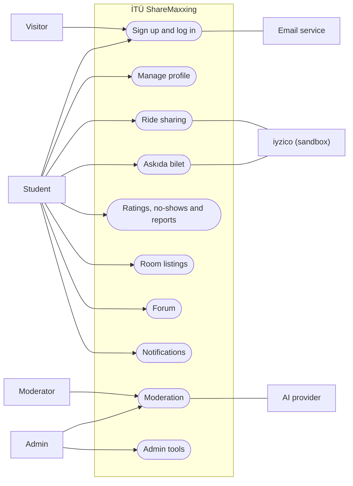
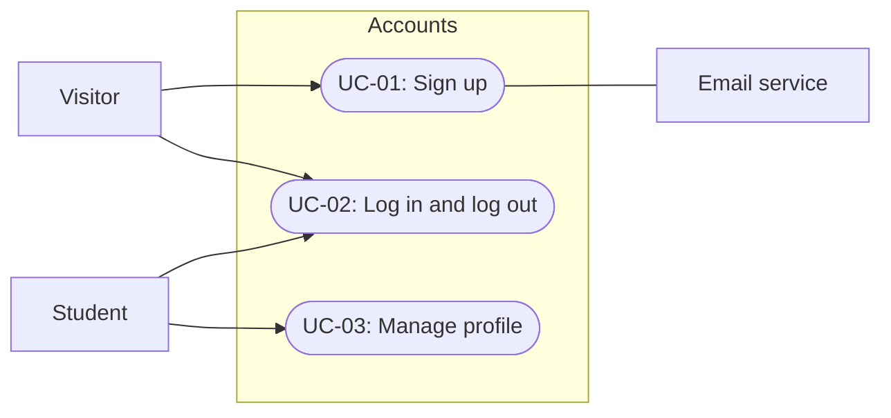
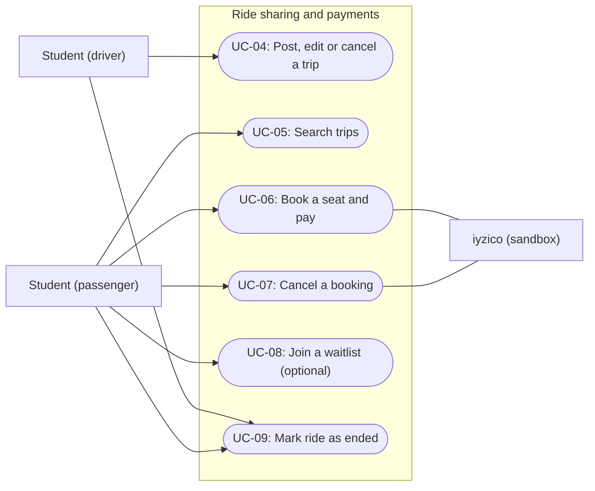
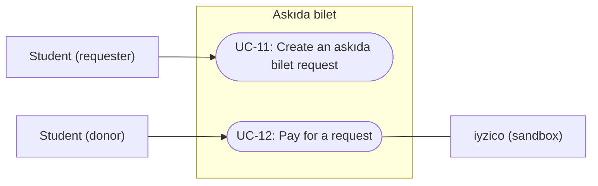
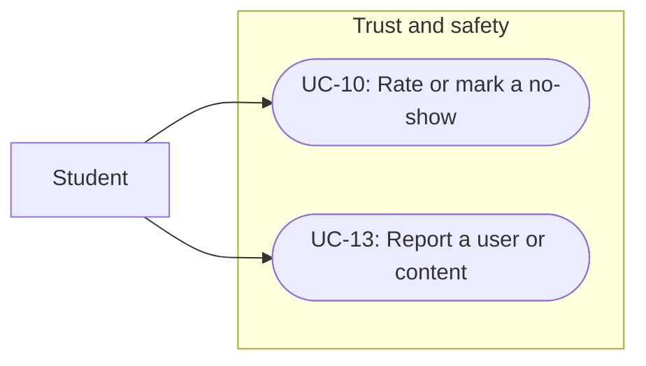
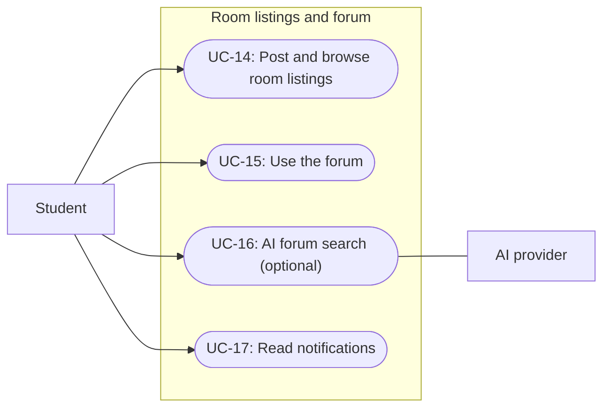
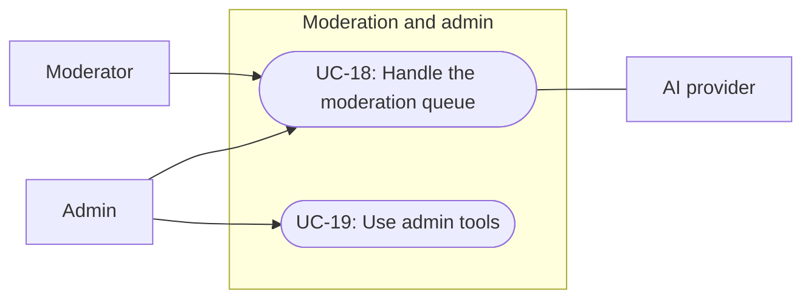

# Software Engineering: Requirements Specification

## Cover Page

| Field | Details |
|---|---|
| **Course** | BLG 411E Software Engineering |
| **Report name** | Requirements Specification |
| **Project title** | İTÜ ShareMaxxing |
| **Group name / number** | The Goys |
| **Group members** | Mehmet Fuat Karakaya — 150230084, Ege Demir — 150220007, Alperen Akbaş — 150220078, Bünyamin İbrahim Kalaycı — 150230030, Egemen Çevik — 150220012 |
| **Instructors** | Tolga Ovatman, Ayşe Tosun Kühn |
| **Submission date** | 2026-11-08 |
| **Document version** | 1.0 |

---

## 1. Introduction

İTÜ ShareMaxxing is a web platform for İTÜ students with verified @itu.edu.tr accounts. Its main feature is intercity ride sharing to and from İstanbul. Drivers post trips, passengers search and book seats, and passengers pay their share of the travel costs in the app. Students in financial need can ask for an "askıda bilet" (a seat paid by an anonymous donor). The same accounts are also used for room and roommate listings and for a student forum. Moderators and admins keep the platform safe.

This document lists the requirements of the system described in our Project Plan (v1.1). Each functional requirement is linked to a task (`T-##`) and a deliverable (`D-##`) of the Plan.

Section 2 lists the functional and non-functional requirements. Section 3 describes the users, gives short scenarios and user stories, shows the use case diagrams and explains each use case step by step. Requirements marked *(optional)* belong to the optional scope of the Plan and are built only if time allows.

---

## 2. System Requirements

### 2.1 Functional Requirements

| Requirement ID | Related task ID(s) | Related deliverable ID(s) | Functional requirement (natural language) | Priority | Verification / acceptance condition |
|---|---|---|---|---|---|
| FR-01 | T-01 | D-01 | The system shall allow sign-up only with an @itu.edu.tr email address. | Must | Sign-up with a non-İTÜ address is rejected. |
| FR-02 | T-01 | D-01 | The system shall send a verification code by email and activate the account only after the user enters the correct code. The code shall expire after a limited time, and the user shall be able to ask for a new one. | Must | An unverified user cannot log in; after entering the correct code, the user can log in. |
| FR-03 | T-02 | D-01 | The system shall let verified users log in with their email and password and log out. | Must | A verified user can log in and log out; an unverified user is refused. |
| FR-04 | T-02 | D-01 | The system shall give each user one role (student, moderator or admin) and block the pages and actions that the role is not allowed to use. | Must | A student cannot open moderator or admin pages. |
| FR-05 | T-03 | D-01, D-04 | The system shall let users view and edit their own profile and see other students' public profiles with ride history and ratings. | Must | Profile changes are saved; a public profile shows ride history and ratings. |
| FR-06 | T-04 | D-01 | The system shall use the same navigation menu and page layout on every page, on phones and on desktop. | Must | All pages use the shared layout. |
| FR-07 | T-05 | D-02, D-03 | The system shall let a driver post a trip with a start city, an end city, date, time, number of free seats, price per seat and optional contact details. | Must | A valid trip is saved and can be found in search. |
| FR-08 | T-05 | D-02 | The system shall reject a trip if neither city is İstanbul or if the start and end city are the same. | Must | Both cases are rejected with an error message. |
| FR-09 | T-05, T-11 | D-02, D-03 | The system shall let the driver edit or cancel their trip. If the trip is cancelled, all its bookings are cancelled and the passengers get a refund. | Must | After cancellation, the bookings are cancelled and refunds are made. |
| FR-10 | T-05 | D-02 | The system shall show a trip's contact details only to verified students. | Must | Contact details are not visible without login. |
| FR-11 | T-06 | D-02 | The system shall return the trips with the searched start and end city, listing trips with free seats first and full trips after them, marked as full. | Must | Search returns only matching trips in this order. |
| FR-12 | T-06 | D-02 | The system shall show a trip detail page with the trip information, the driver's ratings and the contact details if given. | Must | The trip detail page shows these fields. |
| FR-13 | T-07, T-10 | D-02, D-03 | The system shall let a passenger book a free seat on a trip. Booking starts the payment, and the seat count goes down by one. A full trip cannot be booked. | Must | After booking, the seat count goes down by one; booking a full trip is rejected. |
| FR-14 | T-07, T-11 | D-02, D-03 | The system shall let a passenger cancel a booking. The seat count goes up by one and the payment is refunded. | Must | After cancellation, the seat count goes up and a refund is made. |
| FR-15 | T-07 | D-02 | The system shall show a "My bookings" page with each booking and its payment status. | Must | The page lists the user's bookings with their status. |
| FR-16 | T-08 | D-02, D-07 | *(optional)* The system should let a passenger join the waitlist of a full trip. When a seat becomes free, the first person in line is notified and can book the seat within 6 hours, or until departure if that is sooner. After that, the seat is offered to the next person. | Could | A freed seat is offered to the users in queue order. |
| FR-17 | T-09 | D-02, D-03, D-04 | The system shall let the driver and each passenger mark the ride as ended after the trip. This releases the held payment to the driver, adds the ride to the ride history and opens ratings. | Must | After marking, the payment is released and the rating form opens. |
| FR-18 | T-09 | D-02, D-03 | If a ride is not marked as ended, the system shall end it automatically 48 hours after the trip date. | Must | A ride that is not marked is ended after 48 hours. |
| FR-19 | T-10 | D-03 | The system shall take the payment through iyzico in sandbox (test) mode and hold it until the ride is marked as ended. | Must | A test payment is held, then released after the ride ends. |
| FR-20 | T-10, T-11 | D-03 | If a payment or refund fails at iyzico, the system shall show a clear error message to the user. A failed payment does not create a booking. | Must | A declined test card shows an error and no booking is created. |
| FR-21 | T-12 | D-03, D-02 | The system shall let a student create an askıda bilet request for a seat on a trip. The request does not hold the seat; other students can still book it. Unpaid requests expire on the trip date. | Must | A request is created; an unpaid request disappears after the trip date. |
| FR-22 | T-12 | D-03 | The system shall list all open askıda bilet requests on a request pool page, showing only the amount and the request date. | Must | The pool page shows no ride details and no names. |
| FR-23 | T-13 | D-03, D-02 | The system shall let a donor pay for an open request whose trip still has a free seat. The seat is then booked for the requester and the donor sees a thank-you screen. | Must | After payment, the requester has a booking. |
| FR-24 | T-13 | D-03 | The system shall never show the donor the ride details or the requester, and never show the requester or the driver who the donor is. | Must | API responses contain no identity fields of the other side. |
| FR-25 | T-14 | D-03, D-09 | The system shall record every payment, hold, release, refund and askıda bilet payment in a ledger, and provide a check that balances match the ledger. | Must | Each payment action has a matching ledger entry. |
| FR-26 | T-15 | D-04 | The system shall store ended rides in each user's ride history. | Must | An ended ride appears in both users' history. |
| FR-27 | T-15 | D-04 | The system shall let a driver or a passenger mark the other side as a no-show. | Must | The no-show is saved on the user's record. |
| FR-28 | T-16 | D-04 | After a ride ends, the system shall let the driver and the passenger rate each other. A rating is shown only after both sides have submitted their ratings. | Must | A rating stays hidden until both sides rate. |
| FR-29 | T-17 | D-04, D-09 | The system shall let users report another user or content. The report goes to the moderation queue. | Must | A submitted report appears in the moderation queue. |
| FR-30 | T-18 | D-05 | The system shall let users post, edit and delete their own "I have a room" or "I need a room" listings with an İstanbul district and optional contact details. Contact details are shown only if the poster adds them. | Must | The owner can post, edit and delete; other users cannot edit. |
| FR-31 | T-18 | D-05 | The system shall let users browse room listings and filter them by district and by type. | Must | Filtering returns only matching listings. |
| FR-32 | T-19 | D-06 | The system shall let users post questions with a category (course-related, general, yemekhane, housing, transport, campus life) and answer questions. | Must | Questions and answers are saved and shown. |
| FR-33 | T-19 | D-06 | The system shall let users filter forum questions by category. | Must | Filtering returns only the chosen category. |
| FR-34 | T-21 | D-06 | The system shall let users search forum posts by keyword. | Must | Search returns posts that contain the keyword. |
| FR-35 | T-20 | D-06 | *(optional)* The system should let users vote on questions and answers, and higher-voted posts should be ranked higher. | Could | Votes change the order of posts. |
| FR-36 | T-34 | D-14, D-06 | *(optional)* The system should let users tag course-related posts with a course code and filter posts by that code. | Could | Filtering by a course code returns only tagged posts. |
| FR-37 | T-23 | D-13, D-06 | *(optional)* The system should index forum posts and, for a question in natural language, show related posts with links to the originals. If nothing related is found, it should say so and offer keyword search. | Could | Sample questions return related posts with links. |
| FR-38 | T-22 | D-07 | The system shall create in-app notifications for bookings, cancellations, payments, funded askıda bilet requests and forum replies, and a ride-end reminder 24 hours after departure if the ride is not marked as ended yet. Waitlist alerts are added only if the waitlist is built. | Must | Each listed event creates a notification. |
| FR-39 | T-22 | D-07 | The system shall show a notification bell with the number of unread notifications and a notification list. | Must | The unread count updates when notifications are read. |
| FR-40 | T-24 | D-08, D-09 | The system shall send new forum posts and room listings to an AI check. Content marked as unsuitable goes to the moderation queue. If the AI check fails, the content is kept and sent to the queue as "AI unavailable". The AI never hides content or punishes users by itself. | Must | Unsuitable test content appears in the queue; a failed AI check also sends the content to the queue. |
| FR-41 | T-25 | D-09, D-04 | The system shall let moderators and admins see reports and AI-flagged content in the moderation queue and hide the content, warn the user, suspend the user or dismiss the item. | Must | A moderator can take each action from the queue. |
| FR-42 | T-26 | D-09 | The system shall let admins search users and change their roles. Moderators cannot use this page. | Must | An admin can change a role; a moderator is refused. |
| FR-43 | T-26 | D-09, D-03 | The system shall show admins an askıda bilet overview (open and paid requests, matching the ledger) and usage statistics. | Must | The overview totals match the ledger. |

**Functional requirement notes:**  
Tasks T-27 to T-33 (database, CI pipeline, cloud deployment, reports, documentation, demo and slides) are internal work, so they have no functional requirement. Their quality goals are in Section 2.2.

### 2.2 Non-functional Requirements

| Requirement ID | Quality attribute | Non-functional requirement (natural language) | Applies to | Verification / measurement |
|---|---|---|---|---|
| NFR-01 | Security | Only verified @itu.edu.tr users can use the platform. Every page and API action checks the user's role. Passwords are stored hashed, and secret keys are kept out of the code repository. | Whole system | Automated tests try forbidden actions with the wrong role and expect them to fail; code review. |
| NFR-02 | Security | Users can see only their own bookings and payments. | FR-13 – FR-20 | Automated tests try to read another user's bookings and payments. |
| NFR-03 | Performance | Pages and search results load within 5 seconds on a phone over a mobile connection. | Whole system | Lighthouse mobile test on the deployed site. |
| NFR-04 | Performance | The system works with about 100 students using it at the same time. | Search, booking, forum | Simulated load test with a load testing tool (100 virtual users). No real users are needed. |
| NFR-05 | Usability | The interface is in Turkish and works on phone screens (from 360 px wide) and on desktop. Searching and booking a ride takes only a few clear steps. | Whole system | Each member tests their features on a real phone; a short test session with 3–5 students. |
| NFR-06 | Reliability | No payment is lost. Every ride payment, refund and askıda bilet payment is recorded, and balances always match the ledger. Payment provider errors are shown to the user clearly. | FR-13 – FR-25 | Automated tests compare balances with the ledger; tests with failed sandbox payments. |
| NFR-07 | Privacy | Askıda bilet donors and recipients stay anonymous to each other and to drivers. Contact details appear only when the poster adds them and only to verified students. Only the personal data the features need is collected. | FR-10, FR-21 – FR-24, FR-30 | Automated tests check that hidden fields never appear in API responses. |
| NFR-08 | Maintainability | All code is in TypeScript, reviewed before merging, and tested automatically on every push. A pull request with a failing test cannot be merged. | Whole system | CI results on GitHub; review records on pull requests. |
| NFR-09 | Deployment | The site runs on a cloud provider at a public URL, and every merge to the main branch is deployed automatically. | Whole system | The live site is reachable; a merged change appears on it. |
| NFR-10 | AI reliability | AI flags only advise moderators; only a moderator or admin can hide content or punish a user. If the AI service fails, the content is kept and sent for human review. AI flagging reaches at least 80% precision and 80% recall on at least 50 labelled Turkish posts and listings (at least 25 unsuitable and 25 suitable, not used for prompt tuning). | FR-40, FR-41 | Evaluation on the labelled set; tests that simulate AI errors. |
| NFR-11 | AI reliability | *(optional)* If AI forum search is built, each result links to an existing post, and a "no result" message with keyword search is shown when nothing related is found. | FR-37 | Tests with sample questions. |

**Non-functional requirement notes / assumptions:**  
The payment provider (iyzico) is used only in sandbox mode, so no real money is used. The cloud provider and the AI provider are chosen in the design phase and must have a free or student tier.

---

## 3. Use Cases

### 3.1 User Types

| User type ID | User type / actor | Description and responsibilities | Goals / typical actions | Related requirement ID(s) |
|---|---|---|---|---|
| UT-01 | Visitor | A person who is not logged in. | Sign up, verify the email, log in. | FR-01 – FR-03 |
| UT-02 | Student | A verified İTÜ student. The same student can be a driver, a passenger, an askıda bilet requester, a donor, a room lister or a forum user. | Post and book rides, pay, request or fund askıda bilet, rate, report, post listings, use the forum. | FR-05 – FR-39 |
| UT-03 | Moderator | A student given the moderator role. | Handle reports and AI-flagged content. | FR-41 |
| UT-04 | Admin | Platform administrator. Can do everything a moderator can do. | Manage users and roles, see the askıda bilet overview and statistics. | FR-41 – FR-43 |
| UT-05 | iyzico (external system) | Payment provider in sandbox mode. | Take, hold, release and refund payments. | FR-19, FR-20, FR-23 |
| UT-06 | Email service (external system) | Sends emails from the platform. | Deliver sign-up verification codes. | FR-02 |
| UT-07 | AI provider (external system) | Hosted AI model API. | Check posts and listings; (optional) forum search. | FR-37, FR-40 |

**Access or role distinctions:**  
Visitors can only sign up and log in. Students can use all features except moderation and admin pages. Moderators can also use the moderation queue. Admins can also manage users and roles and see the askıda bilet overview and statistics.

### 3.2 User Scenarios

**Personas:**

| Persona ID | Name | Description |
|---|---|---|
| P-01 | Elif | Second-year student from Ankara. Goes home about once a month and wants a cheaper ride than the bus. |
| P-02 | Mert | Fourth-year student with a car. Drives to İzmir on long weekends and wants to share the fuel cost. |
| P-03 | Zeynep | Third-year student who cannot pay for a trip home this month. |
| P-04 | Can | Graduate student who wants to help other students anonymously. |
| P-05 | Deniz | First-year student looking for a room near campus. |
| P-06 | Ayşe | Senior student working as a moderator. |
| P-07 | Burak | Admin from the student affairs office. |

**SC-01: Signing up and booking a ride home**  
**Persona:** P-01 (Elif)  
**Related requirements:** FR-01 – FR-03, FR-11 – FR-13, FR-19, FR-38

Elif signs up with her İTÜ email address and enters the code she receives by email. She searches for trips from İstanbul to Ankara. Trips with free seats are listed first. She opens one, checks the driver's ratings and books a seat. She pays with a test card, the money is held, and she gets a notification that her booking is confirmed.

**SC-02: Posting a trip and finishing the ride**  
**Persona:** P-02 (Mert)  
**Related requirements:** FR-07, FR-08, FR-17, FR-26, FR-28

Mert posts a trip from İstanbul to İzmir for Friday evening with 3 seats and a price per seat. After the trip, he and his passengers mark the ride as ended. The held payments are released to him, and the ride is added to everyone's history. Mert rates his passengers. Each rating becomes visible after both sides have rated.

**SC-03: The driver cancels a trip**  
**Persona:** P-02 (Mert)  
**Related requirements:** FR-09, FR-14, FR-25, FR-38

Mert's car breaks down, so he cancels his trip. All bookings on the trip are cancelled, the passengers get their money back, and they receive a notification. Each refund is recorded in the ledger.

**SC-04: Askıda bilet**  
**Persona:** P-03 (Zeynep), P-04 (Can)  
**Related requirements:** FR-21 – FR-25, FR-38

Zeynep finds a trip to Bursa but cannot pay for it, so she creates an askıda bilet request. The request pool page shows only the amount and the date. Can opens the pool, picks a request and pays for it. He sees a thank-you screen, but not who the student is or where they are going. Zeynep gets a notification and a booking on the trip. The driver does not see who paid.

**SC-05: Looking for a room**  
**Persona:** P-05 (Deniz)  
**Related requirements:** FR-30, FR-31, FR-40

Deniz filters room listings by the district Sarıyer and the type "I have a room". There is no good one, so Deniz posts an "I need a room" listing with an email address. The listing is published and checked by the AI in the background.

**SC-06: Asking a question in the forum**  
**Persona:** P-05 (Deniz)  
**Related requirements:** FR-32 – FR-34, FR-38, FR-39

Deniz wants to know if the yemekhane is open on Saturdays. He searches the forum for "cumartesi" but finds nothing, so he posts a question in the yemekhane category. Another student answers, and Deniz sees a new notification on the bell.

**SC-07: Moderating content**  
**Persona:** P-06 (Ayşe)  
**Related requirements:** FR-29, FR-40, FR-41

A room listing with insulting words is flagged by the AI and appears in the moderation queue. A user report about another forum post is also in the queue. Ayşe hides the listing and warns its owner. She reads the reported post, decides it is fine and dismisses the report.

**SC-08: Admin work**  
**Persona:** P-07 (Burak)  
**Related requirements:** FR-42, FR-43

Burak gives Ayşe the moderator role. He then checks the askıda bilet overview and the usage statistics for the monthly report.

**SC-09: Waitlist** *(optional)*  
**Persona:** P-01 (Elif)  
**Related requirements:** FR-16, FR-38

The only trip to Ankara on Friday is full, so Elif joins its waitlist. When a passenger cancels, Elif is first in line and gets a notification. She books the seat within 6 hours.

#### User Stories Linked to the Project Plan

| Scenario ID | Project Plan WBS activity ID | User story | Related requirement ID(s) |
|---|---|---|---|
| SC-01 | WBS-1.1, WBS-1.2, WBS-1.3 | As a visitor, I want to sign up with my İTÜ email and verify it with a code so that only İTÜ students can join. | FR-01, FR-02 |
| SC-01 | WBS-2.1, WBS-2.3 | As a student, I want to log in and log out so that I can use my account safely. | FR-03 |
| SC-08 | WBS-2.2 | As an admin, I want each page to check the user's role so that students cannot use moderator or admin pages. | FR-04 |
| SC-02 | WBS-3.1, WBS-3.2 | As a student, I want to edit my profile and see other students' ride history and ratings so that I can decide whom to ride with. | FR-05 |
| SC-01 | WBS-4.2, WBS-4.3 | As a student, I want the same menu on every page and pages that work on my phone so that the site is easy to use. | FR-06, NFR-05 |
| SC-02 | WBS-5.1, WBS-5.2 | As a driver, I want to post, edit and cancel a trip so that I can share my travel costs. | FR-07 – FR-10 |
| SC-01 | WBS-6.1, WBS-6.2 | As a passenger, I want to search trips by start and end city and see trips with free seats first so that I find a ride quickly. | FR-11, FR-12 |
| SC-01 | WBS-7.1, WBS-7.2 | As a passenger, I want to book and cancel a seat and see my bookings so that I can plan my trip. | FR-13 – FR-15 |
| SC-09 | WBS-8.1, WBS-8.2 | *(optional)* As a passenger, I want to join the waitlist of a full trip so that I can get a seat if someone cancels. | FR-16 |
| SC-02 | WBS-9.1, WBS-9.2 | As a driver, I want the ride to be marked as ended so that I receive the payment. | FR-17, FR-18 |
| SC-01 | WBS-10.1, WBS-10.2, WBS-10.3 | As a passenger, I want to pay in the app and have the money held until the ride ends so that I only pay for rides that happen. | FR-19, FR-20 |
| SC-03 | WBS-11.1 | As a passenger, I want my money back when a booking or trip is cancelled. | FR-09, FR-14 |
| SC-04 | WBS-12.1, WBS-12.2 | As a student in need, I want to request a seat without showing my name so that I can ask for help privately. | FR-21, FR-22 |
| SC-04 | WBS-13.1, WBS-13.2 | As a donor, I want to pay for a request anonymously so that I can help another student. | FR-23, FR-24 |
| SC-03 | WBS-14.1 | As an admin, I want every payment recorded in a ledger so that I can check that no money is lost. | FR-25 |
| SC-02 | WBS-15.1 | As a driver, I want to see my ride history and mark no-shows so that unreliable users are visible. | FR-26, FR-27 |
| SC-02 | WBS-16.1, WBS-16.2 | As a passenger, I want to rate the driver after the ride so that other students can trust the ratings. | FR-28 |
| SC-07 | WBS-17.1 | As a student, I want to report a user or a post so that moderators can check it. | FR-29 |
| SC-05 | WBS-18.1, WBS-18.2 | As a student, I want to post room listings and filter them by district and type so that I can find a room or a roommate. | FR-30, FR-31 |
| SC-06 | WBS-19.1, WBS-19.2 | As a student, I want to ask and answer questions in categories so that I can get help from other students. | FR-32, FR-33 |
| SC-06 | WBS-19.3 | *(optional)* As a student, I want to filter questions by course code so that I find questions about my course. | FR-36 |
| SC-06 | WBS-20.1 | *(optional)* As a student, I want to vote on answers so that the best answers are shown first. | FR-35 |
| SC-06 | WBS-21.1 | As a student, I want to search the forum by keyword so that I can find answers that already exist. | FR-34 |
| SC-06 | WBS-22.1, WBS-22.2, WBS-22.3 | As a student, I want notifications with an unread count so that I do not miss bookings, payments and replies. | FR-38, FR-39 |
| SC-06 | WBS-23.2, WBS-23.3 | *(optional)* As a student, I want to ask a question in my own words and see related posts so that I can find answers more easily. | FR-37 |
| SC-07 | WBS-23.1, WBS-24.1 | As a moderator, I want new posts and listings checked by AI so that unsuitable content reaches me quickly. | FR-40 |
| SC-07 | WBS-25.1, WBS-25.2 | As a moderator, I want one queue for reports and flagged content so that I can handle them in one place. | FR-41 |
| SC-08 | WBS-26.1, WBS-26.2 | As an admin, I want to manage roles and see statistics so that I can run the platform. | FR-42, FR-43 |
| — | WBS-4.1, WBS-27.1 – WBS-29.2 | Internal technical work (frontend setup, database, CI, load and phone tests, cloud setup and deployment). No user story; covered by NFR-03 – NFR-05, NFR-08 and NFR-09. | — |
| — | WBS-30.1 – WBS-33.1 | Course reports, documentation, demo and presentation. No user story. | — |

### 3.3 Use Case Diagrams

#### 3.3.1 Whole-System Use Case Diagram

**Whole-system diagram notes:**  
A student can act as a driver, a passenger, a requester, a donor, a room lister or a forum user. Moderators and admins are also students. The AI provider checks new posts and listings and sends unsuitable ones to moderation.

#### 3.3.2 Functionality-Specific Use Case Diagram: Accounts

**Functionality covered:** T-01 – T-04 / FR-01 – FR-06 / UC-01 – UC-03  
**Diagram notes:** The verification code is sent by the email service.

#### 3.3.3 Functionality-Specific Use Case Diagram: Ride sharing and payments

**Functionality covered:** T-05 – T-11 / FR-07 – FR-20 / UC-04 – UC-09  
**Diagram notes:** Payments, holds, releases and refunds go through iyzico in sandbox mode.

#### 3.3.4 Functionality-Specific Use Case Diagram: Askıda bilet

**Functionality covered:** T-12 – T-14 / FR-21 – FR-25 / UC-11, UC-12  
**Diagram notes:** The donor and the requester never see each other.

#### 3.3.5 Functionality-Specific Use Case Diagram: Trust and safety

**Functionality covered:** T-15 – T-17 / FR-26 – FR-29 / UC-10, UC-13  
**Diagram notes:** Reports go to the moderation queue (UC-18).

#### 3.3.6 Functionality-Specific Use Case Diagram: Room listings and forum

**Functionality covered:** T-18 – T-23, T-34 / FR-30 – FR-39 / UC-14 – UC-17  
**Diagram notes:** Votes and course-code filters are optional parts of UC-15.

#### 3.3.7 Functionality-Specific Use Case Diagram: Moderation and admin

**Functionality covered:** T-24 – T-26 / FR-40 – FR-43 / UC-18, UC-19  
**Diagram notes:** The AI only adds items to the queue. Moderators and admins make the decisions.

### 3.4 Use Cases

#### 3.4.1 Use Case Coverage Matrix

| Project Plan task ID | Functional requirement ID(s) | Use case ID(s) | Scenario ID(s) |
|---|---|---|---|
| T-01 | FR-01, FR-02 | UC-01 | SC-01 |
| T-02 | FR-03, FR-04 | UC-02 | SC-01, SC-08 |
| T-03 | FR-05 | UC-03 | SC-02 |
| T-04 | FR-06 | UC-02, UC-03 (shared layout on all pages) | SC-01 |
| T-05 | FR-07 – FR-10 | UC-04 | SC-02, SC-03 |
| T-06 | FR-11, FR-12 | UC-05 | SC-01 |
| T-07 | FR-13 – FR-15 | UC-06, UC-07 | SC-01 |
| T-08 *(optional)* | FR-16 | UC-08 | SC-09 |
| T-09 | FR-17, FR-18 | UC-09 | SC-02 |
| T-10 | FR-19, FR-20 | UC-06, UC-09 | SC-01 |
| T-11 | FR-09, FR-14, FR-20 | UC-04, UC-07 | SC-03 |
| T-12 | FR-21, FR-22 | UC-11 | SC-04 |
| T-13 | FR-23, FR-24 | UC-12 | SC-04 |
| T-14 | FR-25 | UC-12, UC-19 | SC-03 |
| T-15 | FR-26, FR-27 | UC-10 | SC-02 |
| T-16 | FR-28 | UC-10 | SC-02 |
| T-17 | FR-29 | UC-13 | SC-07 |
| T-18 | FR-30, FR-31 | UC-14 | SC-05 |
| T-19 | FR-32, FR-33 | UC-15 | SC-06 |
| T-20 *(optional)* | FR-35 | UC-15 | SC-06 |
| T-21 | FR-34 | UC-15 | SC-06 |
| T-22 | FR-38, FR-39 | UC-17 | SC-06 |
| T-23 *(optional)* | FR-37 | UC-16 | SC-06 |
| T-24 | FR-40 | UC-18 | SC-07 |
| T-25 | FR-41 | UC-18 | SC-07 |
| T-26 | FR-42, FR-43 | UC-19 | SC-08 |
| T-27 – T-33 | Internal work (NFR-03 – NFR-05, NFR-08, NFR-09) | — | — |
| T-34 *(optional)* | FR-36 | UC-15 | SC-06 |

#### 3.4.2 UC-01: Sign up

| Field | Description |
|---|---|
| **Use case ID** | UC-01 |
| **Use case name** | Sign up |
| **Goal / Purpose** | A visitor creates an account with an İTÜ email address. |
| **Actor(s)** | Visitor, Email service |
| **Related Project Plan task(s)** | T-01 |
| **Related functional requirement(s)** | FR-01, FR-02 |

**Pre-condition(s):**  
The visitor has an @itu.edu.tr email address and no account yet.

**Main success flow:**

1. **Actor:** Enters name, İTÜ email address and password, and submits the form.
2. **System:** Checks the email address and sends a verification code by email.
3. **Actor:** Enters the code.
4. **System:** Activates the account.

**Alternative flows:**

- **A1: Code expired or not received (step 3):** The visitor asks for a new code. The system sends a new code and the flow returns to step 3.

**Exception / error flows (if applicable):**

- **E1: Not an İTÜ address (step 2):** The system shows an error and does not create the account.
- **E2: Wrong code (step 4):** The system shows an error; the account stays inactive.

**Post-condition(s):**  
The account is active and the user can log in.

#### 3.4.3 UC-02: Log in and log out

| Field | Description |
|---|---|
| **Use case ID** | UC-02 |
| **Use case name** | Log in and log out |
| **Goal / Purpose** | A verified user enters and leaves the platform. |
| **Actor(s)** | Student, Moderator, Admin |
| **Related Project Plan task(s)** | T-02, T-04 |
| **Related functional requirement(s)** | FR-03, FR-04, FR-06 |

**Pre-condition(s):**  
The user has a verified account.

**Main success flow:**

1. **Actor:** Enters email and password.
2. **System:** Checks them and opens the home page with the menu for the user's role.
3. **Actor:** Logs out when done.
4. **System:** Ends the session.

**Alternative flows:**

- **A1: Forbidden page (after step 2):** If the user opens a page that the role is not allowed to use, the system shows an error.

**Exception / error flows (if applicable):**

- **E1: Wrong password or unverified account (step 2):** The system shows an error and does not log the user in.

**Post-condition(s):**  
The user is logged in with the right role, or logged out.

#### 3.4.4 UC-03: Manage profile

| Field | Description |
|---|---|
| **Use case ID** | UC-03 |
| **Use case name** | Manage profile |
| **Goal / Purpose** | A student updates their profile and checks other students' profiles. |
| **Actor(s)** | Student |
| **Related Project Plan task(s)** | T-03 |
| **Related functional requirement(s)** | FR-05 |

**Pre-condition(s):**  
The student is logged in.

**Main success flow:**

1. **Actor:** Opens their profile and edits it.
2. **System:** Saves the changes.
3. **Actor:** Opens another student's profile.
4. **System:** Shows the public profile with ride history and ratings.

**Alternative flows:**

- **A1: Only viewing (step 1):** The student skips editing and goes to step 3.

**Exception / error flows (if applicable):**

- **E1: Invalid input (step 2):** The system shows an error and keeps the old values.

**Post-condition(s):**  
The profile is up to date.

#### 3.4.5 UC-04: Post, edit or cancel a trip

| Field | Description |
|---|---|
| **Use case ID** | UC-04 |
| **Use case name** | Post, edit or cancel a trip |
| **Goal / Purpose** | A driver offers seats on a trip and shares the travel costs. |
| **Actor(s)** | Student (driver), iyzico |
| **Related Project Plan task(s)** | T-05, T-11 |
| **Related functional requirement(s)** | FR-07 – FR-10 |

**Pre-condition(s):**  
The driver is logged in.

**Main success flow:**

1. **Actor:** Fills in the start city, end city, date, time, free seats, price per seat and optional contact details.
2. **System:** Checks that one city is İstanbul and the two cities are different.
3. **System:** Saves the trip and shows it in search results.

**Alternative flows:**

- **A1: Edit (later):** The driver changes the trip details and the system saves them.
- **A2: Cancel (later):** The driver cancels the trip. The system cancels all bookings, refunds the passengers and notifies them.

**Exception / error flows (if applicable):**

- **E1: Invalid cities (step 2):** The system shows an error and does not save the trip.

**Post-condition(s):**  
The trip is posted, updated or cancelled.

#### 3.4.6 UC-05: Search trips

| Field | Description |
|---|---|
| **Use case ID** | UC-05 |
| **Use case name** | Search trips |
| **Goal / Purpose** | A passenger finds trips between two cities. |
| **Actor(s)** | Student (passenger) |
| **Related Project Plan task(s)** | T-06 |
| **Related functional requirement(s)** | FR-11, FR-12 |

**Pre-condition(s):**  
The passenger is logged in.

**Main success flow:**

1. **Actor:** Enters a start city and an end city.
2. **System:** Lists the matching trips, with free-seat trips first and full trips after them.
3. **Actor:** Opens a trip.
4. **System:** Shows the trip detail page.

**Alternative flows:**

- **A1: Full trip (step 3):** The trip is marked as full and cannot be booked. If the waitlist is built, the passenger can join it (UC-08).

**Exception / error flows (if applicable):**

- **E1: No trips found (step 2):** The system shows a "no trips found" message.

**Post-condition(s):**  
The passenger sees the matching trips.

#### 3.4.7 UC-06: Book a seat and pay

| Field | Description |
|---|---|
| **Use case ID** | UC-06 |
| **Use case name** | Book a seat and pay |
| **Goal / Purpose** | A passenger books a seat and pays a share of the travel costs. |
| **Actor(s)** | Student (passenger), iyzico |
| **Related Project Plan task(s)** | T-07, T-10, T-14 |
| **Related functional requirement(s)** | FR-13, FR-15, FR-19, FR-20, FR-25 |

**Pre-condition(s):**  
The passenger is logged in and the trip has a free seat.

**Main success flow:**

1. **Actor:** Clicks "Book" on the trip page.
2. **System:** Opens the iyzico sandbox payment page.
3. **Actor:** Pays with a test card.
4. **System:** Holds the payment, records it in the ledger, creates the booking and lowers the seat count by one.
5. **System:** Shows a success screen and sends a notification.

**Alternative flows:**

- **A1: Passenger leaves the payment page (step 3):** No booking is created.

**Exception / error flows (if applicable):**

- **E1: Payment fails (step 4):** The system shows an error and no booking is created.

**Post-condition(s):**  
The passenger has a booking, and the payment is held until the ride ends.

#### 3.4.8 UC-07: Cancel a booking

| Field | Description |
|---|---|
| **Use case ID** | UC-07 |
| **Use case name** | Cancel a booking |
| **Goal / Purpose** | A passenger cancels a booking and gets the money back. |
| **Actor(s)** | Student (passenger), iyzico |
| **Related Project Plan task(s)** | T-07, T-11 |
| **Related functional requirement(s)** | FR-14, FR-20, FR-25 |

**Pre-condition(s):**  
The passenger has a booking on a trip that has not started.

**Main success flow:**

1. **Actor:** Opens "My bookings" and cancels a booking.
2. **System:** Cancels the booking and raises the seat count by one.
3. **System:** Refunds the payment, records it in the ledger and sends a notification.

**Alternative flows:**

- **A1: Waitlist exists (step 2, optional):** The free seat is offered to the first person on the waitlist (UC-08).

**Exception / error flows (if applicable):**

- **E1: Refund fails (step 3):** The system shows an error message.

**Post-condition(s):**  
The booking is cancelled and the money is returned.

#### 3.4.9 UC-08: Join a waitlist *(optional)*

| Field | Description |
|---|---|
| **Use case ID** | UC-08 |
| **Use case name** | Join a waitlist |
| **Goal / Purpose** | A passenger waits for a seat on a full trip. |
| **Actor(s)** | Student (passenger) |
| **Related Project Plan task(s)** | T-08 |
| **Related functional requirement(s)** | FR-16 |

**Pre-condition(s):**  
The trip is full.

**Main success flow:**

1. **Actor:** Joins the waitlist of the trip.
2. **System:** Shows the passenger's place in line.
3. **System:** When a seat becomes free, notifies the first person in line.
4. **Actor:** Books the seat within 6 hours (UC-06).

**Alternative flows:**

- **A1: Offer not used (step 4):** After 6 hours, or at departure if that is sooner, the seat is offered to the next person.

**Exception / error flows (if applicable):**

- **E1: Already on the list (step 1):** The system shows the current place in line.

**Post-condition(s):**  
The passenger books the seat or stays on the list.

#### 3.4.10 UC-09: Mark ride as ended

| Field | Description |
|---|---|
| **Use case ID** | UC-09 |
| **Use case name** | Mark ride as ended |
| **Goal / Purpose** | The ride is closed and the driver gets paid. |
| **Actor(s)** | Student (driver), Student (passenger), iyzico |
| **Related Project Plan task(s)** | T-09, T-10 |
| **Related functional requirement(s)** | FR-17, FR-18, FR-19 |

**Pre-condition(s):**  
The trip date has passed and the passenger has a booking.

**Main success flow:**

1. **Actor:** The driver and the passenger click "Ride ended".
2. **System:** Releases the held payment to the driver and records it in the ledger.
3. **System:** Adds the ride to the ride history and opens the rating form.

**Alternative flows:**

- **A1: Nobody marks the ride (step 1):** The system ends the ride automatically 48 hours after the trip date and continues with step 2.

**Exception / error flows (if applicable):**

- **E1: Trip not done yet (step 1):** The button is not active before the trip.

**Post-condition(s):**  
The ride is ended, the driver is paid and ratings are open.

#### 3.4.11 UC-10: Rate or mark a no-show

| Field | Description |
|---|---|
| **Use case ID** | UC-10 |
| **Use case name** | Rate or mark a no-show |
| **Goal / Purpose** | Drivers and passengers give feedback about each other. |
| **Actor(s)** | Student (driver), Student (passenger) |
| **Related Project Plan task(s)** | T-15, T-16 |
| **Related functional requirement(s)** | FR-26 – FR-28 |

**Pre-condition(s):**  
The ride has ended.

**Main success flow:**

1. **Actor:** Opens the rating form and rates the other side.
2. **System:** Saves the rating and keeps it hidden.
3. **System:** When the other side also rates, shows both ratings on the profiles.

**Alternative flows:**

- **A1: No-show (step 1):** Instead of rating, the user marks the other side as a no-show. The system saves it on that user's record.

**Exception / error flows (if applicable):**

- **E1: Already rated (step 1):** The system does not accept a second rating for the same ride.

**Post-condition(s):**  
The rating or the no-show is saved.

#### 3.4.12 UC-11: Create an askıda bilet request

| Field | Description |
|---|---|
| **Use case ID** | UC-11 |
| **Use case name** | Create an askıda bilet request |
| **Goal / Purpose** | A student in need asks for a paid seat without showing their name. |
| **Actor(s)** | Student (requester) |
| **Related Project Plan task(s)** | T-12 |
| **Related functional requirement(s)** | FR-21, FR-22 |

**Pre-condition(s):**  
The student is logged in and the trip has a free seat.

**Main success flow:**

1. **Actor:** Clicks "Askıda bilet iste" on the trip page.
2. **System:** Creates the request.
3. **System:** Shows the request on the request pool page with only the amount and the date.

**Alternative flows:**

- **A1: Request not paid (after step 3):** On the trip date, the request expires and leaves the pool.

**Exception / error flows (if applicable):**

- **E1: Trip is full (step 2):** The system does not create the request.

**Post-condition(s):**  
An open, anonymous request is in the pool.

#### 3.4.13 UC-12: Pay for a request

| Field | Description |
|---|---|
| **Use case ID** | UC-12 |
| **Use case name** | Pay for a request |
| **Goal / Purpose** | A donor pays for another student's seat anonymously. |
| **Actor(s)** | Student (donor), iyzico |
| **Related Project Plan task(s)** | T-13, T-14 |
| **Related functional requirement(s)** | FR-23 – FR-25 |

**Pre-condition(s):**  
There is an open request and its trip still has a free seat.

**Main success flow:**

1. **Actor:** Opens the request pool and picks a request.
2. **Actor:** Pays with a test card.
3. **System:** Holds the payment, records it in the ledger and books the seat for the requester.
4. **System:** Shows the donor a thank-you screen and notifies the requester.

**Alternative flows:**

- **A1: Donor cancels (step 2):** The donor leaves the payment page and nothing changes.

**Exception / error flows (if applicable):**

- **E1: Payment fails (step 3):** The system shows an error and the request stays open.

**Post-condition(s):**  
The requester has a booking. The donor and the requester do not see each other.

#### 3.4.14 UC-13: Report a user or content

| Field | Description |
|---|---|
| **Use case ID** | UC-13 |
| **Use case name** | Report a user or content |
| **Goal / Purpose** | A student tells the moderators about a bad user or post. |
| **Actor(s)** | Student |
| **Related Project Plan task(s)** | T-17 |
| **Related functional requirement(s)** | FR-29 |

**Pre-condition(s):**  
The student is logged in.

**Main success flow:**

1. **Actor:** Clicks "Report" on a user, trip, listing or forum post.
2. **Actor:** Writes the reason and sends the report.
3. **System:** Adds the report to the moderation queue.

**Alternative flows:**

- **A1: Cancel (step 2):** The student closes the form and nothing is saved.

**Exception / error flows (if applicable):**

- **E1: Empty reason (step 3):** The system asks for a reason.

**Post-condition(s):**  
The report is in the moderation queue.

#### 3.4.15 UC-14: Post and browse room listings

| Field | Description |
|---|---|
| **Use case ID** | UC-14 |
| **Use case name** | Post and browse room listings |
| **Goal / Purpose** | A student finds a room or a roommate. |
| **Actor(s)** | Student |
| **Related Project Plan task(s)** | T-18 |
| **Related functional requirement(s)** | FR-30, FR-31 |

**Pre-condition(s):**  
The student is logged in.

**Main success flow:**

1. **Actor:** Opens room listings and filters by district and type.
2. **System:** Shows the matching listings.
3. **Actor:** Posts a new listing with type, district, description and optional contact details.
4. **System:** Saves the listing and sends it to the AI check (UC-18).

**Alternative flows:**

- **A1: Edit or delete (later):** The owner edits or deletes the listing.

**Exception / error flows (if applicable):**

- **E1: Missing district or type (step 4):** The system shows an error and does not save the listing.

**Post-condition(s):**  
The listing is published.

#### 3.4.16 UC-15: Use the forum

| Field | Description |
|---|---|
| **Use case ID** | UC-15 |
| **Use case name** | Use the forum |
| **Goal / Purpose** | Students ask questions and help each other. |
| **Actor(s)** | Student |
| **Related Project Plan task(s)** | T-19, T-20, T-21, T-34 |
| **Related functional requirement(s)** | FR-32 – FR-36 |

**Pre-condition(s):**  
The student is logged in.

**Main success flow:**

1. **Actor:** Searches the forum by keyword or filters by category.
2. **System:** Shows the matching questions.
3. **Actor:** Posts a new question with a category, or answers a question.
4. **System:** Saves the post, sends it to the AI check (UC-18) and notifies the question owner about new answers.

**Alternative flows:**

- **A1: Vote (optional):** The student votes on a question or answer, and the order of posts changes.
- **A2: Course code (optional):** The student tags a course-related question with a course code or filters by it.

**Exception / error flows (if applicable):**

- **E1: No category (step 4):** The system shows an error and does not save the question.

**Post-condition(s):**  
The question or answer is published.

#### 3.4.17 UC-16: AI forum search *(optional)*

| Field | Description |
|---|---|
| **Use case ID** | UC-16 |
| **Use case name** | AI forum search |
| **Goal / Purpose** | A student finds related posts by asking a question in their own words. |
| **Actor(s)** | Student, AI provider |
| **Related Project Plan task(s)** | T-23 |
| **Related functional requirement(s)** | FR-37 |

**Pre-condition(s):**  
The AI search is built and forum posts are indexed.

**Main success flow:**

1. **Actor:** Types a question into the AI search box.
2. **System:** Finds related posts.
3. **System:** Shows the posts with links to the originals.

**Alternative flows:**

- **A1: Nothing found (step 2):** The system shows a "no result" message and offers keyword search.

**Exception / error flows (if applicable):**

- **E1: AI service not available (step 2):** The system offers keyword search instead.

**Post-condition(s):**  
The student sees related posts or is directed to keyword search.

#### 3.4.18 UC-17: Read notifications

| Field | Description |
|---|---|
| **Use case ID** | UC-17 |
| **Use case name** | Read notifications |
| **Goal / Purpose** | A student sees news about bookings, payments and replies. |
| **Actor(s)** | Student |
| **Related Project Plan task(s)** | T-22 |
| **Related functional requirement(s)** | FR-38, FR-39 |

**Pre-condition(s):**  
The student is logged in.

**Main success flow:**

1. **System:** Shows the number of unread notifications on the bell.
2. **Actor:** Opens the bell.
3. **System:** Lists the notifications and marks them as read.

**Alternative flows:**

- **A1: No notifications (step 3):** The system shows an empty list.

**Exception / error flows (if applicable):**

- **E1: Related item deleted (step 3):** The system shows that the item no longer exists.

**Post-condition(s):**  
The notifications are marked as read.

#### 3.4.19 UC-18: Handle the moderation queue

| Field | Description |
|---|---|
| **Use case ID** | UC-18 |
| **Use case name** | Handle the moderation queue |
| **Goal / Purpose** | A moderator decides what to do with reported or flagged content. |
| **Actor(s)** | Moderator, Admin, AI provider |
| **Related Project Plan task(s)** | T-24, T-25 |
| **Related functional requirement(s)** | FR-40, FR-41 |

**Pre-condition(s):**  
There is at least one report or AI-flagged item in the queue.

**Main success flow:**

1. **System:** The AI checks new posts and listings and adds unsuitable ones to the queue. User reports are also added.
2. **Actor:** Opens the moderation queue and an item.
3. **Actor:** Hides the content, warns the user, suspends the user or dismisses the item.
4. **System:** Applies the action and closes the item.

**Alternative flows:**

- **A1: AI check fails (step 1):** The content stays published and is added to the queue as "AI unavailable".

**Exception / error flows (if applicable):**

- **E1: Student opens the queue (step 2):** The system shows an error.

**Post-condition(s):**  
The item is closed with the moderator's decision.

#### 3.4.20 UC-19: Use admin tools

| Field | Description |
|---|---|
| **Use case ID** | UC-19 |
| **Use case name** | Use admin tools |
| **Goal / Purpose** | An admin manages users and follows the platform's activity. |
| **Actor(s)** | Admin |
| **Related Project Plan task(s)** | T-26, T-14 |
| **Related functional requirement(s)** | FR-25, FR-42, FR-43 |

**Pre-condition(s):**  
The admin is logged in.

**Main success flow:**

1. **Actor:** Searches for a user and changes the user's role.
2. **System:** Saves the new role.
3. **Actor:** Opens the askıda bilet overview and the statistics.
4. **System:** Shows open and paid requests (matching the ledger) and usage numbers.

**Alternative flows:**

- **A1: Only statistics (step 1):** The admin goes directly to step 3.

**Exception / error flows (if applicable):**

- **E1: Moderator opens the page (step 1):** The system shows an error.

**Post-condition(s):**  
The role is updated and the admin sees the current numbers.
